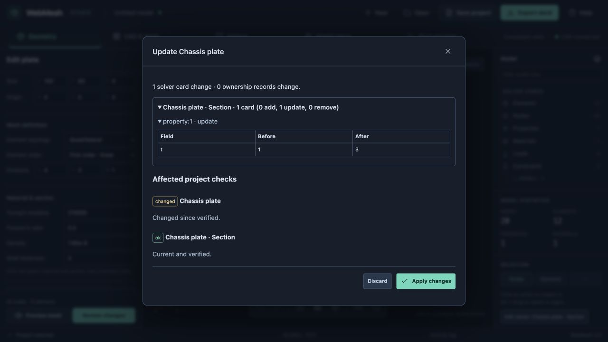
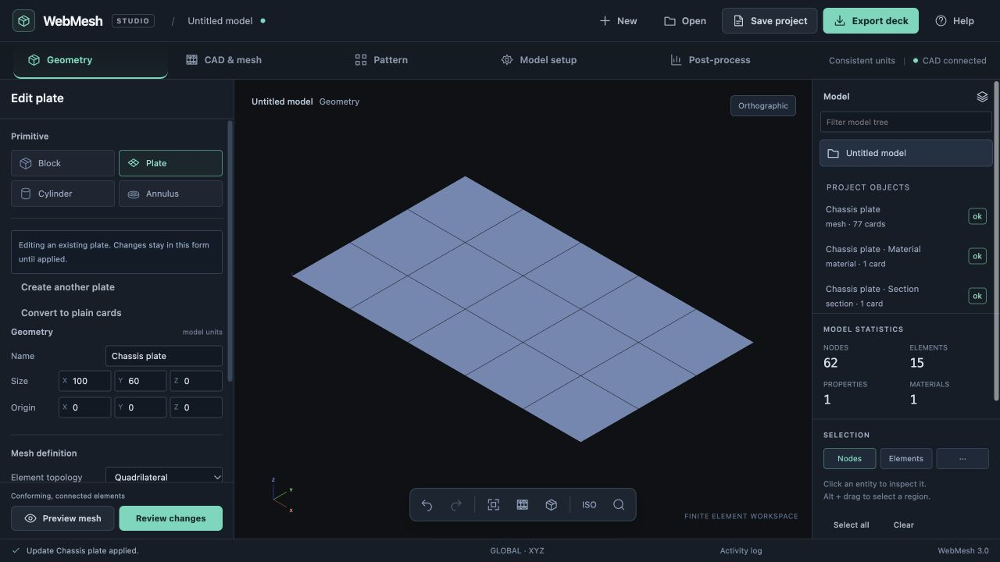

# Implementation 03: editable plate and owner inspector

22 October 2026 · branch `codex/project-core-foundation`

## Outcome and scope

Deliver the first analyst-facing project object: a parametric plate with an owned material, shell section and mesh. Existing block/cylinder/annulus, CAD, pattern and card workflows remain available. The plate creation form also offers plain cards. This is the first usable slice of the workspace design, not the full assembly or attachment interface.

## Implementation plan

1. Add a pure plate-to-project adapter. Persist dimensions, origin, divisions, topology, order, material and thickness. Allocate exact-sized node/element blocks and stable material/section roles. Preserve IDs for geometry/material edits; give a changed discretization a new mesh identity. Never reuse retired blocks, including after conversion.
2. Connect the plate form to a preview and explicit Apply action. Group added, removed and updated cards by owner, expose old/new values, and show affected checks. Discard leaves the model and IDs unchanged. Intervening edits reject stale candidates.
3. Add project objects to the model tree. A selected owned node, element or property exposes its owner. The inspector opens the plate's parameters, material or section as appropriate, and offers conversion with the affected object/dependency list. Unsupported owners remain inspectable without invented editing actions.
4. Add visible project checks and export-blocker details. Editable project saving remains available while runnable export is blocked. Keep draft parameters local until the analyst applies the candidate.
5. Exercise the existing engine with a plate, two motor attachments and a shared PBUSH template. Add generated RBE2 dependent-DOF conflict checks against other rigids, SPCs and permanent GRID constraints. Do not add a motor-template UI in this milestone.
6. Verify generation, stable IDs, reference protection, conversion, stale candidates, no-op regeneration, undo/redo, and save/reopen. Test the real UI in the browser and run the focused and full suites. Preserve the earlier unstaged review fixes.

## Acceptance

An analyst can create an editable plate, inspect its mesh/material/section in the tree, change thickness through the owner, preview the exact change, discard or apply it, undo/redo it, save/reopen, and regenerate without changes. Selecting an owned card gives a route to its owner. Converting the plate bundle keeps every solver card but removes regeneration behavior; undo restores the definitions. Refining a plate carrying hand-authored node loads fails clearly instead of silently reassigning them.

## Validation record

Implemented in `app/primitive-project.js`, the workbench inspector/review, and the engine ownership adapter.

- Focused ownership/plate regression suite: **53 passed**. It covers exact block reservations, stable IDs, new identities for discretization changes, hand-load reference protection, conversion, no-op generation, stale candidates, undo/redo, persistence, motor dependencies, dependent-DOF conflicts, and selection cleanup after remeshing.
- Generated CTRIA6 and CQUAD8 plates pass the real writer/parser in source, free, small and large formats, with every midside connection retained. These tests found and fixed two integration defects: quadratic shells used the wrong semantic bucket, and newly generated quadratic cards lacked a semantic writer path and could become unwritable-card comments.
- The engine fixture assembles a plate, two RBE2/CBUSH motor connections and one shared PBUSH. Changing the plate marks the external connections Invalid until re-evaluated; the plate UI disables Apply for affected Invalid dependencies. Adding an SPC after generating the rigids is also guarded.
- Final isolated staged-tree suite: **363 passed, 0 failed, 0 skipped** (`npm test`, using the existing local quadmesh/paved libraries). JavaScript syntax checks and `git diff --check` passed.
- Browser verification used the actual editor at `127.0.0.1:8791`: create a 4×3 quad plate; save and reopen; select PSHELL 1 and edit its owner; inspect thickness 1 → 3 in the exact diff; discard and reopen to confirm thickness 1; apply; undo to 1 and redo to 3; regenerate with an empty diff; convert to plain cards and undo; select all nodes and open their owner; change to CQUAD8; export 12 quadratic elements with all midsides; save/reopen the quadratic project and regenerate with an empty diff; refine to 5×3 and confirm deleted node IDs leave selection. No browser console warnings or errors were reported in the final session.
- Existing review changes and STEP/review artifacts remain outside this milestone's commit.

## Boundaries and next milestone

This delivers one editable plate in the current workspace. Other primitives, CAD and ordinary card tools retain their existing behavior. The motor assembly is an engine regression fixture; there is no motor attachment wizard or multi-body assembly UI yet. Project checks describe definition validity, not solver completeness. The UI does not certify supports, load cases or overall analysis readiness.

A plate's material and section currently belong to its bundle. Geometry edits preserve topology roles; division, topology and order edits replace mesh identities. Hand loads referencing removed IDs block regeneration. External project dependents need their own adapter before applying an upstream edit; conversion lists the bundle and rejects external dependents. General region matching, automatic attachment relocation, shared material editing across bundles, run provenance, results invalidation and unified CAD/FE undo remain separate work.

Implemented in [Implementation 04: mapped CAD mesh ownership](implementation-04-cad-ownership.md). The original handoff was to connect one CAD source and its generated mesh to this same review/commit/owner path: persist its source and mesh settings, retain explicit region identity, show a reference/dependency impact preview before remeshing, and reject unresolved references. Add a regression with a hand load and a dependent connection before expanding to assembly and reusable attachment templates.
