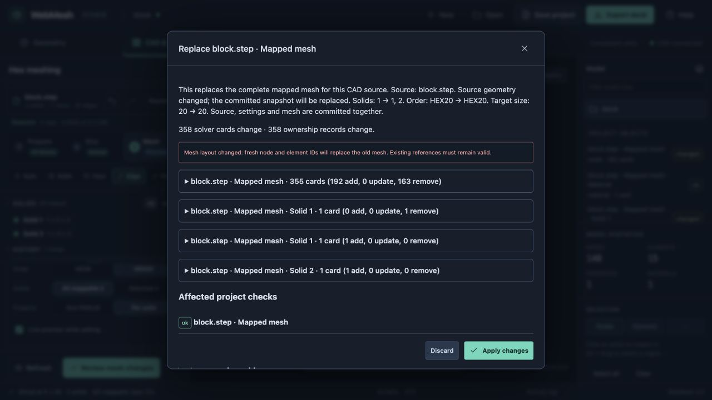
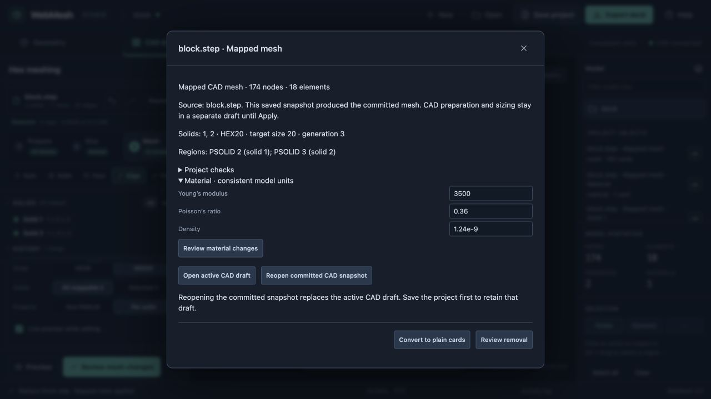
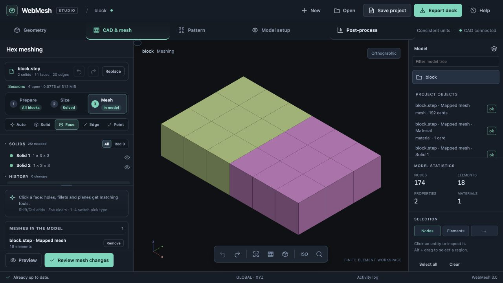

# Implementation 04: mapped CAD mesh ownership

22 October 2026 · branch `codex/project-core-foundation`

## Scope and implementation plan

Connect native mapped HEX8/HEX20 generation to project ownership, using the existing CAD preparation tools. One owned mapped mesh bundle per CAD session contains a committed source snapshot, a material, explicit solid regions/sections, and its generated mesh. Shell/Gmsh and previously authored plain CAD meshes retain their existing workflows; this milestone does not infer ownership for imported cards.

1. Add a pure mapped-CAD adapter with explicit source and region identities. Store original/prepared CAD and meshing settings. Preserve IDs for identical regeneration; changed geometry, target solids, connectivity or node coordinates receive fresh mesh identities. Preserve section IDs only when their explicit geometry/region identity still matches.
2. Use the existing exact change review before committing. Show replaced source/regions, retain the old model on discard/failure, and reject stale CAD drafts as well as stale model transactions. Check all hand-card references and dependent objects before Apply.
3. Treat CAD preparation/sizing as a draft. The committed project keeps the CAD snapshot used to build its mesh. Export continues to represent that committed model until Apply. Persist the active draft separately, and label its difference from the committed mesh clearly.
4. Route owned CAD cards to an inspector with source/settings/region information, material editing, reopening the committed CAD snapshot, conversion, and removal. Reconcile the CAD mesh list from actual ownership after model undo/redo. Never rebind restored owned elements as legacy tags.
5. Verify with the real parser/writer, a hand load and a dependent connection. Exercise the browser with actual repository STEP geometry, review/discard/apply, remesh, undo/redo, export and save/reopen. Preserve earlier review fixes outside this commit.

## Acceptance

A mapped CAD mesh appears in the project tree with its source, material and sections. Reopening and regenerating an unchanged saved source produces no card changes. Refinement allocates new mesh IDs; an existing load referencing old nodes prevents replacement. Unsupported external dependents block Apply. A CAD draft never changes the committed source or mesh until Apply. Conversion preserves cards; removal and replacement remain guarded and undoable.

## Validation

Implemented in `app/cad-project.js`, the CAD workspace and the shared project review/inspector.

- Focused tests cover explicit geometry/solid identity, fresh remesh blocks, stable unchanged regeneration, retired region identities, hand-load protection, external connection invalidation, conversion/removal, stale CAD drafts, selected-solid persistence and exact CAD settings/source restoration.
- Real engine tests write and parse HEX8 and HEX20 in free/small/large formats, preserve midside connectivity, exercise undo/redo and save/load ownership, and remesh a reopened deck with retained source records.
- Browser verification at `127.0.0.1:8791` used `examples/block.step`: set size 20, preview and discard, apply 15 HEX8 elements/48 nodes, edit the owned material to PLA estimates, reopen its committed source, and confirm a zero-change regeneration. Switch to HEX20: the review shows 163 added and 63 removed mesh cards, leaving the existing section/material. Apply produces 15 HEX20 elements/148 nodes; undo restores 48 nodes and redo restores 148. Save/reopen retains the material, ownership and settings and regenerates with no card changes.
- Manually slice the reopened CAD at X = 50, leaving the committed model unchanged; export before/after this draft slice was byte-for-byte identical. Select Per solid and apply: 18 conforming HEX20 elements/174 nodes, with PSOLID 2 and 3 replacing PSOLID 1. Reopening the new prepared source again yields an empty diff. Conversion retains all solver cards; undo restores its owners.
- This testing found and fixed cached previews surviving sizing/selection changes, missing selected-solid settings on restore, and deleted source PSOLID/MAT1 records surviving synchronization after remeshing a reopened project. The retained PSOLID records prevented save/export; a regression now exercises remesh, removal and undo with actual parsed source cards, a retained parser session and the real writer/parser. A stale element count after removal also now ignores inactive compact data. After these fixes the browser successfully saved and reopened the two-solid project, showed zero elements after removal, restored 18 elements with Undo, exported the restored mesh, and regenerated it with zero changes. The final browser session reported no console warnings/errors.
- Final isolated milestone suite: **375 passed, 0 failed, 0 skipped** (`npm test`, using the existing local quadmesh/paved libraries). The retained-parser-session regression was then strengthened and **94 focused tests passed** in the isolated copy. Inspector errors are shown inside the open dialog; invalid material input was checked in the browser. JavaScript syntax and `git diff --check` passed.
- Earlier unstaged review fixes and STEP/review artifacts remain outside this milestone.

## Boundaries and next milestone

Ownership currently covers native mapped HEX8/HEX20, with one complete mapped mesh bundle per CAD session. It stores the original file, a prepared BREP snapshot, settings and explicitly numbered solid regions qualified by a geometry fingerprint. It does not infer region correspondence after topology changes. Changed geometry, target solids, node coordinates/connectivity or property grouping allocate fresh mesh blocks; unchanged explicit regions preserve their section IDs. Reintroducing a retired region gets a new section identity. A source snapshot can be reopened without its server session; replaying all preparation undo steps is not included.

The CAD preparation draft is saved separately. Its changes do not invalidate the committed source/mesh or change export until Apply. Model undo/redo updates the CAD mesh list from actual ownership; it does not undo the active CAD draft. Reopening a committed source replaces that draft, with this consequence shown in the inspector. Previously created plain CAD meshes are not adopted, and other meshers cannot overwrite an owned mesh without explicit removal/conversion. Shell/Gmsh ownership, assembly instances, shared materials across bundles, run provenance and unified CAD/FE history remain separate work. Project checks describe definition consistency, not analysis completeness.

The next bounded milestone is a named mounting region and one analyst-authored RBE2/CBUSH attachment on an owned mesh, using a shared PBUSH template. Persist the intended CAD region, mesh-node resolution and shaft point separately; preview node/DOF/reference changes, and reject a remesh when the region cannot be re-resolved. Exercise two attachments sharing stiffness, hand-load protection, save/reopen, undo/redo, and an upstream material/remesh edit. RBE3 payload masses, live wheel instances and the solver/run workflow follow as separate slices.
