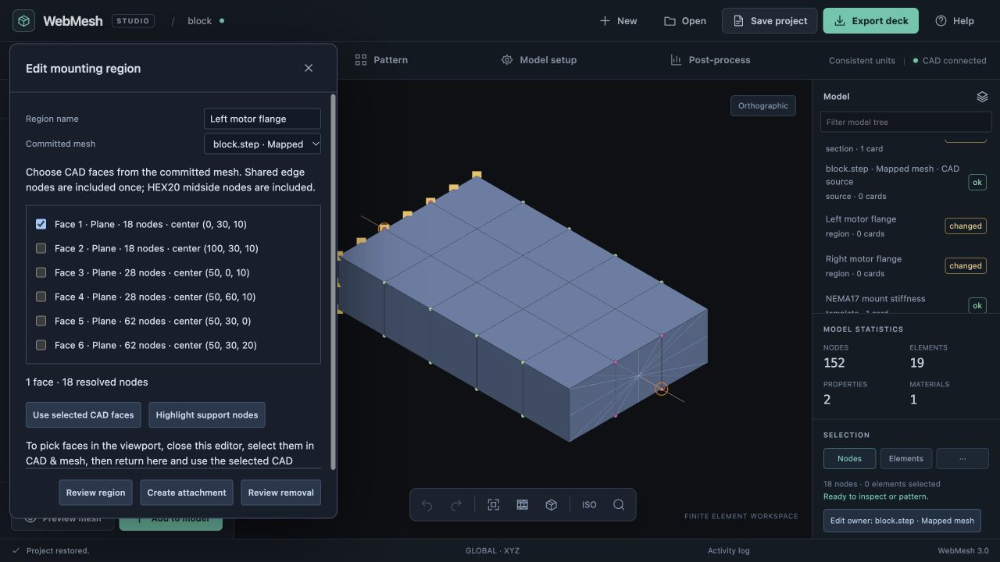
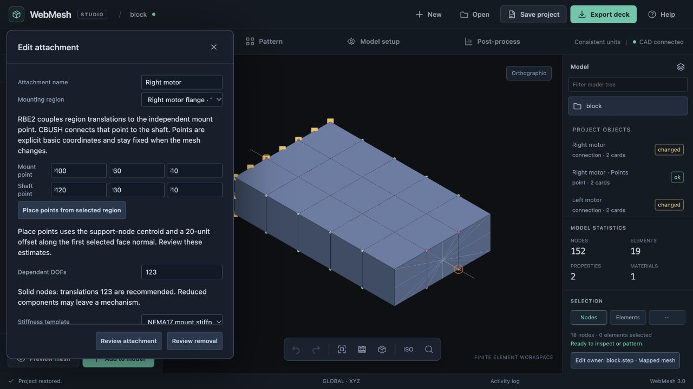
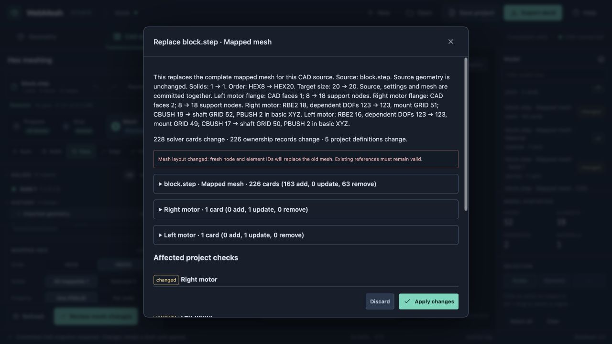

# Implementation 05: mounting regions and RBE2/CBUSH attachments

22 October 2026 · branch `codex/project-core-foundation`

## Scope and plan

Author a named mounting region on a committed native mapped CAD mesh, then connect its resolved nodes through an RBE2 to an explicit mount point and through a CBUSH to an explicit shaft point. Several attachments can use one shared PBUSH template. This slice uses the existing project graph, exact change review, reference/DOF checks and atomic history.

1. Preserve exact CAD face membership during HEX8/HEX20 generation, including used midside nodes. Store the resulting global node IDs and face descriptions with the committed mesh. A mounting region stores a named face selection qualified by its source geometry fingerprint, separately from its current mesh resolution.
2. Add pure region, attachment and shared-template builders. Preserve point, connection and property identities across edits and remeshing. Re-resolve supported downstream regions/connections in the same upstream transaction. Reject missing faces, changed source geometry, invalid support geometry, overlapping dependent DOFs and dangling hand references.
3. Add Model setup entry points and owner editors for regions, attachments and templates. Show face/node membership, mount and shaft coordinates, dependent components, stiffness frame and shared-template consumers. Highlight resolved support nodes; review definitions and solver-card changes before Apply. Removal must respect external dependents; shared regions/templates are retained when an attachment is removed.
4. Exercise two attachments sharing stiffness, region edits, material edits, refinement, hand-load/DOF conflicts, undo/redo, save/reopen and real deck export. Manually verify the browser workflow using repository STEP geometry.

## Acceptance and boundaries

Sizing/order changes re-resolve CAD face membership atomically with the new mesh; shaft points and connection IDs remain stable. Changing topology or dropping a selected face blocks the remesh with a named-region explanation. Unknown downstream generators remain invalid until their own evaluator handles the change. Existing projects without face membership require one reviewed regeneration before region creation.

PBUSH K1–K6 use the basic Cartesian frame (`CID=0`), explicitly labeled in the editor; translational stiffness is force/length and rotational stiffness is moment/radian. The attachment is an analyst-defined idealization, not an automatic motor model or a complete analysis. This milestone does not add RBE3 payload masses, arbitrary shell regions, assembly instances, local attachment frames, contact, or solver/run orchestration.

## Validation

Implemented in `app/attachment-project.js`, `app/attachment-workspace.js`, mapped mesh provenance and the shared project review. Enter through **Model setup → Mounting regions & attachments** or a project owner in the model tree. A saved region also offers **Create attachment**. Regions can use checked face descriptions or a viewport CAD selection whose geometry fingerprint matches the committed source. The point-placement helper supplies a visibly labeled centroid/20-unit face-normal estimate; coordinates remain analyst-authored and independent of later mesh resolution.

- Generator tests verify exact planar face membership for HEX8/HEX20, used midsides, shared interfaces and selected-solid coverage. Ownership tests exercise union regions, old-project provenance migration, two attachments sharing one property, stable point/element IDs, material/stiffness edits, remeshing, unsupported consumers, missing faces, topology replacement, dependent-DOF conflicts, hand loads and constraints, removal and untouched input state.
- Real engine tests verify atomic history, saved ownership and source/free/small/large writer/parser round trips, including a remesh after parsing the original deck. Both RBE2 dependent lists and CBUSH basic-frame/property/node references survive export. A hand constraint on the independent shaft remains attached through refinement; a hand load on a retired mesh node blocks replacement.
- Browser verification imported `examples/block.step`, generated 15 HEX8 elements/48 nodes, and authored opposite named flange regions with 8 nodes each. Two motor attachments use independent mount/shaft GRID pairs 49/50 and 51/52, RBE2 16/18, CBUSH 17/19 and a single PBUSH 2. Shared K1 was changed to 250000; the CAD material was changed to PLA estimates. Both edits re-evaluated the known consumers and passed review.
- Saved and reopened the project, then remeshed to 15 HEX20 elements/148 mesh nodes plus the four attachment points. Each flange resolves 18 support nodes. The review showed two RBE2 updates and fresh mesh IDs, with unchanged point, CBUSH and PBUSH identities. Discard retained the committed mesh; Apply and Undo/Redo changed the mesh and both support lists together. A subsequent saved/reopened regeneration showed zero card, ownership or project-object changes.
- Manually picked CAD face 6 in the viewport and transferred it into the region editor: 62 quadratic support nodes. An overlapping flange edit was rejected with the exact conflicting RBE2, GRID and component. Slicing the CAD at X=50 into two solids caused remeshing to fail with the named region and geometry-change explanation. Exports before and after the rejected replacement were byte-for-byte identical. Reopening the committed source restored the unchanged-regeneration path.
- The downloaded browser deck was independently parsed: 152 GRID, 15 CHEXA20, two RBE2 with 18 dependents each, two CBUSH with CID=0/PID=2, and one shared PBUSH with the edited stiffness. No load case or motor mass is implied by this authoring fixture.
- Browser testing also corrected the zero-card region-change message, preserved a clear distinction between project-object and card changes, reset new dialogs to the top, named the close button for accessibility, and removed irrelevant unused-node warnings from attachment previews.

Final isolated staged-tree suite: **388 passed, 0 failed, 0 skipped** (`npm test`, using the existing local quadmesh/paved libraries). The ownership suite contains 72 tests; mapping provenance adds three regressions. JavaScript syntax checks and `git diff --check` passed. The final browser session reported no warnings or errors. Desktop region/attachment editors keep the viewport visible beside the form, so support-node highlights can be inspected. Earlier unstaged review fixes and STEP/review artifacts remain outside this milestone.

## Next actionable slice

Add a payload definition consisting of an explicit offset center of mass, CONM2 and RBE3 distribution over one or more named regions. Extend owned-card validation and the real writer/parser first; make mass, offsets, independent components and weights explicit. Re-resolve its support with the same native-mesh transaction, protect hand references, and verify combined RBE2/RBE3 DOF conflicts. Exercise a 0.5 kg battery and 1 kg payload in consistent model units, including a 200 mm offset, before adding analysis cases/run provenance. Local connector frames and topology correspondence repair remain separate from that mass-authoring slice.
