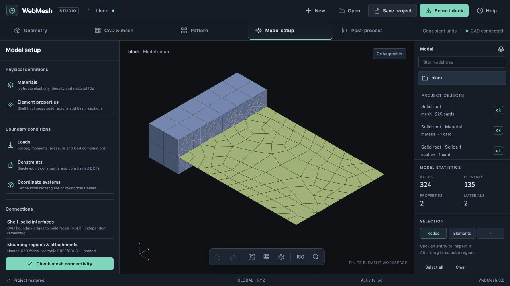
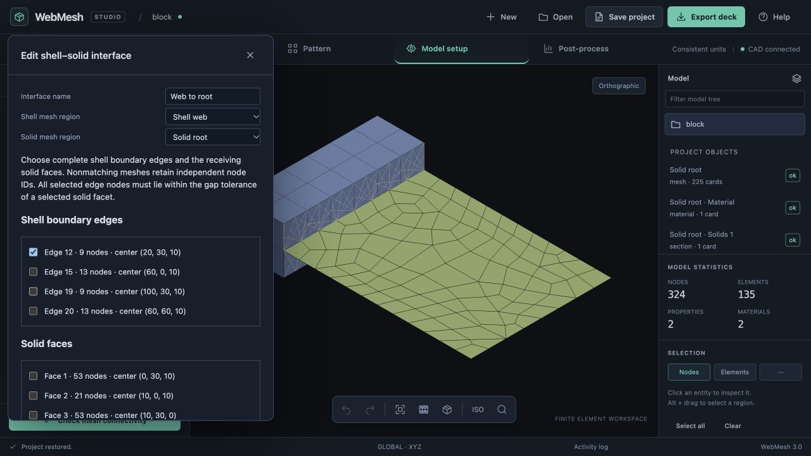
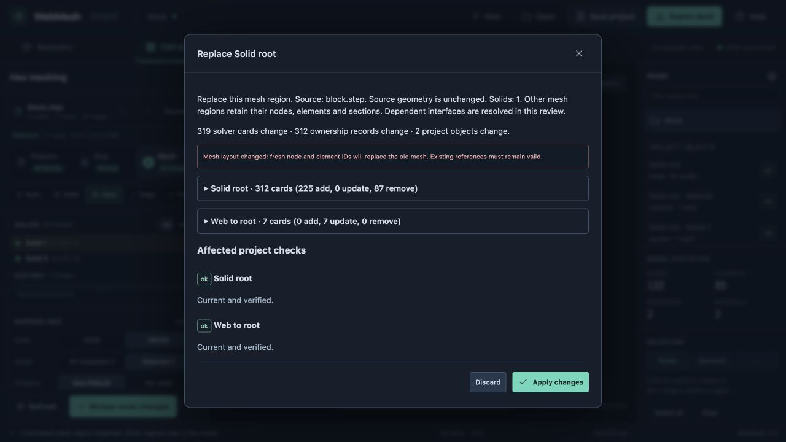
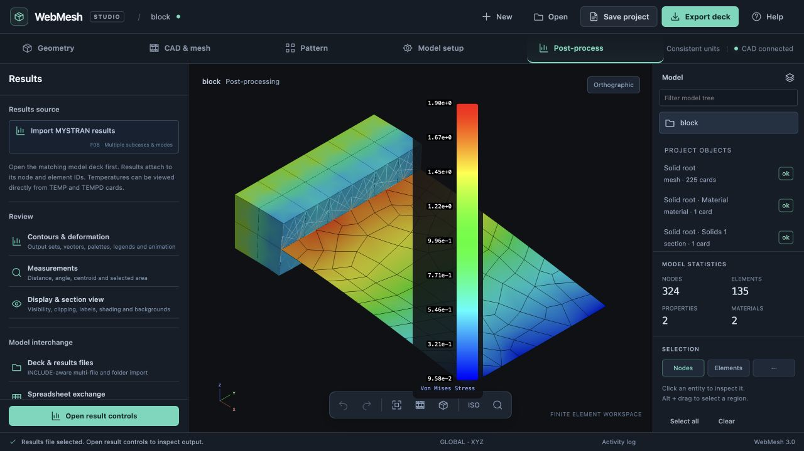
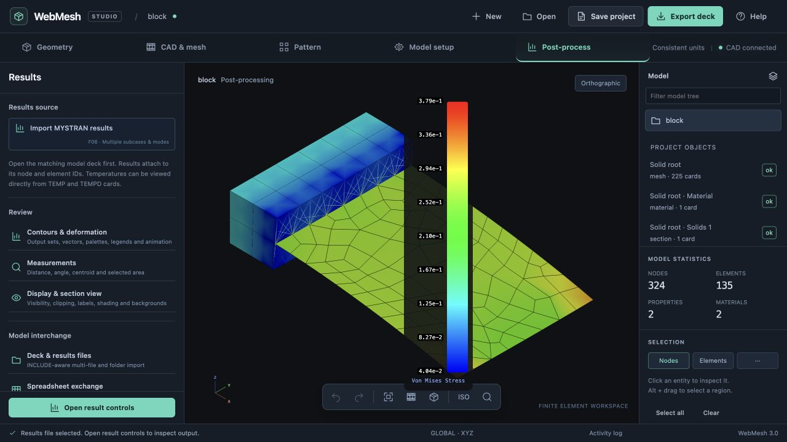

# Implementation 06: mixed shell/solid regions from one CAD source

23 October 2026 · branch `codex/project-core-foundation`

## Scope and actionable plan

Mixed idealization is a first-class requirement, including thin and thick portions of an originally continuous CAD solid. Prepare/partition the geometry first; create multiple independently owned mesh regions referencing one saved original/prepared CAD source. Unmeshed CAD is reference geometry. This milestone precedes payload/mass authoring.

1. Generalize CAD ownership to mapped HEX8/HEX20 and CQUAD4/CTRIA3 regions. Give each region independent sizing, element settings, material, PSOLID/PSHELL sections and shell thickness/offset. Preserve exact face and shell boundary-edge membership. Reject duplicate coverage and shell/solid double idealization of the same CAD solid; partition continuous solids before assigning different roles.
2. Add explicit Create/Edit mesh region controls. Reopen one region's settings and selection while retaining all sibling meshes. Commit only the selected region. Save/reopen the shared CAD source and all region definitions. Block changing a shared topology underneath existing regions; topology correspondence repair is a later milestone.
3. Author an explicit shell-edge/solid-face distributed tie. Emit one RBE3 per shell boundary GRID, reference DOFs 123456, independent solid translations 123, uniform weights inside an analyst-set support radius. Require geometric proximity to resolved solid facets and at least three noncollinear support nodes. Explain that radius controls averaging and local compliance. This transfers moments through solid translations, without welding incompatible shell rotations to solid nodes.
4. Re-resolve interfaces in the same transaction when either mesh changes. Retain connection identities while shell reference nodes remain; allocate fresh identities for fresh shell nodes. Preserve the other region and its section/mesh identities exactly. Reject missing selectors, inadequate support, overconstraints, dependent support nodes, dangling hand references and unknown downstream consumers. Discard, Undo/Redo and reopen must remain atomic.
5. Validate mixed generation, shell thickness/offset round trips, both independent remesh directions, interface failures, history and persistence through the real engine/writer. Exercise a repository STEP in the browser, export and solve a bending case with MYSTRAN or Vibestran, and record reproducible evidence and limitations here.

## Interface formulation and bounds

The implementation uses ordinary RBE3 cards, not a solver-specific contact or RSSCON card. Shell reference DOFs are derived from a local cloud of solid translations. The independent cloud must span a plane; collinear support cannot determine all rotations. Corner-triangulated solid face facets provide the gap check, including for HEX20, and the radius limits the support cloud. Curved faces therefore use a faceted proximity approximation; refine the solid surface as needed. Both sides keep independent grids and can use different mesh densities. The UI exposes both tolerances; it never silently expands a radius or drops an unsupported edge node.

This follows the RBE3 reference/support convention described in the [OptiStruct RBE3 reference](https://help.altair.com/hwsolvers/os/topics/solvers/os/rbe3_bulk_r.htm); its [shell-to-solid connection documentation](https://2025.help.altair.com/2025.1/hwsolvers/os/topics/solvers/os/shell_to_solid_connection_r.htm) also describes an RBE3-based shell-edge/solid-face approach. Our radius-based implementation is its own explicit idealization, not an implementation of RSSCON1. A patch/solver check establishes force/moment transfer; it does not certify accuracy for arbitrary geometries or radii.

No automatic topology matching, tied contact, assembly instances, generated MPC sets or general solid-solid interfaces are included. Geometry changes shared by several committed regions require removing/redefining the affected regions and interfaces first. Legacy Gmsh volume meshes remain plain cards. Shell boundary interfaces support Recombined, Paved and Tri meshes; Quadtree keeps face provenance but its independent sampled boundaries are not classified for this interface. The new shell ownership path requires complete positive-quality coverage of its requested faces.

## Validation

Implemented through `app/cad-project.js`, `app/interface-project.js`, `app/interface-workspace.js`, the existing CAD workspace and shared transaction review.

- Pure/real-engine tests cover shared source ownership, shell sections and ZOFFS, independent remeshing in both directions, fresh/reserved identities, unchanged sibling cards, re-resolved interface patches, exact writer/parser round trips, atomic discard/Undo/Redo and saved ownership. Failure cases cover overlapping idealizations, topology drift, missing edges, unsupported gaps/radii, constrained reference DOFs, dependent supports and dangling hand references. Workspace tests cover creating a second region, restoring selected faces, ignoring irrelevant solid selections for midsurfaces and keeping sibling status current.
- Python tests verify exact face membership and boundary edges for Recombined/Paved shells after midsurface placement, plus Gmsh triangle provenance. Quadtree is explicitly excluded from boundary-interface authoring.
- Browser verification imported `examples/block.step`, sliced the originally continuous solid at X=20, meshed the root with 24 HEX8/63 nodes, and meshed the remainder as a midsurface at Z=10 with PSHELL T=20: 54 CQUAD4/69 nodes. A named interface ties shell CAD edge 12 to solid face 6 using radius 15 and gap tolerance 0.01: seven RBE3 patches, each with 6–9 independent solid nodes.
- Saved/reopened the connected project. Changing only the root to HEX20 reviewed seven RBE3 support updates and no shell changes. Discard retained the original model; Apply and Undo/Redo were exercised. Refining only the shell to size 7.5 produced 102 CQUAD4/123 nodes and nine RBE3 patches. Comparisons of the downloaded project definitions prove the sibling mesh, materials and sections were identical in each direction. Reopening either region restores its own method, scope and sizing.
- Solver verification found and corrected an existing HEX20 midside-order defect in the mapper, primitive generator/checker and display: Nastran G13–G16 are the vertical edges, G17–G20 the upper perimeter. The previously generated quadratic mesh failed Vibestran's Gauss-point Jacobian check. A reviewed regeneration now exports the correct connectivity and solves. Earlier saved HEX20 meshes need explicit regeneration; arbitrary imported decks are not silently rewritten.
- The final browser model contains 324 nodes, 24 CHEXA20, 102 CQUAD4 and nine RBE3. The saved project, solver deck, F06, log, numerical summary and reproduction script are in [validation/mixed-mesh](validation/mixed-mesh/). The two static test cases were added by that script to the exact browser-exported mesh: 100 N downward at the shell tip and a separate 1,000 N·mm moment. Root translations are fixed. Default steel constants are retained; this is a workflow/transfer fixture, not a material study.
- Vibestran solved both cases. Relative residuals were 1.403e-12 and 1.835e-14. Reactions balance the force and the full moment about the origin: Fz=99.999991 N and My=−10000.000014 N·mm for the tip-force case; My=−999.999990 N·mm for the pure-moment case. The script asserts all resultant components within 0.01 in model units. Two shell taper warnings remain; this is not a convergence study.
- Browser verification corrected an RBE3 preview rejection, stale sibling status during settings edits, irrelevant solid-scope restoration for midsurfaces and CAD reference geometry obscuring the FE model outside the CAD workspace.

- The unchanged restored shell region reviewed with zero solver-card, ownership-record or project-object changes. An inadequate radius of 0.1 was rejected in the interface editor without changing the model.
- Postprocessing verification exposed and corrected additional existing defects: the full HEX20 face renderer and selected edges still used the old midside order, continuous contours omitted quadratic solid faces, and the F06 parser skipped the Vibestran solid centroid table and shell values printed without separating spaces. Regression checks retain all 24 solid and 102 shell stress records in both cases and verify actual planar face geometry and continuous/element contour colors. Solid stresses use reported centroid values; shells retain the existing surface envelope behavior. Continuous colors are visualization averages, not a stress recovery calculation.
- Browser postprocessing loaded the matching F06, displayed deformation and continuous von Mises contours on both regions, and switched between the force and moment cases. Their contour ranges changed from 0.0958–1.90 to 0.0404–0.379 in model stress units; the final browser console had no warnings or errors. The existing central legend can obscure the model and still needs a broader results-UI cleanup.
- Final isolated JavaScript suite: 401/401 passed (42.2 seconds). Python shell/provenance tests passed 14/14. Pre-existing unrelated working-tree changes are excluded from the isolated validation and commit.

## Follow-on milestone: mesh actions and embedded conforming interfaces

The expanded, actionable plan is [implementation 07](implementation-07-mesh-actions.md). It retains this guided interface and adds general analyst-authored tools alongside it.

The analyst requested a second supported formulation: extend the shell one or two element rows into the solid and share GRID IDs in the overlap. This deliberately retains shell material within an already meshed solid. It is distinct from the nonmatching RBE3 tie and is now implemented, together with general mesh actions, in [implementation 07](implementation-07-mesh-actions.md). The historical outline below explains the intended progression; implementation 07 records the delivered bounds and validation. Ordinary accidental double idealization remains blocked.

1. Add an explicit interface formulation selector: distributed RBE3 tie or embedded shared-node strip. For the embedded option, select the shell boundary, receiving solid region, penetration direction and depth in element rows. Show the actual overlap dimensions, participating elements and added shell mass/stiffness assumption in the review. Never infer or silently permit general overlapping idealizations.
2. Start with a planar structured strip and compatible HEX8/CQUAD4 connectivity. The shell must extend to an internal nodal plane of the solid, with matching subdivisions throughout the strip. Reject incompatible placement, topology or order with an actionable diagnostic. HEX20 requires a matching CQUAD8 path with corresponding midside nodes before enabling that combination.
3. Define canonical ownership for the shared GRIDs and explicit cross-region references; a shared GRID is exported once. Resolve this ownership/dependency contract before adding geometric generation so deletion, conversion, persistence and undo cannot leave duplicate owners or dangling references. Record exactly which shell elements and solid cells comprise the overlap.
4. Generate the conforming solid nodal plane and embedded shell strip together. Emit shared-node connectivity without RBE3s or coincident duplicate nodes. Relax the overlap guard only for the overlap explicitly owned by this interface; ordinary accidental shell/solid double coverage remains blocked.
5. Treat remeshing as a coordinated interface transaction. Regions away from the overlap remain independent; changing either side preserves the compatible strip or rebuilds both affected strips. Review the neighbor changes and any thickness/section implications before Apply. Incompatible local refinement blocks the transaction rather than silently breaking shared connectivity.
6. Test one- and two-row penetration, node uniqueness, matching faces/order, independent regions away from the strip, both remesh directions, removal/conversion, save/reopen and Undo/Redo. Run a force and pure-moment patch test, report the deliberate added mass, and compare mesh refinement and compliance with the distributed-tie case. Do not require identical stiffness from these different idealizations.

After embedded interfaces, implement payload definitions: explicit center of mass, CONM2 and RBE3 distribution over named mounting regions, followed by analysis cases and run/result provenance. Reuse the owned RBE3 validation added here, extending the authoring contract only with matching writer/parser and DOF tests.
