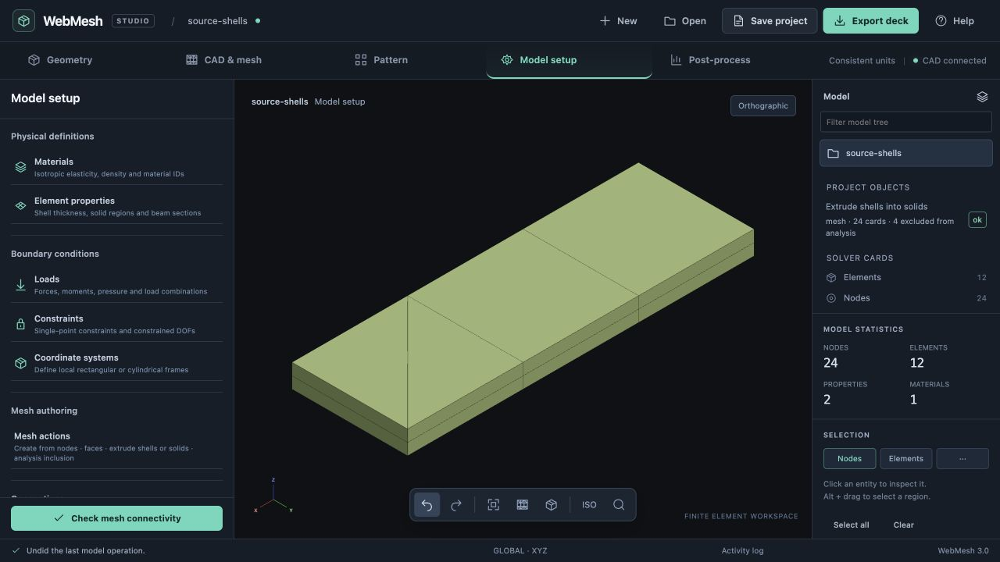
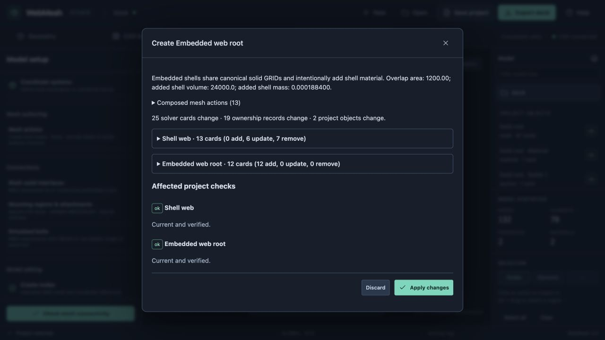
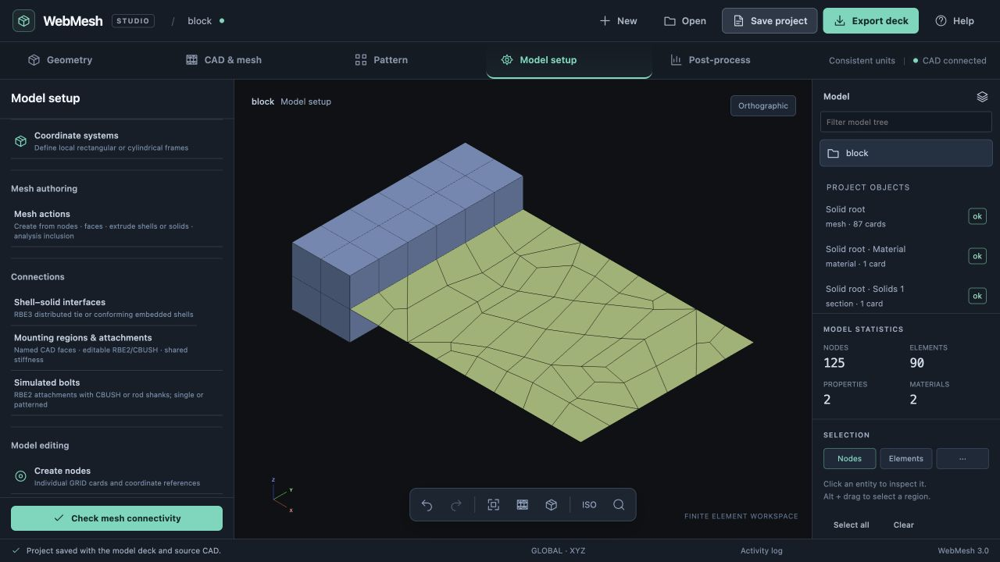
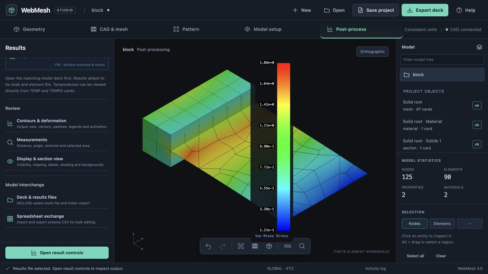

# Implementation 07: analyst mesh actions and embedded interfaces

23 October 2026 · branch `codex/project-core-foundation`

## Goal and architecture

Automatic and guided workflows compose actions available directly to the analyst. This is a primary project goal, recorded in the README and workspace design. This milestone implements the principle for mesh authoring and embedded interfaces; migrating every existing generator is separate work.

The action layer operates on explicit nodes, elements and properties and returns a detached candidate plus an inspectable action sequence. The project adapter adds stable ownership, source dependencies and persistence. The UI exposes these operations beside the existing CAD generators and RBE3 tie. A guided embedded-interface recipe selects and sequences these same actions. All paths use the engine's existing review/commit/discard transaction and Undo/Redo.

## Actionable sequence

1. Create linear elements from ordered existing GRID IDs; create conforming shells on selected solid facets, including internal facets; extrude an ordered node chain into shell rows, optionally reusing existing nodes. Reject ambiguous matches, duplicate elements, degenerate/inverted elements and unsupported topology/order. Preserve canonical GRID ownership.
2. Extrude selected CTRIA3/CQUAD4 shells into CPENTA6/CHEXA8 solids with a specified total vector and layer count. Share base GRIDs and adjacent columns. Require an existing appropriate section. Optionally exclude source shells from analysis in the same transaction. Analysis participation is independent of display visibility: excluded source cards remain editable and saved, shared nodes remain, and all deck export formats omit excluded elements. Element loads referencing excluded elements must block exclusion/export until explicitly repaired. Exclusion is reversible and visible in the authoring UI.
3. Persist analyst action definitions and explicit source signatures. Upstream changes that invalidate explicit selections block with a repair diagnostic; do not bind to reused numbers or silently regenerate a manual mesh. New operations use reserved identities. Removal restores edited source connectivity. Conversion is guarded: source owners with dependent actions cannot be converted individually, and exclusion definitions cannot be discarded by conversion.
4. Add the guided embedded option beside the existing RBE3 formulation. Start with planar, conforming HEX8/CQUAD4 geometry and one or two rows. Reuse the solid's internal facet nodes, share boundary connectivity and create overlapping shells through the same public actions. Review records actual participating cells/facets and overlap dimensions. This deliberately adds shell material/stiffness inside the solid; no hidden RBE or coupling element is generated.
5. Re-resolve the guided interface when either CAD mesh changes. Preserve unaffected interior shell cards and sibling regions. If subdivisions/planes no longer match, reject the whole transaction with a repair instruction. Restore the original shell boundary when removing the interface. Shared GRIDs have one canonical owner and export once.
6. Verify pure actions, ownership/reference guards, real writer/parser round trips in all formats, history and persistence, both remesh directions, failure cases, and exclusion. Manually exercise the tools in the browser. Solve a shared-node force/moment fixture and an extruded solid fixture; record evidence and practical limits here.

## Initial limits

Linear elements only in these actions; quadratic face connectivity requires its own matching-order implementation. Extrusion uses a straight uniform vector and evenly spaced layers. Embedded guidance requires an already conforming internal HEX8 nodal plane: it does not resample or remesh the CAD regions automatically. Manual explicit selections require repair/recreation after incompatible upstream changes. Existing RBE3 nonmatching interfaces remain available.

## Implementation and validation

Implemented through `mesh-actions.js`, `mesh-action-project.js`, `mesh-action-workspace.js` and `embedded-interface.js`, using the existing engine ownership, project history and card writer. The shared connectivity checker and pattern path now understand linear wedges too.

### Direct tools

Open **Model setup → Mesh actions**. Use the current viewport selection or enter explicit IDs. Ordered node connectivity is editable; semicolons separate multiple elements. The tools expose:

- Create CTRIA3, CQUAD4, TET4, HEX8 or PENTA6 from existing nodes.
- List solid facets, including internal faces, and create conforming shells on selected facets.
- Extrude an ordered node chain into quad shells, with a total vector, layer count and optional coincident-node reuse.
- Extrude mixed triangle/quad shells into wedges/hexes. Neighboring columns share nodes and the source layer reuses the original GRIDs. Negative and oblique vectors retain positive solid orientation.
- Share explicitly paired coincident nodes in selected owned elements. Optional retirement removes unused source GRIDs; loads, constraints and other references prevent unsafe retirement. Removing the action restores the original connectivity and nodes.
- Exclude selected elements from analysis. Extrusion offers this for its parent shells by default. The object tree shows the exclusion count; the action editor can include them again. This is independent of visibility. Editable projects retain the source cards; all source/free/small/large solver exports omit excluded elements while retaining their GRIDs. Loads referring to an excluded element block the change.

The review displays the composed action inputs and exact card changes. The guide invokes those same actions, including source-node retirement, rather than maintaining a separate element generator. Manual action inputs retain exact snapshots and original precision through save/reopen. Incompatible source changes require removing/recreating the dependent action; material changes can revalidate unchanged selections. Editing action parameters in place, general arbitrary-coordinate-system extrusion, automatic subdivision matching and quadratic embedded interfaces remain later work.

### Embedded guide

Open **Model setup → Shell–solid interfaces → New shell–solid interface** and select **Embedded shared-node shells**. Choose a shell boundary, a receiving solid face, a penetration direction, one or two rows, and a matching tolerance. The solid owns every shared GRID. The interface owns the new shells; the original shell region references the canonical solid entry nodes. It preserves the original shell recipe for removal and regeneration. Interface removal restores the original boundary in the same transaction. Individual conversion that would orphan the connectivity edit is blocked.

The review reports overlap area, added shell volume and added shell mass in consistent model units. It does not remove solid material or add an RBE. Independent compatible remeshing re-resolves the shared boundary and strip atomically. Incompatible spacing/order, missing selectors, ambiguity and existing hand references block the entire candidate. One interface per shell region is supported in this first slice; simultaneous embedded/RBE3 interfaces on the same region require a later boundary-overlap contract.

### Browser verification

The saved files and reproduction scripts are in [validation/mesh-actions](validation/mesh-actions/).

- Imported `source-shells.bdf` through the browser. Extruded two quads and two triangles by 2 model units in two layers, with source exclusion enabled: 24 nodes, four HEX8 and four PENTA6. The editable project retains all four parent shells; the downloaded solver deck contains only the eight solids. Including the sources, Undo/Redo, saving, reopening and exporting were exercised.
- On the same mesh, manually created a shell on an internal solid facet, extruded an ordered node chain with node reuse, and created a quad from ordered GRID IDs. These operations added four shells and zero nodes. `manual-actions.webmesh` retains the independently authored actions.
- Reopened the previous STEP-based mixed project, removed its RBE3 tie, regenerated the root as 24 HEX8 and the web at size 10 as 54 CQUAD4, and authored a two-row embedded interface. It reviewed 12 added shells, six updated boundary elements and seven retired duplicate GRIDs. The resulting model has 125 nodes, 24 hexes and 66 shells, with no RBE3. Unchanged regeneration reviewed zero card, ownership or object changes.
- The two-row strip extends 20 units through the root, covers area 1,200, and deliberately adds shell volume 24,000. With the fixture's steel density, added mass is 0.0001884 in its N–mm–tonne units (0.1884 kg). This is a coarse workflow fixture, not an accuracy recommendation for this thick plate idealization.
- Imported the matching Vibestran F06, displayed deformation and continuous von Mises contours on shell and solid elements, and switched between the force and moment cases. No browser warnings/errors were recorded.
- The existing server had reached its 24-session limit. Verification used an isolated local server instead of deleting existing sessions. Session accumulation remains an existing lifecycle issue.

### Solver and regression evidence

Run `python3 docs/design/validation/mesh-actions/verify.py --solver ~/Documents/vibe-tran/build/vibestran --output /tmp/action-check`. It solves the actual browser extrusion export and the actual two-row browser mesh, plus one-row and RBE3 recipes composed on the same base regions. Test supports and loads are explicitly added by the script. The saved solver decks, F06 files, logs and [results.json](validation/mesh-actions/results.json) make the checks reproducible.

All cases solved, with relative residuals below 5.4e-11. The extrusion reacts a 1 N tip load; the mixed cases react a 100 N tip load and a separate 1,000 N·mm moment. All six force/moment resultant components balance within 0.01 in consistent units. The extrusion deck contains no parent shells; its unused PSHELL property is harmless and reported by the solver.

| Interface on the same base regions | Embedded shells | Mean tip Z displacement under 100 N | Mean tip Z displacement under 1,000 N·mm |
| --- | ---: | ---: | ---: |
| One row | 6 | −0.005713 mm | −0.0007885 mm |
| Two rows | 12 | −0.004170 mm | −0.0006061 mm |
| RBE3, radius 15 | 0 | −0.003905 mm | −0.0005760 mm |

These differences are expected for different idealizations; no equality of stiffness is assumed. This is an equilibrium/compliance comparison, not a convergence study. Mesh refinement is covered by transaction tests: compatible solid refinement preserves shell interior cards; compatible shell refinement preserves every solid card; incompatible boundary subdivisions reject atomically. A numerical convergence study remains separate.

Regression checks also cover positive wedge/hex Jacobians, negative/oblique extrusion, coincident-node reuse/ambiguity, exact internal facet connectivity, invalid elements, source-load guards, one/two-row interfaces, real writer/parser round trips in all four formats, active-only writer projection, source precision, removal, discard, Undo/Redo and saved ownership. Final clean-suite results are recorded below.

Final isolated JavaScript suite: **417/417 passed** in 44.6 seconds. The clean copy contained only this milestone; unrelated pre-existing edits were excluded. The solver script independently solved all four fixtures (seven static subcases total).

## Follow-on work

Add editable parameters and selection repair for analyst action objects, extend conforming actions to quadratic topology, and support multiple disjoint interfaces on one region. Continue applying the composition rule to CAD preparation, attachment authoring and analysis setup as those workflows are changed. [Implementation 08](implementation-08-payload-masses.md) now provides editable point/CONM2/RBE3 actions and a distributed-payload guide with explicit COM and remesh-aware named regions. Analysis cases and run provenance are the next domain workflow.
