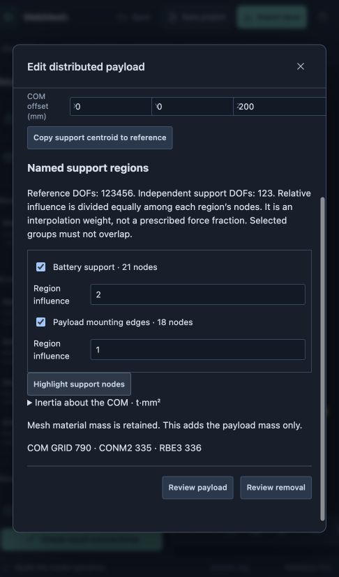
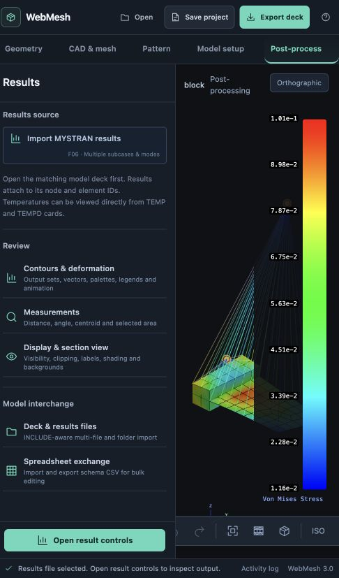

# Implementation 08: payloads and distributed masses

23 October 2026 · branch `codex/project-core-foundation`

## Goal

Author a battery or payload with an explicit center of mass and distribute its inertial loads over named mounting regions. The guide composes the same point, CONM2 and RBE3 actions exposed as direct analyst tools. This completes the mass-authoring slice described in Implementation 05; analysis cases and immutable solver/run provenance follow separately.

## Actionable plan

1. Add public point, concentrated-mass and weighted RBE3 actions. Validate positive mass, finite offsets, physically admissible inertia, independent support geometry and explicit component conventions. Extend owned CONM2 validation and real writer/parser coverage before exposing the tools.
2. Extend named mounting regions to committed CAD shell faces and boundary edges as well as mapped solid faces. Resolve canonical shared nodes and preserve geometry-qualified selectors through compatible independent remeshing.
3. Add editable direct point/mass/distribution objects and a payload recipe. Preserve reference GRID, mass and RBE3 IDs across edits and remeshing. Declare all support dependencies, reject overlapping region groups and conflicting dependent DOFs, and protect hand references on removal. Make mass units, center-of-mass offset and weighting conventions visible.
4. Expose the tools under Model setup, with viewport selection, support highlighting, action-sequence review, atomic Apply/Discard, Undo/Redo and save/reopen. Payload placement is explicit and does not drift with changing mesh centroids.
5. Exercise a 500 g battery and 1 kg payload with a 200 mm offset in the browser. Verify all export formats, stable identities, compatible remeshing, invalid support/DOF cases and removal. Run gravity and lateral-acceleration checks in the installed solvers and inspect matching postprocessing results.

## Scope boundaries

The first distributed formulation constrains all six reference DOFs using independent translations 123. Region influence is shared equally among that region's nodes; it is a relative interpolation weight, not a prescribed force fraction. Overlapping region groups require an explicit repair instead of silently counting nodes twice. Coordinates and inertia use basic XYZ. Bare values use project units; mass and length fields accept supported unit suffixes. No shell/solid mass is removed automatically. Arbitrary local frames, tributary-area weighting, solver launch UI and run provenance remain later work.

## Validation

Implemented in `connection-actions.js`, `mass-project.js` and `mass-workspace.js`, with shared ownership validation and the real CONM2 writer. Enter through **Model setup → Masses & payloads**. Direct tools and the payload guide both use the public point, mass and weighted-distribution actions; their inputs appear under **Composed actions** in change review. Named points, including existing motor mount/shaft points, are available in the direct mass and distribution editors.

### Browser workflow

- Reopened the previous STEP-based embedded-interface project: 24 HEX8, 54 CQUAD4 web elements and 12 overlapping embedded shells. Created an 18-node region from two shell boundary edges and a 21-node solid-face region.
- Authored a **1 kg payload** at reference `(60, 30, 10)` mm plus `(0, 0, 200)` mm COM offset, and a **500 g battery** at `(10, 30, 20)` mm plus `(0, 0, 15)` mm. Explicit suffix inputs converted to `0.001 t` and `0.0005 t`. Payload identities are GRID 790 / CONM2 335 / RBE3 336; battery identities are 791 / 337 / 338.
- Reviewed and discarded a mass change, then gave the payload two disjoint support groups with region influences 1 and 2. Applied, undid and redid the edit; saved and reopened the project. Values and identities remained intact.
- Independently remeshed the shell from Recombined to Paved at size 10. The web changed from 54 to 50 quads. Review showed the replaced shell cards and one updated payload RBE3 support list; the solid, embedded strip, mass values and COM points retained their cards. Applied and saved the result. This exposed and fixed a preview bug where a mixed structural/rigid candidate was sent to the structural-only validator without RBE3 connectivity.
- Created a standalone named point (GRID 857), selected it by name for a 350 g CONM2 (389), and authored an explicit 21-node RBE3 distribution (390). Each public tool reviewed and committed individually. The direct-tool fixture is saved separately from the solver fixture.
- Imported the matching MYSTRAN F06 into the restored remeshed project. Both subcases appeared. Deformation and displacement contours changed correctly between gravity (maximum `6.70230e-4` mm) and lateral acceleration (`2.13714e-4` mm). Lateral von Mises contours displayed a range of `0.0115884–0.101019` N/mm². The final browser console had no warnings or errors.

### Solver checks

The fixture is a small steel mixed-mesh workflow model, not a new rover analysis or a converged engineering prediction. The saved authoring project contains the masses and connections. The reproducible harness adds a fixed root and two static acceleration cases: 1 g in −Z and 0.5 g in +Y. It retains structural mass, including the intentionally overlapping embedded shells. Total mass is **2.6304 kg**, of which **1.5 kg** is the two added masses.

| Check | Installed MYSTRAN | Installed Vibestran |
| --- | --- | --- |
| Normal solver completion | Pass | Pass |
| Gravity reaction Z; expected 25.795412 N | 25.795412 N | 24.275668 N — fail |
| Lateral reaction Y; expected −12.897706 N | −12.897708 N | −11.246356 N — fail |
| All six resultant force/moment components within 0.02 N or N·mm | Pass, both cases | Fail, both cases |
| Solver accuracy indicator below 1e−8 | Epsilon: 3.97e−14 / 1.87e−14 | Relative residual: 3.75e−8 / 2.55e−10 — first case fails |

The installed MYSTRAN binary requires an explicit compatibility projection in the validation harness: free-field real tokens limited to 11 significant digits, empty continuations removed, and HEX8 `PSOLID IN=2`. The WebMesh export is retained separately in the saved project. This is not yet a product solver profile or a launch workflow. Vibestran's discrepancy is recorded with its input, F06, log and machine-readable failed checks; no external solver source was changed and its output is not accepted as validated.

Automated coverage checks unit conversion, physical inertia, independent/noncollinear supports, overlapping groups, RBE2/RBE3/SPC conflicts, shell-edge canonical nodes, stable identities through shell and solid remeshing, point edits, explicit direct-selection repair, protected hand references, removal, atomic history, save/reopen, and source/free/small/large writer/parser round trips. A regression exercises combined structural/rigid change previews.

Final isolated intended-commit suite: **428 passed, zero failures or skips** in 42.9 s (`npm test`, with the existing local quadmesh/paved libraries). JavaScript syntax and diff-whitespace checks passed. Existing unrelated viewport/results-reset edits and their tests were excluded from that checkout.

Evidence and reproduction instructions: [validation/payload-masses](validation/payload-masses/README.md).

Visual verification used the existing narrow browser viewport. The forms remain usable, but the tool panel and legend leave little model area; responsive panel collapse remains a usability follow-up.

## Next actionable milestone

Analysis cases and run provenance now take priority:

1. Add editable analysis-case objects that reference reviewed load and constraint sets, with consistent unit labels and case-control generation through the existing transaction path.
2. Build an immutable run snapshot containing the projected solver deck, project revision/digest, solver identity/options and explicit compatibility transformations. Launch remains separate from changing the editable model.
3. Import results against that snapshot, retain subcase labels, and detect stale results after model edits. Surface numerical completion and equilibrium diagnostics separately from process exit status; include the Vibestran fixture as a failing validation example.
4. Exercise the complete battery/payload and motor-attachment workflow through cases, solve, save/reopen and postprocessing. Keep direct analyst actions available alongside guides. Local frames, tributary-area weights and general topology-selection repair remain separate extensions.
