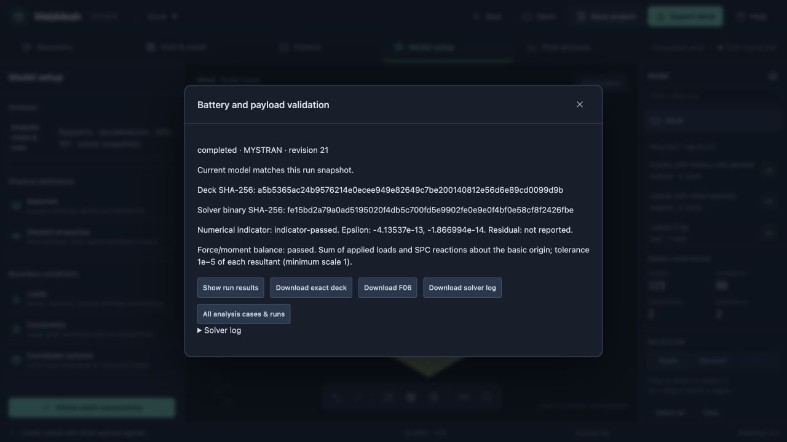
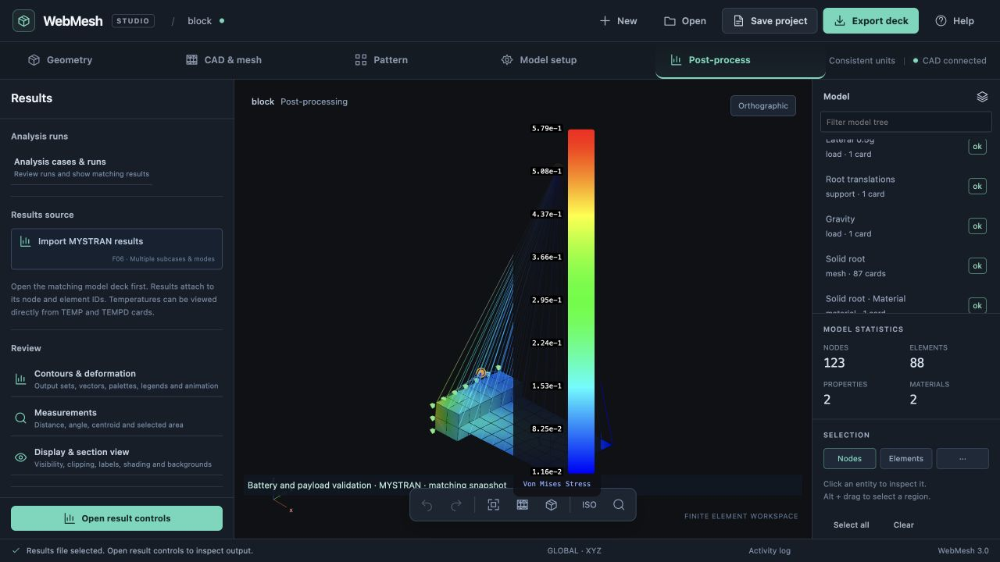

# Implementation 09: analysis cases and run snapshots

23 October 2026 · branch `codex/project-core-foundation`

## Goal and plan

Complete a linear-static workflow from reviewed supports and accelerations through named cases, an immutable solver input, execution and matching postprocessing. Guides compose the same public actions exposed to the analyst.

1. Add owned support and acceleration sets through the existing transaction/ownership layer; reference existing load and support sets in editable SOL 101 cases. Resolve named points/regions explicitly and block dangling selections.
2. Project case control and explicit solver compatibility options into a detached deck. Record exact input, SHA-256, units, case labels, model digest and solver identity. Preserve hand cards and fail unsupported projections clearly.
3. Add a local solver job service with configured executable discovery, isolated folders, bounded execution, status/cancel and retained result retrieval. Distinguish process completion from numerical diagnostics.
4. Bind F06 results to the run snapshot; show case labels and current/stale provenance. Disable results on an edited model; permit returning to the captured model explicitly. Save/reopen runs and results with integrity checks.
5. Manually author and solve the battery/payload fixture in the browser. Check independent reaction balance, edit/undo, save/reopen, invalid references, failed/cancelled jobs and no stale result reuse. Keep external solver bug investigations local and ignored.

## Boundaries

First slice: SOL 101, basic-frame acceleration and SPC1 authoring, existing nodal load/support sets, MYSTRAN and Vibestran executable profiles. Local frames, dynamic analyses, remote execution and generalized selector repair remain later work. Numerical diagnostics are reported separately from an engineering acceptance or convergence claim.

## Validation

Implemented on the same branch. `analysis-actions.js` exposes support and acceleration generators; `analysis-project.js` owns their sets and named cases. The engine retains GRAV cards across source/free/small/large export, including multiple cards sharing one SID, and preserves their order on save/reopen. Named regions re-resolve through compatible remeshing; explicit selections require repair if their node identities disappear. Motor shaft points can be supported without constraining RBE-dependent mounting nodes.

`analysis-runs.js` provides explicit compatibility projections, digests and diagnostics. `analysis-session.js` retains detached input snapshots and results outside model undo history. The local `solver_service.py` launches configured MYSTRAN/Vibestran executables in bounded, isolated jobs. The UI exposes exact input review, status, cancel, downloads and matching postprocessing. Manual F06 imports carry an unverified label.

The browser-authored battery/payload fixture solved two cases in MYSTRAN. Epsilon estimates were −4.13537e−13 and −1.866994e−14. Product OLOAD/SPC resultant checks passed, and independent mass integration verified all six reaction components to 0.02 N or N mm. Named case selection, stress contours/deformation, saved-run reopening, edited-model staleness, undo and returning to the captured model were exercised. Evidence and reproduction: [validation/analysis-runs](validation/analysis-runs/README.md).

Automated validation covers ownership, history, all writer formats, saved input/result integrity, concurrent edits, missing subcases, motor-shaft references, remeshed named regions, process isolation, current executable hashes, cancellation, time/output limits, failed jobs and HTTP origin checks. Final isolated intended-commit verification: **441 JavaScript tests passed**, **44 server tests passed**, and **5 solver-service tests passed**, with no failures or skips. The independent retained-result balance script, JavaScript syntax checks and source whitespace checks also passed. Exact F06/log evidence retains the solver’s original whitespace. Unrelated viewport edits were excluded from this checkout.

## Remaining limits and next milestone

This slice provides a complete local static workflow. Its browser solve uses the mixed-mesh battery/payload fixture; motor-shaft supports are exercised with the existing two-motor attachment fixture in integration tests. Full rover assembly validation remains a separate acceptance exercise.

Balance checking currently requires basic-coordinate GRID positions/displacements and printed OLOAD/SPCFORCES tables. Results remain conservative about matching: a model/ownership change requires undo or opening the captured snapshot. In-progress jobs belong to a live server session; completed archived runs remain readable after it stops. The run snapshot captures the analysis model and source definitions, not the temporary interactive CAD-session history.

Next: **selection repair and local frames**. Preserve the generic action architecture:

1. Make named regions and explicit point/element selections inspectable, highlight their current resolution and show invalidation reasons before remeshing.
2. Let an analyst replace a failed selection in a reviewed transaction that regenerates dependent interfaces, attachments, masses and supports; preserve identities where roles still match and show every changed card.
3. Add reusable rectangular frame actions for attachment stiffness, force/acceleration and support directions, with explicit transformation and export checks.
4. Validate the combined motor/battery/payload assembly through remesh, repair, solve and saved result comparison. Improve the result panel/legend layout so the visible subcase and model remain readable without a modal covering the viewport.
