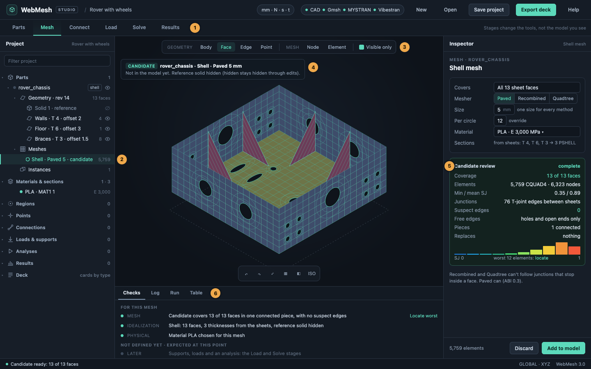
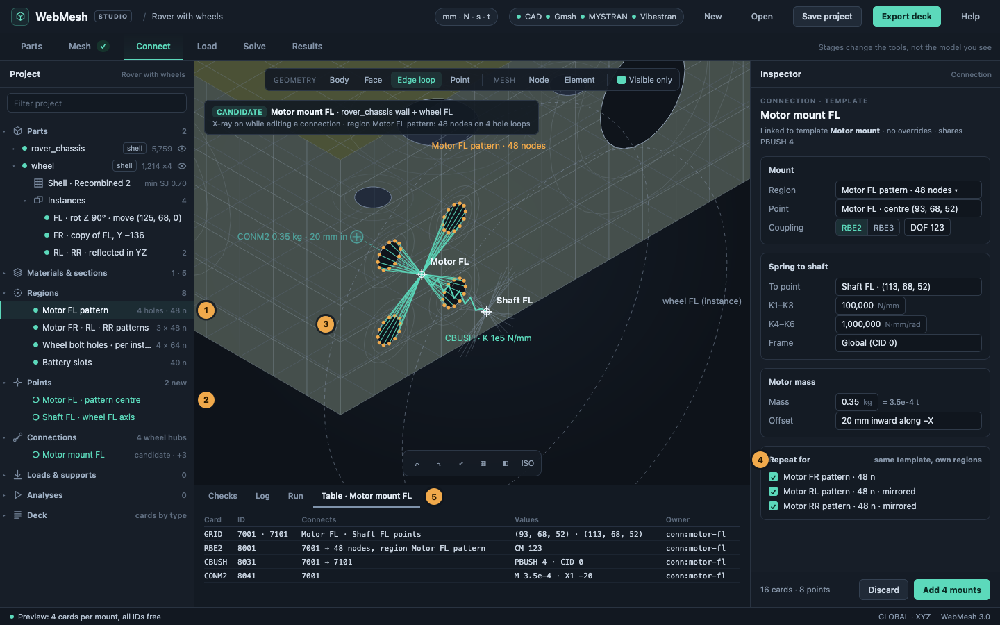
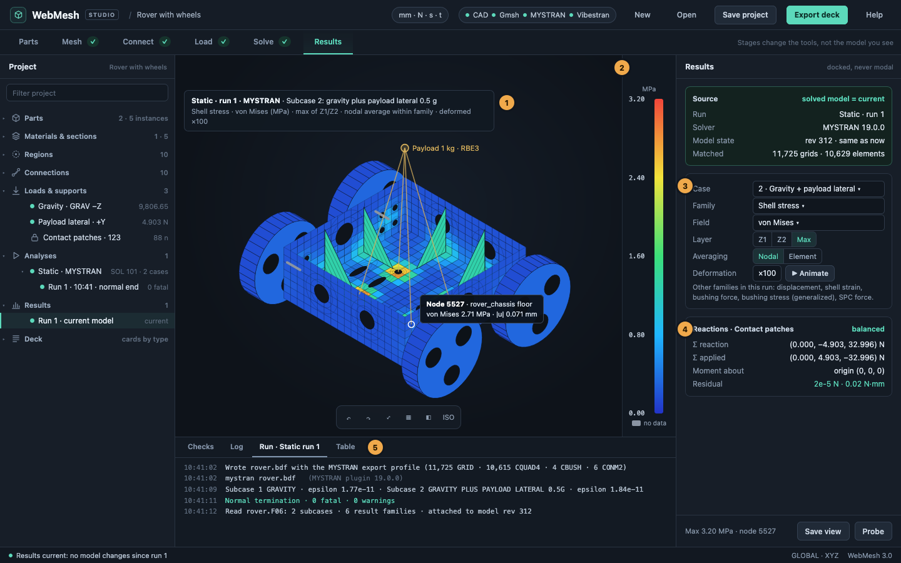
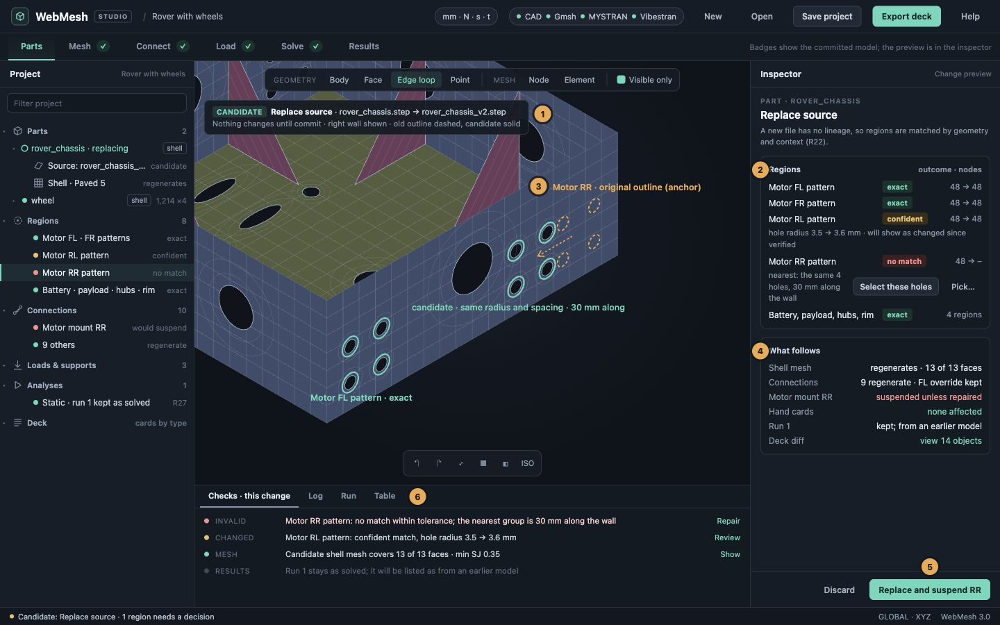

# Design: a project workspace built around the analysis model

*Design revised after both reviews, 22 October 2026. Milestones 1–17 now implement the project core, owned authoring, assembly/analysis workflow, tree/visibility/docked inspectors, reviewed CAD replacement and object deletion. Remaining work is listed in the implementation notes below.*

This document describes what the analyst sees. How the model behaves when it changes is defined in [model-rules.md](model-rules.md): ownership, change propagation, overrides, region matching, runs and recovery. Rule numbers such as R8 refer to that document. Where the two disagree, the rules win.

## Why

An independent review on 22 October 2026 found two things. Analysts can complete real models in WebMesh. But the interface makes them fight it to do so. The reviewer built a rover chassis with four wheels, motors, masses and two load cases, and solved it in MYSTRAN. That worked, but with several workarounds:
- exporting decks to recover hole-boundary node IDs;
- using Replace (meant to swap the CAD file) as an undocumented way to assemble parts;
- typing the same ID lists into card forms over and over;
- adding the solution controls and gravity with a script.

The review traces most of this to one cause. The interface is organized around tools (Geometry, CAD & mesh, Pattern, Model setup, Post-process). An analysis is organized around objects: parts, their idealization, meshes, connections, loads, analyses and results. WebMesh already tracks some of these objects internally, but it doesn't show them, save them or let you edit them.

This document proposes making those objects the backbone of the interface, without rewriting the engine. The review's report and screenshots are in the untracked folder `docs/ui-ux-review-2026-10-22/` in the main checkout. The findings it numbers F01–F19 are referred to here by number. The mockups are in [project-workspace-mockups.html](project-workspace-mockups.html).

## Goals

**Primary architectural goal — guidance composes analyst-accessible actions.** Automatic and guided routines throughout WebMesh must compose the same actions available directly to the analyst. Selection, generation, connectivity changes and analysis participation share validation, review, ownership and history contracts. A guide may choose inputs and sequence actions, but may not monopolize a modeling capability. Its composition must be inspectable and the analyst must be able to continue manually. Apply this to new workflows now and migrate older workflows incrementally; do not claim older routines already comply. See [implementation 07](implementation-07-mesh-actions.md).

1. **Every object is visible.** A project tree lists each object with its state: parts, meshes, materials and sections, regions, connections, loads and supports, analyses and results.
2. **Every object owns its references.** A mesh knows which faces it covers. A region knows which hole loops it is. A result knows which solved model it belongs to. When something upstream changes, its dependents are re-evaluated within the same previewed change, or held for a decision with a stated reason. Nothing is silently kept, and nothing is silently dropped. (F01, F07, F18)
3. **One way to make things:** pick, see a candidate, review it, commit. This holds for meshes, regions, connections, instances and patterns. The review shows what the candidate covers, what it replaces and what is wrong with it. (F06, F17)
4. **No hex bias.** You choose how each part is idealized: solid, shell or mixed. Advice and checks follow that choice. (F13)
5. **Run solvers from WebMesh,** as plugins, the way Gmsh is today. Results attach to the exact model state that was solved. (F10, F15)
6. **The project file saves everything you can edit,** and says plainly what it doesn't. (F18)

**Non-goals:**
- Rewriting `editor-engine.js`.
- Replacing Nastran cards as the source of truth for what gets solved.
- Multi-user editing.
- CAD sketching or feature modelling.

## Where we are

- **Layout:** a top bar, a row of tool tabs, a tool panel on the left, the viewport, and a "Model" browser on the right. The browser lists card types with counts. Most setup and results tools open modal dialogs over the viewport.
- **CAD:** a page has one active CAD source. Its server session keeps every revision, with undo and redo. Sheets (free faces standing for thin walls) are recorded with their thickness and offset.
- **Meshes:** a CAD mesh enters the model tagged with its owner (`cadId#meshId`). A new mesh replaces only the meshes covering the same bodies. This is the seed of the ownership this design needs.
- **Everything else is plain cards:** connections, masses, loads, supports and case control. There are no named sets, and the model has no notion of parts or instances.
- **Saving:** a project holds the deck, the current CAD file and a five-line text history.

## The object model

```
Project            units (mm·N·s·t by default)
├─ Parts           each: source, geometry (CAD revisions, sheets), idealization, meshes, instances
├─ Materials & sections
├─ Regions         named sets defined by a rule (hole loops, faces, IDs) and resolved to nodes/elements
├─ Points          named reference points (motor centres, payload COM)
├─ Connections     RBE2, RBE3, CBUSH, CONM2, bolts: built from regions and points
├─ Loads & supports   load sets, support sets, combinations
├─ Analyses        solver plugin, solution, subcases, outputs, runs
├─ Results         from a run or an imported file, tied to a model state
└─ Deck            every card by type: today's Model browser, for card-level work
```

### Parts

A **part** has three things:
- **a source:** a CAD file, an opened deck, or a primitive built in WebMesh;
- **its geometry:** for CAD, its server session with all its revisions, plus its sheets;
- **an idealization:** solid, shell or mixed.

In a mixed part, each body has a role:
- *mesh as solid*;
- *reference only*, as when walls are replaced by sheets and the solid stays as a hidden reference;
- *ignore*.

A deck opened from a file becomes a part whose mesh is "imported", so starting from an existing mesh is a normal path.

A part has **meshes**. Each mesh records:
- its method and settings;
- what it covers: bodies or faces, by geometric signature;
- its sections;
- its coverage: meshed, failed, and skipped with the reason;
- its quality, and its status (R18).

Shell–solid interfaces need two explicit formulations. A distributed RBE3 tie connects nonmatching meshes; an embedded conforming strip extends shells one or two element rows into the solid and shares GRID IDs. The latter deliberately adds shell material inside the solid, requires compatible connectivity/order, and coordinates remeshing of both sides locally. Its overlap must be declared and reviewed, rather than treated as accidental duplicate coverage. Implementation 06 provides the RBE3 option; Implementation 07 provides the embedded option through the same public mesh actions available to the analyst.

A part has one or more **instances**: placements with a transform, reflections included. The first instance is the part where it was modelled. Instances are live. Each gets its own nodes and elements in the deck, regenerated when the part's mesh changes. This replaces today's practice of copying a mesh with Pattern and then losing track of where the copies came from. (F08)

**Part actions:**
- *Add part*.
- *Replace source*: a new CAD file for this part. Its effects are previewed before anything changes. Regions are matched again by lineage and geometry, and any that can't be matched are shown for a decision (R21–R22). Mockup D shows this.
- *Isolate part*.
- *Add instance*.

Live instances, and the undo that spans CAD and FE, are significant pieces of engineering in their own right. Each has its own acceptance tests: S2, S7 and S9 in the rules.

### Materials and sections

There is one list of materials and one of sections (PSHELL, PSOLID, PBUSH, and so on).
- A sheet's thickness and offset become a section, as they do today.
- Every mesh gets a material you choose; nothing defaults silently to steel. The first mesh asks which material to use, and later meshes reuse the last choice. (F09)
- The Materials node lists what exists. Creating a material is one action among several.

### Regions and points

A **region** is a named set with a *scope*, a *rule*, an *anchor* and a *resolution* (R21):
- **Scope:** a part, or particular instances of it.
- **Rule:** what you picked, kept in CAD terms where possible. Examples: "the edge loops of these four holes", "these faces", "this box, visible entities only", or explicit IDs.
- **Anchor:** the evidence for finding that geometry again.
- **Resolution:** the node or element IDs on each instance, recomputed when the mesh changes.

Whether a region still means the same geometry is decided by matching its anchor (lineage first, then geometry and context), never by its node count. A refined mesh can legitimately turn 48 nodes into 80, and four wrong holes can still give 48. Ambiguous, missing and non-rule-preserving split/merge matches require a decision (R22–R26). Explicit-ID regions are suspended when remeshing loses entity identity, even if numeric IDs are reused; a general acknowledgement cannot repair them.

Region tools:
- pick a hole loop;
- *all holes in this pattern*;
- *connected faces*;
- a visible-only box or brush;
- explicit IDs in the one ID grammar (see Selection).

Every region shows its membership and count before it's used. (F12)

Resolving CAD-based rules needs each mesh to say which CAD entity every node lies on. The shell mesher already meshes edges first and shares each edge's nodes. Returning that classification (node → vertex, edge or face, by signature) with the mesh is a small change in `cad_shell.py` and the hex mapper. Making reattachment trustworthy is the large part. It is treated as a major feature, with its own corpus of geometry-edit test cases (piece 4 in the rules).

A **point** is a named location: a region's centroid plus an offset, a picked node, or typed coordinates. Points become the reference GRIDs of connections. You never create reference grids by hand.

### Connections

A **connection** is built from regions and points, previewed, then committed. Its cards carry its owner tag, so they can be regenerated or removed together. The kinds are:
- **Rigid:** RBE2 from a region to a point, with dependent DOFs.
- **Interpolation:** RBE3 from a region to a point, with weighting (equal or by area) and DOFs.
- **Spring:** CBUSH and PBUSH between two points. Stiffness is given in a named frame, and the orientation is written once (F05).
- **Mass:** CONM2 at a point, with offset and inertia, usually coupled by an RBE3 to a region.
- **Bolt:** today's simulated-bolt tool, as a template.

**Templates** combine these. For example, a *motor mount* is RBE2 to a point, plus CBUSH to the shaft, plus CONM2 offset 20 mm inward. *Repeat for…* applies a connection to other regions, so the rover's four motors are one definition and three repeats. Expert control stays: every generated card can be opened and inspected.
- **Editing a generated card** asks where the change belongs: the template, an override for this object only, detaching the object from the template, or converting it to plain cards.
- **Overrides** are shown against the template value, with *Keep* and *Revert*.
- **Every regeneration** is previewed as a card diff before it commits.

See R8–R12, and the worked example there of one motor's PBUSH stiffness.

### Loads, supports and analyses

- **Load sets** hold:
  - gravity (GRAV);
  - forces and moments at points or spread over regions;
  - pressure on faces (PLOAD4).
- **Support sets** hold SPCs on regions.
- **Combinations** are LOAD cards.
- **An analysis** names:
  - a solver plugin and a solution (SOL 101 first);
  - subcases, each with a label, a support set, a load and outputs;
  - parameters (AUTOSPC, …).

  Each analysis keeps its **runs**. A run records:
  - the time;
  - the model state it solved;
  - the deck it wrote;
  - the log and diagnostics;
  - the result files.

  (F10)
- **The unit system** is chosen when the project is created or a deck is imported, and is then locked (R31). It is shown in the top bar.
  - Fields display their units: modulus in MPa, density in t/mm³, g in mm/s².
  - Inputs accept other units with an explicit suffix ("0.35 kg") and show the stored value beside them ("= 3.5e-4 t").
  - An imported deck's unit interpretation can be corrected by an explicitly named action, which changes no numbers. Converting values between unit systems is a later feature.
  - A mass and centre-of-gravity summary sits on the Materials and Analyses nodes. (F09)

### Results

A result comes from a run, or from an imported F06 that is checked against the model. It records:
- the model state it matches;
- its cases;
- its fields, by element family.

Results are always drawn on their run's own solved model, which the run keeps as the exact deck it solved:
- A run from an earlier model opens in a read-only **run view**. The current model never shows a stale run's results.
- An F06 imported without its deck is marked **unverified**, even when its IDs and counts agree.
- Anything without data for the chosen field is drawn grey.

See R27–R30. (F01, F04, F15)

### Status and dependencies

Objects depend on each other:
- part geometry → meshes → regions → connections, loads and supports → analyses → results;
- materials and sections → meshes.

Every object has one of five statuses, each with a one-line reason (R18):
- *not defined yet*: expected unfinished work, and neutral;
- *ok*;
- *changed since verified*;
- *unverified*;
- *invalid*.

A change re-evaluates downstream objects or suspends them. It never silently deletes them (R16–R17). Suspended objects block both Solve and runnable export. An explicitly acknowledged incomplete-deck export names its omissions; dangling hand cards cannot be suspended (R5). Statuses are computed from the dependency graph, never stored as flags that can drift (R20).

The **Checks** dock puts what matters for the current action first. Only *invalid* blocks. *Not defined yet* items, such as no supports while you are still meshing, never appear as warnings outside the stage that defines them (R19). The checks are grouped by the review's five gates:
- idealization;
- mesh;
- physical model;
- analysis;
- results.

Each line links to its object. This replaces the "N to fix" chip, which measures only hex mappability. (F11, F13)

### Model state

The engine gets a revision counter, which every committed transaction increments, plus a hash of the card stream, computed at save and at each run. Runs store both, their unit interpretation, and a separate hash of the exact solver-input deck (R27). A candidate captures its base revision and cannot overwrite a newer edit (R15). That is how WebMesh decides whether a run belongs to the current model, including after a project is reopened.

## Layout

The mockups show four moments from the rover. A, B and C follow the walkthrough below, and D shows a recovery. The PNGs are rendered from [project-workspace-mockups.html](project-workspace-mockups.html), which also carries notes for each numbered callout.



*A: Mesh stage. The chassis's shell candidate, with its coverage, quality, junctions and what it replaces, beside the commit button.*



*B: Connect stage. A motor-mount template on a region of 4 hole loops, previewed in place, with Repeat for the other three motors.*



*C: Results stage. Shell von Mises from a MYSTRAN run, with bushings grey for no data, a caption, a docked legend, and reaction balance.*



*D: Replace source with a chassis whose rear-right motor holes moved. The preview shows each region's match outcome. The old outline of the lost pattern is drawn beside the suggested candidate, and the mount that would be suspended is named. This is scenario S3 in the rules.*

The desktop layout, from 1280 px wide:

- **Top bar:** project name, unit system chip, plugin chip (CAD, Gmsh, MYSTRAN, Vibestran: what's available), New, Open, Save, Export, Help.
- **Stage bar:** *Parts · Mesh · Connect · Load · Solve · Results*. This replaces the tool tabs. Stages are optional navigation, not a wizard, and the whole model stays reachable from any of them.
- **What a stage changes:** only the tool palette. The tree, the viewport and what's visible stay the same, so switching stage never hides the model.
- **Selection and tools survive a switch.** The active selection and any running tool are kept. If a tool needs a different selection filter, it changes the filter visibly and says so, never silently.
- **Badges:** each stage shows a count of what is *invalid* or *changed since verified* there. Unfinished work isn't counted.
- **Left dock: the project tree,** resizable from 240 to 480 px. Each node has an eye toggle, a status mark and a count. Its context menu offers Isolate, Edit, Rename, Delete and Repeat.
- **Viewport:**
  - a caption at top left saying what's shown: active part or instance, or the result's run, case, field and scale;
  - a selection filter bar along the top;
  - the legend docked against the right edge, never over the model.
- **Right dock: the inspector,** resizable from 300 to 480 px. It shows the selected object, or the tool you're running, which is just the edit state of an object. It never blocks picking in the viewport. Card editors open here, not in dialogs. (F16)
- **Bottom dock, collapsible:** *Checks · Log · Run · Table*. Table shows the selection's or region's entities as rows.

**Below 1000 px wide:** the tree and inspector become overlays opened from a slim rail. The viewport keeps the full width.

## Interaction patterns

**Candidate, review, commit.** Every generator works the same way:
1. Its tool runs in the inspector.
2. The candidate is drawn in a distinct style in the viewport.
3. The review lists:
   - what it creates;
   - what it replaces;
   - coverage ("12 of 13 faces"; failed faces drawn red);
   - quality, with the worst elements locatable.
4. **Discard** leaves the model unchanged; **Add**/**Replace** commits it if its base revision is still current. Otherwise recompute and review again.

Shell meshing joins hex meshing in this pattern. Today it commits at once. (F06, F17)

**One size.**
- Each mesh has one Size. A method's own parameters, such as Gmsh's size factor or per-circle counts, are labelled as overrides.
- Size controls on edges and faces belong to the part's geometry. They survive revisions by geometric match, as edge sizes already do.

**Selection.**
- The filter bar reads *Geometry: body · face · edge · point* and *Mesh: node · element*, with a *visible only* toggle.
- Shift adds to the selection; box and polygon selection stay as they are.
- One ID grammar works everywhere: `1 2 5-9 10 THRU 20 BY 2`. The resulting count shows before anything is applied, and unknown words are refused visibly.
- *Save as region* turns any selection into a region.
- Any tool that uses a selection shows the selection's count and validity next to its button. (F12)

**Visibility.**
- What's hidden stays hidden through operations. Hidden state follows an entity's lineage, matched by geometry, as sheets already are.
- *Isolate* works on any object. The *working set* dims everything except what the current tool edits.
- Whatever an operation creates is highlighted briefly. (F14)

**Undo.** One history of transactions, labelled by object ("Wheel · instance 3 · move").
- A part's CAD revision steps take part in it, so Undo in the Mesh stage and Undo in the Connect stage are the same Undo (R33).
- Cancelling or failing never creates a history entry, and always leaves the last committed model (R34).

## Walkthrough: the review's rover, under this design

1. **Parts.**
   1. *Add part* → `rover_chassis.step`. Idealization: Shell. The solid becomes *reference only* and hides.
   2. Surface tools make nine offset sheets: walls T 4 offset 2, floor T 6 offset 3, braces T 3 offset 1.5.
   3. Extend the braces, Join, and remove the strips. The solid stays hidden through every step.
2. **Mesh.** On the chassis: Shell, Paved, size 5, 12 per circle. The candidate shows 13 of 13 faces, 5,759 CQUAD4, minimum SJ 0.35, and junctions classified as intentional T-joints. Choose PLA (E 3,000, ν 0.35, ρ 1.24e-9) and *Add*.
3. **Wheel.**
   1. *Add part* → `wheel.step`, shell, with web and rim sheets. The Paved candidate's minimum SJ is 0.07.
   2. Switch to Recombined: minimum SJ 0.70. Add.
   3. *Add instance* ×3, typing or picking each transform, with two reflections. The tree shows the wheel with four instances, all from one mesh.
4. **Connect.**
   1. Region *Motor FL pattern*: pick one mounting hole, then *all holes in this pattern* (4 loops, 48 nodes).
   2. Template *motor mount*:
      - RBE2 (123) to point *Motor FL* at the pattern centre;
      - CBUSH (K 1e5 N/mm, 1e6 N·mm/rad, global frame) to point *Shaft FL*;
      - *Shaft FL* gets an RBE2 to region *Wheel FL bolt holes* (64 nodes) on wheel instance 1;
      - CONM2 0.35 kg, 20 mm inward.
   3. Preview lists 4 cards. Commit, then *Repeat for* the other three patterns.
   4. Battery: region *Battery slots* (40 nodes) and a mass connection of 0.5 kg at 15 mm above, through RBE3. Payload the same way: 1 kg, 200 mm up, on 48 nodes.
5. **Load.**
   - Load set *Gravity*: GRAV 9,806.65 mm/s² in −Z.
   - Load set *Payload lateral*: 4.903 N in +Y at point *Payload*.
   - Combination *Gravity + lateral*.
   - Support set *Contact patches*: region *Rim contact* (box below Z 23.6, visible only, 88 nodes), DOFs 123.
6. **Solve.** Analysis *Static*: MYSTRAN, SOL 101.
   - Subcase 1 *Gravity*; subcase 2 *Gravity plus payload lateral 0.5 g*.
   - Outputs: displacement, SPC forces, stress and force.
   - The Run tab streams the log. Diagnostics link to element IDs. The result attaches to the run.
7. **Results.**
   - The results dock offers case 2 and *Shell stress → von Mises*, Z1/Z2/max layer and averaging. Its maximum is 3.20 MPa. The 4 CBUSH show grey: no data for that field.
   - *Bushing force → FZ* is its own family.
   - The reactions panel shows ΣF = (0, −4.903, 32.996) N and the moment about the origin. The caption reads *Static · run 1 · MYSTRAN · subcase 2 · von Mises (MPa) · ×100*.
8. **Save, reopen, New.**
   - Save and reopen. Everything above is still editable. The run's F06 is re-attached by path and hash, or embedded if you chose that.
   - New, then plate: nothing from the rover remains.

This is the path where everything succeeds. The recovery paths get the same care in the rules' acceptance scenarios (S2–S9):
- remeshing a wheel;
- replacing the chassis geometry and repairing one region;
- editing a generated card and keeping the edit through save, reopen and regeneration;
- changing the model after a solve;
- cancelling and failing;
- undoing across CAD and FE;
- reflection.

## Project file, version 2

The file stays JSON. A sketch:

```json
{
  "format": "webmesh-project", "version": 2,
  "units": { "length": "mm", "force": "N", "time": "s", "mass": "t" },
  "deck": "…all cards, as exported today: the authority for solver data…",
  "parts": [{
    "id": "p1", "name": "rover_chassis",
    "source": { "kind": "cad", "file": "rover_chassis.step", "sha256": "…", "content": "base64…" },
    "geometry": { "brep": "base64 of the current revision", "sheets": [ { "signature": "…", "thickness": 4, "offset": 2 } ],
                  "history": ["Surface: offset, 4 faces", "…"], "idealization": "shell",
                  "bodies": [ { "signature": "…", "role": "reference" } ] },
    "meshes": [{ "id": "m1", "method": "shell", "settings": { "mesher": "paved", "size": 5, "perCircle": 12 },
                 "covers": { "faces": ["signature…"] }, "material": "mat-pla", "owner": "p1/m1",
                 "coverage": { "meshed": 13, "failed": 0 } }],
    "instances": [{ "id": "i1", "transform": [1,0,0,0, 0,1,0,0, 0,0,1,0, 0,0,0,1] }]
  }],
  "materials": [ { "id": "mat-pla", "card": 1, "name": "PLA" } ],
  "regions": [ { "id": "r1", "name": "Motor FL pattern", "part": "p1",
                 "rule": { "kind": "edge-loops", "edges": ["signature…"] }, "count": 48 } ],
  "points": [], "connections": [], "loadSets": [], "supportSets": [],
  "analyses": [ { "id": "a1", "name": "Static", "solver": "mystran", "sol": 101, "subcases": [],
                  "runs": [ { "id": "run1", "revision": 312, "modelHash": "…", "deck": "gzip+base64 of the exact deck solved",
                              "solver": { "plugin": "mystran", "version": "19.0.0" }, "profile": "mystran", "status": "normal",
                              "solverDeckHash": "…", "units": { "length": "mm", "force": "N", "time": "s", "mass": "t" },
                              "result": { "file": "rover.F06", "sha256": "…" } } ] } ],
  "view": { "result": { "run": "run1", "case": 2, "field": "shell.vonMises", "scale": 100 } }
}
```

- **Cards and definitions.** The deck is what gets solved. Inside WebMesh it always equals what the definitions, their overrides and the hand cards produce (R6–R7).
  - Overrides are saved on their objects, never on card IDs (R9).
  - A card nobody owns is still saved, and stays editable as a card.
- **Runs** keep the exact deck they solved, compressed, along with units at launch, the solver version and export profile (R27).
- **CAD:** new saves retain a portable checkpoint of every retained preparation state, the undo cursor and redo branch, sheets and topology/display metadata. Reopening reuses an exact unchanged session for that workspace/part, or stages a separate session. Failed restores remove only their unadopted candidates and preserve the current draft and histories.
  - Older projects retain their current prepared BREP and audit labels. Missing historical geometry cannot be reconstructed from text.
  - Committed server sessions are never silently expired; save the project before stopping its server. Portable history limits fail explicitly without truncating the live history (milestone 15).
- **References to geometry** use scoped anchors, context and rule-preserving lineage (R21–R22), never entity numbers alone. Signatures are matching evidence, not unique identities. Splits, merges and duplicate signatures have explicit outcomes.
- **Result files** are referenced by name, size and hash, and re-attached on open. *Include result files* embeds them; they can be large (17 MB for the rover).
- **Version 1 projects** still open. Their deck becomes one "imported" part, and their CAD becomes that part's source.

## Plugins: solvers alongside Gmsh

Today the server knows one plugin, Gmsh, through `cad_gmsh_plugin.py`, and the UI knows only Gmsh's state. This becomes a small registry.

**Registry:**
- Each plugin module provides:
  - `status()`, returning `{id, kind, available, version, features, install}`, where kind is mesher, solver or importer;
  - the functions its kind needs.
- `/api/health` lists every plugin, and the top bar's plugin chip shows them.
- The first solver plugins are **MYSTRAN** and **Vibestran**. Each executable is found from a flag (`--solver mystran=PATH`), an environment variable or `PATH`, the way `--gmsh` works.

**Solver plugin contract:**
- **Export profile.** The writer options that solver needs. MYSTRAN, for example:
  - free fields of at most 16 characters;
  - SPC1 lists without mixed THRU;
  - no blank continuation lines;
  - one CBUSH orientation.

  The analysis's solver picks the profile. Plain *Export deck* asks for one: Generic Nastran, MYSTRAN, and so on. (F05)
- **Run.**
  - `POST /api/solve` with the deck and options returns a job ID.
  - `/api/solve/status` returns the state and the log tail.
  - `/api/solve/cancel` stops the job.
  - `/api/solve/result` returns the F06 and any other outputs.
- **Process.** Each job runs in its own process, in a folder in the server's temporary space, like CAD tasks. It has a generous time limit and can be cancelled. The folder is removed once results are fetched, or when the server stops.
- **Diagnostics.** Fatal errors and warnings are parsed from the F06 and log into lines that link to card and element IDs.
- **Results** are read by the existing F06 reader in the browser and attached to the run's model state.

Gmsh moves into the same registry as a mesher plugin, with no change to what it does.

## How today's code maps onto this

- **`app/project.js` (new, pure, UMD, tested in Node).** The object model, statuses and dependencies, region rules and resolution, and saving and loading version 2. It talks to the engine through `WebMeshAPI` and to the CAD workspace per part.
- **`app/workbench.js`** becomes the layout shell: stage bar, tree, inspector, docks. Each object kind gets a small panel module (part, region, connection, analysis, results), exposed on `window` like today's workspaces.
- **`app/cad-workspace.js`** becomes the Mesh-stage tool for the selected part. Its state is keyed by part. `meshesBySession` already keeps meshes per session within a page. Prepare, Size and Mesh stay as its steps.
- **`app/editor-engine.js`** keeps its role. Changes:
  - owner tags are extended to every generated card;
  - a revision counter and change event are added;
  - result display controls are exposed through the API, so the results dock can drive them;
  - the card editor renders into a container instead of a modal.
- **`app/bolt-workspace.js`** becomes a connection template.
- **Pattern** splits in two. Copies of a part become instances. "Copy selected elements" stays as a mesh tool.
- **The right-hand Model browser** becomes the tree's *Deck* node.
- **Server:**
  - a plugin registry and the `/api/solve` endpoints;
  - mesh results carry node-to-CAD classification;
  - the CAD import action accepts sheet records with a BREP, for reopening projects.

## Delivery

The first version of this document delivered the layout first and the statuses last. That order is replaced by section 8 of the rules.

**The first user-facing deliverable is one narrow, complete workflow.** It includes:
- the chassis, plus a wheel repeated as instances;
- a named mounting region and one attachment;
- a gravity analysis, run in MYSTRAN, with its results;
- saving and reopening;
- then a remesh that exercises the dependencies.

**What it is built on.** Ownership, change propagation, statuses and transactions are present from its first piece. [Implementation 01](implementation-01-project-core.md) builds the isolated core; it does not enable the redesigned UI. The UI is the minimum needed inside today's shell.

**The rest of the layout follows the slice:** the docks, card editors out of modals, and the remaining stages.

**Fixes required before enabling the slice.** The integrity fixes in Phase 1 of the plan don't depend on any of this and land before the slice:
- F04: result semantics;
- F05: export;
- F07: references;
- F06: coverage.

**Fixes that can land at any time.** Phase 3's small items: the ID grammar, visibility, wording and Help.

## Settled after review

1. **Stage bar.** Kept, as optional navigation. Selection and the running tool survive a switch.
2. **Instances.** Live, sharing one mesh, with explicit tests (S2, S9). Editing one instance's elements offers *apply to the part* or *Make unique* (R36).
3. **Hand edits to generated cards.** Replaced by explicit choices: change the template, override for this object, detach, or convert to plain cards. Every regeneration is previewed as a diff (R8–R12).
4. **Units.** Locked at creation or import, with a named correction for an imported deck's interpretation. Conversion comes later (R31).
5. **Results.** Bound to the run's own solved model. Imports without provenance are unverified (R27–R30).
6. **Statuses and dependencies.** These come first in the work, not last (piece 1 in the rules).

## Open questions

1. **ID allocation.** Each object gets an ID block, which keeps IDs stable (R4). How big should the blocks be, and should export offer compact renumbering? (Rules, question 1.)
2. **Result files.** Reference them by path and hash by default and embed them on request, while run decks are always kept? (Rules, question 4.)
3. **Narrow screens.** How much matters below 1000 px: overlays as proposed, or desktop only for now?

## Implementation progress

The [project core milestone](implementation-01-project-core.md) is implemented. [Engine ownership integration](implementation-02-engine-ownership.md) connects explicit generated cards to guarded transactions, undo/redo, project persistence and the export gate. [Editable plates and their inspector](implementation-03-owned-primitive.md) now provide the first analyst-facing ownership workflow, including exact change review, conversion and project checks. [Mapped CAD ownership](implementation-04-cad-ownership.md) now retains committed source snapshots, explicit solid sections and native HEX8/HEX20 meshes through the same review and inspector. CAD preparation remains a draft until Apply. Shell ownership and mixed idealization are now implemented; legacy Gmsh volume tools still create plain cards. [Named mounting regions and RBE2/CBUSH attachments](implementation-05-mounting-attachments.md) now provide CAD face selection, shared PBUSH templates, stable mount/shaft points and automatic support-node resolution through native remeshing. Changed CAD topology blocks affected regions explicitly. [Mixed shell/solid regions from one CAD source](implementation-06-mixed-mesh.md) is implemented with independent mesh regions, explicit RBE3 shell–solid interfaces and independent remeshing, including portions partitioned from one continuous solid. Embedded conforming shell strips with shared GRIDs are implemented in the mesh-action milestone below.

The [mesh-action milestone](implementation-07-mesh-actions.md) implements direct node/element authoring, shell-to-solid extrusion, reversible analysis exclusion and a guided shared-node embedded interface composed from those same actions. Existing CAD and RBE3 generators remain available; migration of older automatic routines is incremental.

The [payload/mass milestone](implementation-08-payload-masses.md) adds editable analysis points, CONM2 masses and weighted RBE3 distributions, plus a payload guide composed from those actions. Named mounting regions now cover shell faces and boundary edges as well as solid faces, including shared embedded-interface nodes. Compatible independent remeshing updates supports while preserving COM and card identities. Browser-authored battery/payload fixtures pass gravity and lateral equilibrium checks in MYSTRAN. The [analysis-case and run milestone](implementation-09-analysis-runs.md) now adds reviewed support/acceleration actions, named SOL 101 cases, configured local solver execution and immutable input/result snapshots. Saved runs retain model matching and named postprocessing. The [selection repair and reusable-frame milestone](implementation-10-selection-frames.md) now stages explicit replacements against a proposed remesh, regenerates dependent objects in one review, and adds shared CORD2R directions for CBUSH, FORCE/GRAV and GRID support DOFs. Local output vectors are transformed for postprocessing and equilibrium checks. Browser repair/solve/reopen and a combined motor/battery/payload regression are validated. The [graphical selection and mesh-region milestone](implementation-11-graphical-regions.md) now provides detached proposed-mesh picking, named node/element regions, graphical replacement and shared consumers. Browser remesh/repair, history and saved-run reopening are validated. Reversible connectivity replay and frame construction from geometry remain open. Independent parts/live mesh instances are implemented in milestone 12; full rover connection/solve acceptance is delivered in milestone 13.

[Independent parts and live instances](implementation-12-parts-instances.md) now provides per-part CAD drafts, reviewed live placements/reflections, instance regions, source participation and frozen independent mesh copies. A saved rover/wheel assembly validates source remeshing across four copies. Source replacement and explicit matching are delivered in milestone 16 below; parametric CAD copies and placement interaction remain open. This is not a claim that every original part/instance rule is complete.

[Reusable assembly connections and rover analysis](implementation-13-assembly-connections.md) now provides shared recipes, region-bound repeats, explicit overrides and independent recipes, composed from public authoring actions. The complete chassis/four-wheel assembly passes two MYSTRAN cases, independent connectivity/mass/result checks, browser postprocessing and saved-run reopening. Reference/excluded mesh visibility is an explicit results control, independent of solver participation. External recipe libraries, general automatic mating/contact, broader result probes remain open. The stage/tree/dock redesign is delivered in milestone 14 below.


[Project tree, visibility and docked editing](implementation-14-project-workspace.md) now delivers a searchable hierarchy, per-object display controls, reversible isolation, compact stage palettes, resizable inspectors and linked checks. Visibility preferences survive remeshing and project reopen without changing solver participation or run identity. The full rover wheel-remesh/graphical-contact-repair workflow passes two MYSTRAN cases and reopened postprocessing. The [acceptance evidence](validation/project-workspace/README.md) includes the runnable project, exact deck, results, screenshots and an independent verifier.

[CAD session reuse and transactional restoration](implementation-15-cad-sessions.md) now provides exact per-workspace/part reuse, cleanup after failed or abandoned restores, rollback of the current model/drafts/histories, and portable executable CAD undo/redo. Browser rover reopening and failures, fresh-server redo/undo and continued real-kernel preparation are validated. Committed sessions are retained until explicitly closed; duplicate browser tabs receive independent session ownership. See [acceptance evidence](validation/cad-sessions/README.md).

[CAD source replacement and explicit repair](implementation-16-cad-replacement.md) now preserves part identity and retained CAD drafts, reviews conservative face/edge/solid matches, displays old boundaries against proposed geometry, and commits incomplete revisions with suspended mesh/analysis definitions. Independent remeshing and explicit region/instance/connection reactivation use the existing authoring actions. Source replacement undo/redo and portable historical CAD drafts are covered. See the root [setup.md](../../setup.md) for dependencies, build requirements, service configuration and tests.

[Reviewed deletion and independent dependents](implementation-17-deletion.md) adds tree **Delete…**, a docked dependency review with keep/remove choices, independent mesh/connection promotion, explicit repair of missing inputs, shared-resource protection and CAD-draft preservation for undo. Kept objects remain named, owned and editable. Hand cards are never silently removed or retargeted.

[Selective CAD replacement and named patterns](implementation-18-selective-replacement.md) now retains unchanged solid owners and shell faces within one owner, matches complete named circular-hole groups, and remeshes changed faces against retained boundaries. The moved rear-right pattern scenario preserves FL/FR/RL cards and repairs only RR's connection cards, including its stiffness override. Browser replacement undo/redo, pending-project reopening, native patch meshing and saved-run postprocessing are exercised. A subsequent user-found seam defect is corrected: patch meshing preserves internal CAD edge membership and verifies actual shared element edges. All original seam counts now match, both MYSTRAN static cases pass force/moment balance, and a 12-mode comparison confirms displacement continuity. The initial one-component connectivity claim was insufficient; see [seam regression evidence](validation/seam-connectivity/README.md). See [acceptance evidence](validation/selective-replacement/README.md).

Source-replacement work still open: automatic preparation replay, arbitrary-plane/rotated or split-loop pattern rules, split/merge correspondence, and compatible partial solid remeshing. Current named patterns are complete circular edges translated within a coordinate-aligned mounting plane; moved candidates require explicit acceptance. Other original-plan gaps remain: a unified CAD/FE history, read-only old-run viewing, field-granular recipe inheritance, owned load combinations, broader result fields/probes and a consistent units/material editing workflow.
