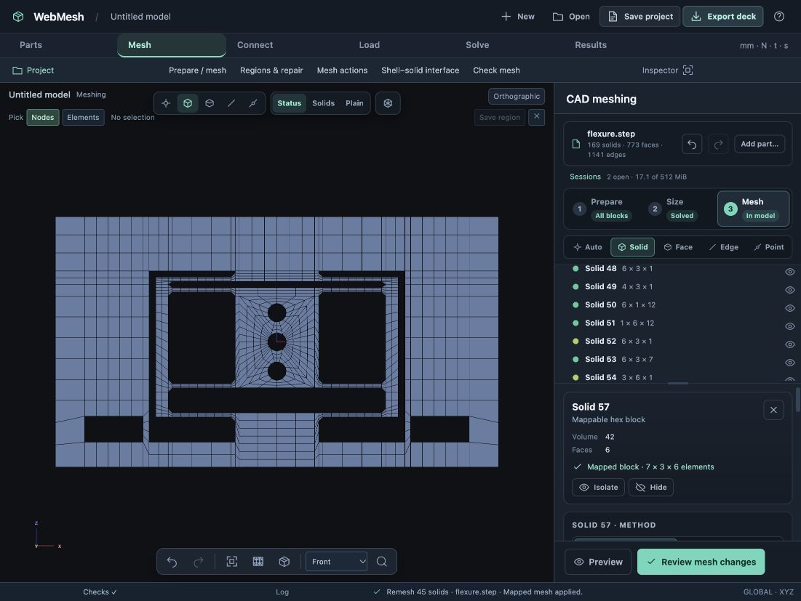
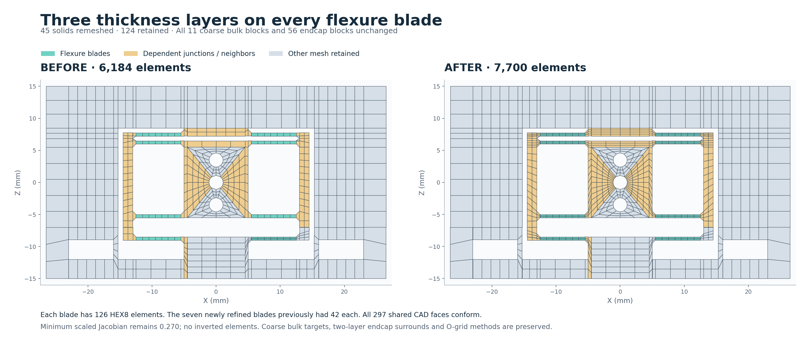
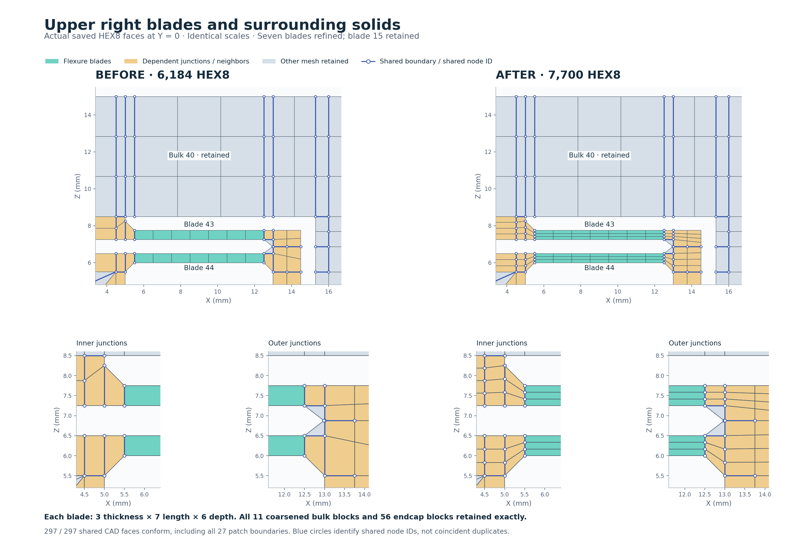
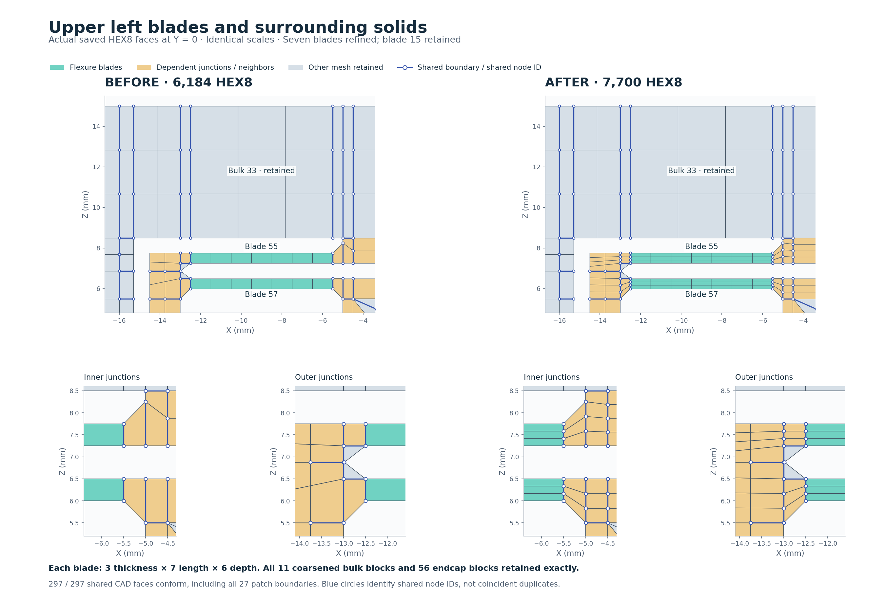
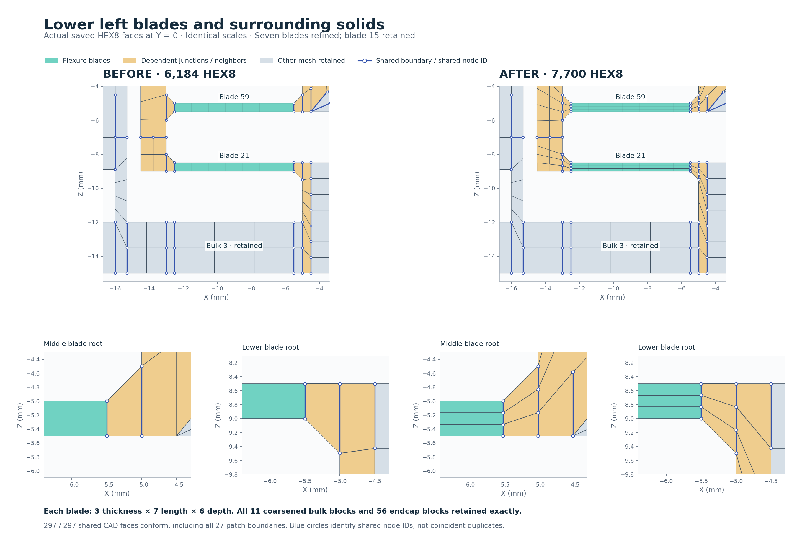
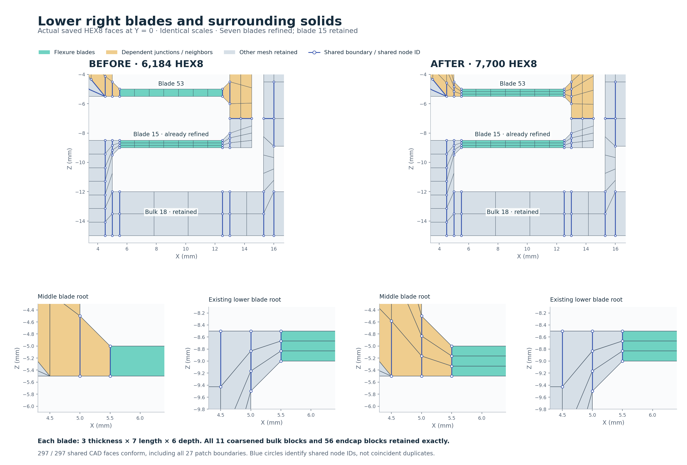

# Three thickness layers on every flexure blade — 25 October 2026

The starting point is the saved coarse-bulk and endcap case, `test-results/flexure-hex/flexure-bulk-coarsened.webmesh` (6,184 HEX8). Blade 15 already has three thickness divisions. This step refines blades **21, 43, 44, 53, 55, 57 and 59** to the same resolution using one local remesh. The final project is **`test-results/flexure-hex/flexure-all-blades.webmesh`** (local ignored output).

Every blade now has **3 elements through its 0.5 mm thickness, 7 along its 7 mm length, and 6 across its 12 mm depth**: 126 HEX8 per blade. Each of the seven newly refined blades previously had 42 elements. Blade 15 is retained exactly.

## Controls and dependent solids

In **Size**, select each blade and choose the **Z · 0.5 mm** directional edge control. Set its count to **3**. The seven new fixed controls are edges **200, 388, 406, 478, 501, 520 and 537**. Some counts propagate before an explicit control is added; blade 57 already reaches three through linked equations, and its count is then fixed explicitly.

Two additional adjustments protect the surrounding mesh:

- Preserve solid 3's existing coarse Z divisions by fixing **edge 19 at 2**. Without this constraint the interval solver redistributes a division away from that bulk block.
- Apply a **1 mm local size to narrow transition strips 50 and 51**. Their resulting 12 height divisions support the refined roots and keep the minimum scaled Jacobian at 0.270. The initial seven-blade sizing trial alone would reduce it to 0.184. That trial was inspected before Apply; only the adjusted patch was applied.

The existing 2.5 mm targets on the eleven coarse bulk blocks stay unchanged, as do the two-layer endcap surrounds and O-grid parameters. Adjacent central-body blocks do remesh where their shared faces require matching divisions; the eleven specifically coarsened bulk blocks and all 56 cylindrical/endcap blocks remain exact.

**Preview affected solids** identifies **45 solids: 16 direct and 29 dependent**. **Review mesh changes → Apply changes** replaces that patch while retaining **124 solids**, **4,508 element cards**, and **6,378 node cards** exactly. There is no full-region regeneration.

## Viewport selection

After the user's request to select in the viewport, all seven newly refined blades were picked directly from a front view in **Solid** mode. The inspector confirmed three thickness divisions for solids 21, 43, 44, 53, 55, 57 and 59. Bulk solids 3 and 33 and transition strip 51 were also selected directly to check their resulting counts. These checks used actual model-view clicks, without selecting tree rows. The earlier sizing inputs had already been authored through the solid list before that request arrived.



## Saved-project verification

| Measurement | Before | After |
| --- | ---: | ---: |
| HEX8 elements | 6,184 | 7,700 |
| Nodes | 8,918 | 10,754 |
| Shared CAD faces conforming | 297 / 297 | 297 / 297 |
| Matching shared quadrilateral faces | 3,392 | 3,904 |
| Connected components | 1 | 1 |
| Minimum scaled Jacobian | 0.269630 | 0.269630 |
| Inverted elements | 0 | 0 |

All **27 patch-to-retained CAD interfaces** have identical quadrilateral node connectivity on both sides. This verifies shared node IDs and element faces, not just coincident coordinates. The prepared CAD topology, all pre-existing size controls, O-grid method assignments, all eleven coarse bulk blocks and solids 106–161 are preserved. The verifier checks every retained element and its node cards exactly.

The new patch's maximum aspect ratio is 12.3. The complete mesh still contains the previous maximum of 125.97 in retained elements. This case checks the meshing workflow, quality and connectivity; it does not establish solution convergence or claim a solver run.

## Matching views with surrounding solids

[Open the comparison viewer](comparison.html) and choose the whole part or any of the four detail views. Each detail includes adjacent solids and enlarged junctions. Blue circles identify shared node IDs. All plots use actual saved element faces at Y = 0, identical before/after scales, and no deformation.











Reproduce the checks and figures from the repository root (Matplotlib is required for plotting):

```sh
node docs/design/validation/all-blade-refinement/verify.cjs > docs/design/validation/all-blade-refinement/verification.json
python3 docs/design/validation/all-blade-refinement/render.py
```

The verifier accepts optional before/after project paths. [verification.json](verification.json) records each interface check, all blade counts and the protected solid IDs.

The final project was reopened through the browser after restarting the server on port 8765. It restored all 7,700 elements and reported no pending mesh changes.
