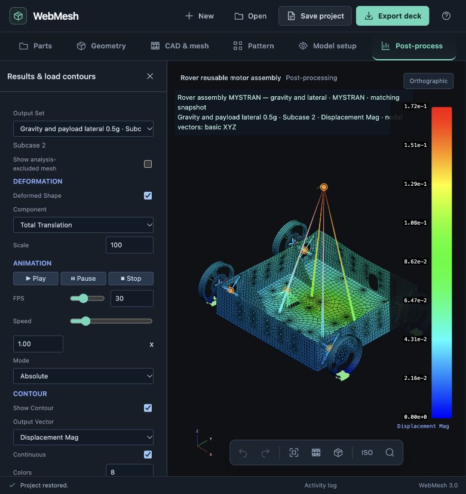
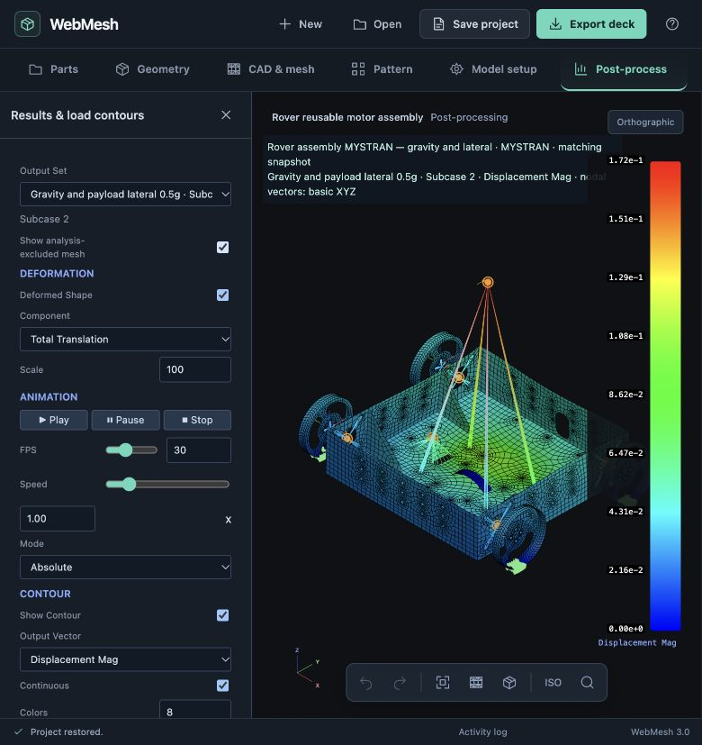
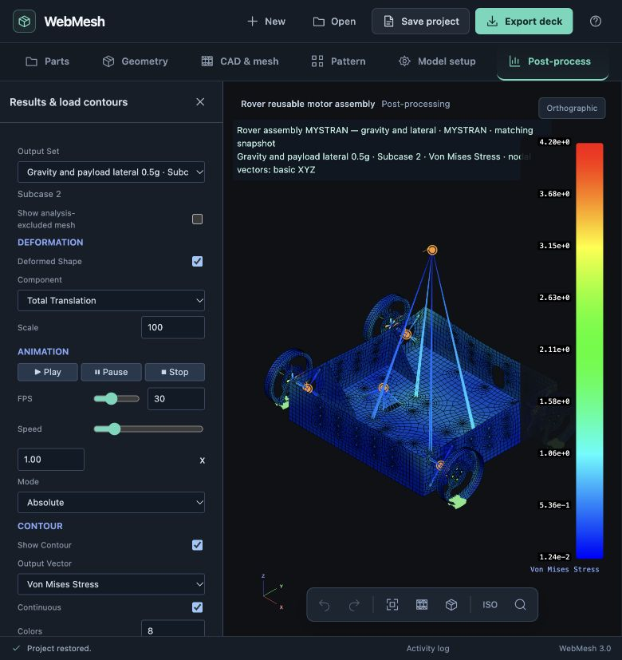

# Reusable connections: complete rover acceptance

23 October 2026 · milestone 13 · `codex/project-core-foundation`

The rover chassis and four live wheel instances now form a single connected analysis model. Four repeats of one NEMA17 recipe connect the chassis mounting holes to the wheel bolt holes. MYSTRAN completed two static cases, and the saved project reopens with matching results in WebMesh.

## Open and reproduce

The tracked project is compressed to 7.3 MB; unpacking produces a 47 MB project with embedded CAD, model/run snapshots and F06. The unpacked working copy is ignored by Git.

```sh
node docs/design/validation/assembly-connections/verify.cjs --unpack
python3 server.py --port 8795 --solver mystran="$HOME/Documents/vibe-tran/MYSTRAN/Binaries/mystran"
```

Open `WebMeshEditor.html` on that server, then **Open → Open project** and select `rover-analysis.webmesh` from this folder. Go to **Post-process → Analysis cases & runs → Rover assembly MYSTRAN — gravity and lateral → Show run results**. Reading saved results does not require another solver run.

To reproduce the analysis authoring from the browser-meshed checkpoint:

```sh
node docs/design/validation/assembly-connections/build.cjs \
  docs/design/validation/assembly-connections/rover-meshes.webmesh.gz \
  /tmp/rover-analysis.webmesh
```

This uses public project actions for named regions, scoped instance regions, the motor recipe, connections, payloads, supports and cases. It reproduces all 21,627 owned card values and every object definition in the final project. It does not replay browser clicks or create a solver result. Open that project and use **Prepare solver run** to solve again.

## Mesh and analysis assumptions

Units are mm, N, s and tonne. The chassis uses provisional isotropic PLA: E = 3000 MPa, ν = 0.35, ρ = 1.24×10⁻⁹ t/mm³. The wheels use the same provisional PLA values. This is a workflow acceptance model, without print-direction anisotropy, contact or convergence certification.

The manually prepared chassis has 13 shell sheets. It was meshed in the browser using **Paved**, nominal size 5 mm and 12 divisions per circle, producing 5,759 CQUAD4s and 6,323 GRIDs; minimum reported scaled Jacobian was 0.350. Chassis thicknesses are 4, 6 and 3 mm by region. The existing wheel source has 892 CQUAD4s with 2 and 2.5 mm shell sections, retained offsets and four live transformed copies. Left-side instances are reflected. Both STEP sources and preparation states are embedded.

| Item | Representation |
| --- | --- |
| Four motors | One shared recipe/PBUSH, four CBUSH connections, 350 g CONM2 per motor |
| Chassis mounting holes | Four named regions, 48 edge nodes each, RBE2 dependent translations 123 |
| Wheel mounting holes | Four instance-scoped regions, 64 nodes each, second RBE2 to each motor shaft |
| Motor stiffness | K1–K3 = 100,000 N/mm; K4–K6 = 1,000,000 N·mm/rad; locked motor approximation |
| Motor COM | 20 mm inward from chassis mount; mount/shaft positions and mass offsets follow each live wheel placement |
| Battery | 500 g at (−57, 0, 42), RBE3 to 40 nodes along the two slots |
| Payload | 1 kg at (0, 0, 227), RBE3 to 48 nodes on four central holes; COM 200 mm above the mounting plane |
| Supports | Translation 123 fixed on 19 low rim nodes per wheel, 76 total; rotations are not manually fixed |
| Gravity case | −9806.65 mm/s² in basic Z |
| Lateral case | Gravity plus a +Y force of 4.903325 N at the payload COM, equivalent to 0.5 g on the payload only |

The second case combines the gravity and FORCE sets through the ordinary `LOAD,3,1.,1.,1,1.,2` card. It is not a whole-vehicle lateral acceleration case. Both cases request displacement, OLOAD, SPCFORCES, stress and element force output.

The editable project retains the original wheel as a reference source. Its 892 elements and 1,008 otherwise unused nodes are excluded from the solver deck. The active model contains **10,365 GRIDs, 9,327 CQUAD4s, eight RBE2s, two RBE3s, four CBUSHs, six CONM2s, one PBUSH and four CORD2Rs**. The verifier finds one connected component. Independent shell-area integration gives 0.464619 kg structural mass; added masses total 2.9 kg. The resulting 3.364619 kg agrees with the solver's 32.995533 N gravity load to approximately 3.1 parts per million.

## Solver and result validation

Executable: `~/Documents/vibe-tran/MYSTRAN/Binaries/mystran`.

Binary SHA-256: `fe15bd2a79a0ad5195020f4db5c700fd5e9902fe0e9e0f4bf0e58cf8f2426fbe`.

Exact input SHA-256: `f4a66dc67a49f58dd52cbb499a205f232cf7140bdee1e67426548e2d7efc0324`.

| Result | Gravity | Gravity + payload lateral |
| --- | ---: | ---: |
| Maximum translation | 0.0789704 mm at GRID 17307 | 0.172492 mm at GRID 18113 |
| Maximum shell von Mises | 3.73604 MPa at element 8273 | 4.20160 MPa at element 10056 |
| Epsilon | 1.497486×10⁻¹³ | 7.766351×10⁻¹³ |
| Largest force residual | 1.1023×10⁻⁶ N | 1.1600×10⁻⁶ N |
| Largest moment residual | 0.0136370 N·mm | 0.0183562 N·mm |

MYSTRAN exited successfully without fatal errors. AUTOSPC constrained zero translations. Rotational AUTOSPC counts are 4,399 / 2,055 / 2,201 for components 4 / 5 / 6, with zero reported AUTOSPC forces. Every active GRID has displacement output; all 9,327 shells have stress output and all four CBUSHs have force output in both cases.

The force/moment check sums OLOAD and SPC reactions about the basic origin. Each component is normalized by the larger absolute contributing applied/reaction load sum, with a minimum scale of 1, and tested at 10⁻⁵ plus a separate F06 rounding bound. Maximum normalized residual is about 3.05×10⁻⁶. A stricter check normalized only by the net resultant fails on small cancelling moment components; that fact and every raw residual remain in `verification.json` and the run's **Force and moment residuals** disclosure. The moment residuals exceed the printed-number rounding bound alone, so they are not described as merely a formatting effect.

`verify.cjs` checks saved-run integrity, deck/result hashes, recipe bindings, card counts, reference-source exclusions, connectivity, mass, AUTOSPC, equilibrium and the real F06 parser. It writes [verification.json](verification.json). The final isolated JavaScript suite passes **494 tests**; unrelated pre-existing working-tree edits were excluded from that checkout.

## Browser acceptance and fixes

The browser was used to commit the chassis shell mesh, edit its PLA material, inspect the reusable recipe UI, reject a negative motor mass, review/apply/undo recipe creation, and change then revert one motor's 350 g → 400 g override. That repeat changed one CONM2 while the other repeats retained their inherited values. Full analysis authoring was reproduced by `build.cjs` through public actions and then opened, edited, run and inspected through the browser.

Both MYSTRAN cases were launched from reviewed snapshots. Named output sets, displacement and shell stress contours, 100× deformed shape, play/pause/stop, and CBUSH force FZ were exercised. The lateral-case connector FZ range was 3.70860–12.6333 N. Saving and reopening retained the completed run and the “matching snapshot” caption.

Acceptance uncovered and fixed case-control FORCE parsing, MYSTRAN field/range/orientation projection, slow owned-card restoration, a legend overlay, and incorrect CBUSH-to-von-Mises fallback. CBUSH recovery components remain available in parsed output; they no longer inflate the shell stress contour to 19,892 MPa.

The fifth wheel seen through the chassis was the reference source, not an extra solved wheel. **Show analysis-excluded mesh** now lets the analyst show or hide it. This session-level results control defaults off, survives output-set changes, and preserves other manual visibility choices. It never changes solver participation, results or ownership. The source remains available in editing after results are cleared.







## Limits and remaining work

The motor/wheel geometry is an approximation using the balancer wheel. Supports idealize fixed contact patches; the model does not simulate rolling, tire compliance, contact or motor rotation. Recipe masses omit motor rotary inertia. Contact patches are explicit node regions and require repair after wheel remeshing. Compatible CAD-edge/instance mounting regions and connector identities are covered by remesh tests; topology replacement is still an explicit repair workflow.

SPC reactions are available in the saved F06 and balance disclosure, but dedicated SPC reaction contours are not yet exposed. Results controls are not a complete probing/reporting workspace. Recipes remain local to the saved project, and the original stage/tree/dock redesign is still unfinished. No new external solver defect was established in this milestone; earlier solver investigations remain separate and untracked.

## Files

- `rover-analysis.webmesh.gz`: complete project with the sealed completed run; `verify.cjs --unpack` creates the ignored editable `.webmesh` copy.
- `rover-meshes.webmesh.gz`: browser-meshed checkpoint before analysis authoring.
- `build.cjs`: public-action authoring reproduction.
- `rover.bdf`, `rover.F06.gz`, `solver.log.gz`: exact solver input and output.
- `verify.cjs`, `verification.json`: independent checks and numerical report.
- PNGs: browser evidence with the source wheel shown and hidden.
