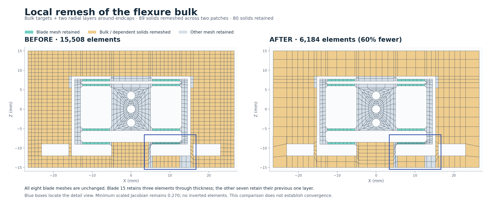
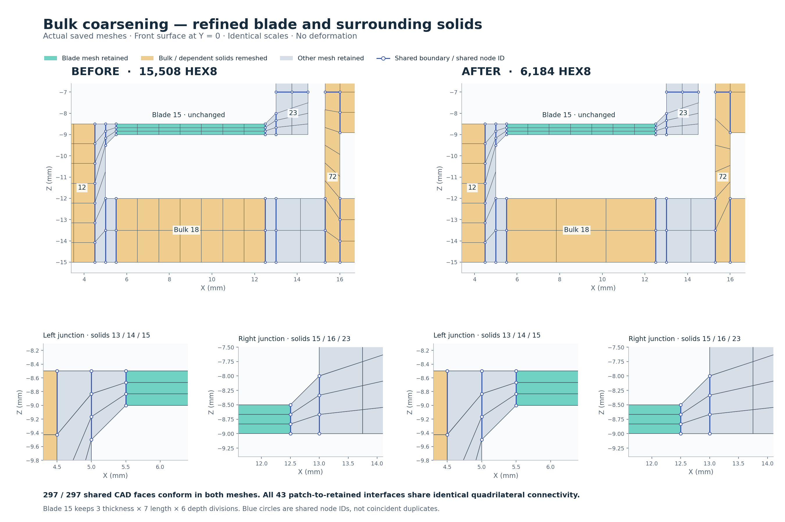
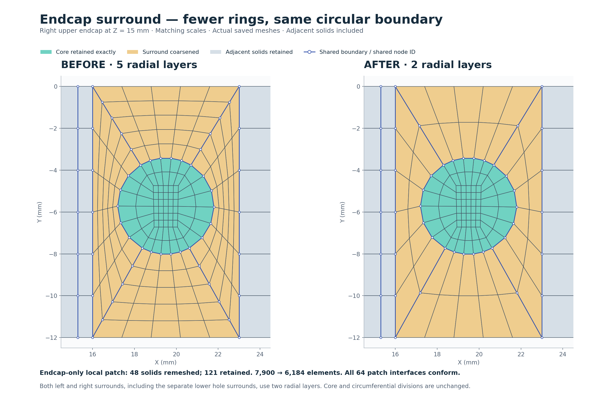
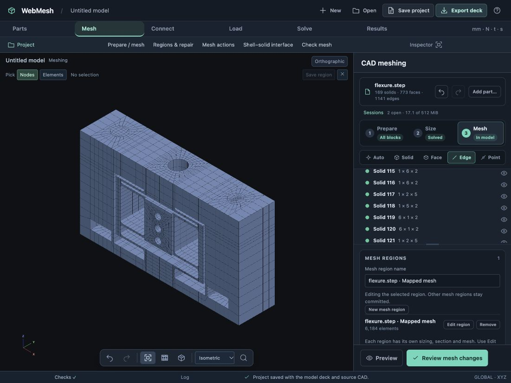

# Flexure bulk coarsening — 25 October 2026

The browser workflow starts from `test-results/flexure-hex/flexure-ogrid.webmesh`, the saved O-grid case with one locally refined blade. It applies a **2.5 mm local size** to bulk solids **3, 5, 6, 9, 12, 18, 33, 40, 73, 76 and 77**. The global target stays at 1 mm. The final saved project is `test-results/flexure-hex/flexure-bulk-coarsened.webmesh`; both projects are local ignored outputs.

All eight blade meshes are retained exactly, including their element IDs, node IDs, coordinates and connectivity. Blade 15 keeps **3 thickness × 7 length × 6 depth divisions**. The other seven blades retain their previous single thickness layer; this step preserves their existing resolution and does not claim that they have received the earlier blade-15 refinement.

## Browser actions

1. In **Size**, select blade 15, choose its Y direction, and fix the existing six depth divisions (edge 154). Its three thickness divisions are already fixed on edge 152.
2. Shift-select the eleven bulk solids and enter **2.5** in **Solid element size**. Review the directly changed and dependent solids.
3. Protect the blade-root transition: fix **edge 130 at 7** using solid 13's Z direction, and **edge 140 at 2** using solid 17's Z direction.
4. Choose **Preview affected solids**, then **Review mesh changes** and **Apply changes**. This bulk patch contains **73 solids: 11 direct and 62 dependent**. The other **96 solids** remain committed. Save the intermediate `flexure-bulk-only.webmesh` project (7,900 elements).
5. Reduce the cylindrical surrounds from **five radial layers to two**. In solids **137, 142, 110 and 118**, choose the **4.893 mm** direction and enter **2**. These fix edges **1017, 1050, 903 and 960**, respectively. The corresponding edge groups carry the radial count through both upper stacks and the separate lower hole surrounds.
6. Preview and apply the second local patch: **48 solids**, retaining the other **121 solids**, including all cylindrical cores. Circumferential counts and O-grid core parameters stay unchanged. Save `flexure-bulk-coarsened.webmesh` and verify the saved cards and real shared element faces using `verify.cjs`.

The first trial used only the bulk targets and depth lock. It reduced the model to 7,732 elements, but lowered minimum scaled Jacobian from 0.270 to 0.170 at the blade-root transition. That Apply was undone. The two additional transition controls recover the original minimum quality at 7,900 elements. The subsequent endcap-surround patch reduces the model further to 6,184 without degrading that minimum. This is a useful example of reviewing quality after dependency propagation, rather than accepting the smallest element count.

## Measured result

| Check | Starting mesh | Bulk coarsened | Endcap surrounds coarsened |
| --- | ---: | ---: | ---: |
| HEX8 elements | 15,508 | 7,900 | 6,184 |
| Nodes | 19,592 | 10,898 | 8,918 |
| Shared CAD faces conforming | 297 / 297 | 297 / 297 | 297 / 297 |
| Matching shared quadrilateral faces | 6,262 | 4,232 | 3,392 |
| Connected components | 1 | 1 | 1 |
| Minimum scaled Jacobian | 0.269630 | 0.269630 | 0.269630 |
| Inverted elements | 0 | 0 | 0 |

The final model has **60.1% fewer elements**. Across both local patches, **89 solids** are remeshed and **80 solids** are retained. **2,894 element cards and 4,827 node cards** remain exactly as they were in the starting mesh. All **43 interfaces** between the combined changed region and the originally retained region match by actual quadrilateral node connectivity. Coordinate coincidence alone is not used as proof. The prepared CAD topology and the four O-grid method assignments are unchanged. No full-region mesh regeneration is applied.

The endcap-only patch retains **5,040 element cards and 7,886 node cards** from the 7,900-element intermediate model. All **64 interfaces** between this patch and the intermediate retained mesh conform. Its minimum scaled Jacobian is **0.487**, with no inverted elements and a maximum aspect ratio of **6.43**. The earlier bulk patch had a minimum of 0.272 and maximum aspect ratio of 12.3.

Maximum aspect ratio remains 125.97 in the retained mesh. This is a meshing workflow and connectivity case study, not an analysis convergence study. No solver run is claimed.







Blue circles in the detail view indicate node IDs shared between neighboring solids. The views are extracted from actual saved HEX8 element faces at Y = 0 and use identical scales. [Open the zoomable comparison](comparison.html).

## Reproduce the checks and figures

From the repository root, with both saved projects present:

```sh
node docs/design/validation/bulk-coarsening/verify.cjs > docs/design/validation/bulk-coarsening/verification.json
node docs/design/validation/bulk-coarsening/verify.cjs test-results/flexure-hex/flexure-bulk-only.webmesh test-results/flexure-hex/flexure-bulk-coarsened.webmesh > docs/design/validation/bulk-coarsening/endcap-verification.json
python3 docs/design/validation/bulk-coarsening/render.py
```

The plotting script requires Matplotlib. The verifier accepts optional before and after project paths. [verification.json](verification.json) and [endcap-verification.json](endcap-verification.json) record the individual interface checks and retained blade counts. The bulk-only project was reopened after restarting the server, with no pending remesh changes; the endcap pass was then authored and saved in that restored project.


