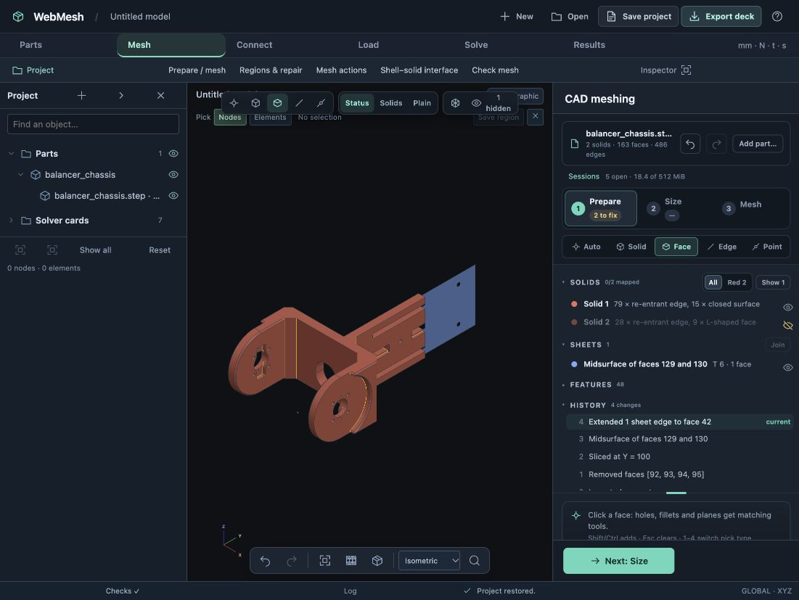

# CAD preparation usability fixes — 2026-10-24

Branch: `codex/project-core-foundation`. These fixes address the balancer hole-removal and Extend visibility regressions before the next redesign milestone.

## Hole removal

The two Ø3 bores near the rear bracket break through an adjoining wall and leave small crescent-shaped blind ends. Recognition previously selected cylinder faces 92 and 94 but omitted floors 93 and 95. The UI called them through holes and OpenCASCADE correctly refused the incomplete removal.

Recognition now includes a neighboring perpendicular planar floor when its complete boundary lies inside the bore's disk. Straight edges must have both endpoints inside; circular boundaries must fit inside the disk as complete circles. This conservative rule includes partial floors without absorbing the surrounding plate or relying only on curved-edge endpoints. Picking either the floor or cylinder offers the same complete removal action. Manual and guided feature removal use that action.

Browser preview and Apply removed all four faces. Solid volume increased from 86,384.958958 to 86,511.878841 mm³; the other holes and curved features remain. The regression exercises individual previews, batch removal, Undo and Redo against the real CAD server and the tracked `examples/balancer_chassis.step`.

## Body visibility

Every accepted CAD update previously cleared the hidden-solid set. Extend commits a sheet operation through that shared path, so it made the hidden parent solid reappear.

Accepted updates now transfer visibility using analytic face geometry and solid volume, independently of revision-local IDs and tessellation bounds. Unchanged bodies retain their choice; split/edited bodies can inherit it from surviving exterior faces. A merge with identifiable visible contributors remains visible. Unmatched geometry defaults to visible: this is display correspondence, not a new general CAD lineage system.

Result previews filter hidden solids and sheets, including their edges. Per-part drafts and saved projects retain the hidden-body and hidden-sheet choices. New imports start visible. The tests cover Extend, Join, Undo/Redo, preview cancellation, reversed solid numbering, split/merge behavior, draft switching and save/reopen.

## Manual browser validation

1. Reproduced the original removal error by checking the two Ø3 through-hole entries. Only faces 92 and 94 were selected.
2. Loaded the fix; both entries now include their blind ends. Preview and Apply succeeded with faces 92, 93, 94 and 95.
3. Sliced the balancer at Y = 100 mm and created a 6 mm midsurface from faces 129/130.
4. Hid solid 2. Temporarily hid solid 1 to expose sheet edge 476, selected it, then showed solid 1 again for target picking.
5. Extended edge 476 to transverse face 42. Sheet area increased from 2,196.457050 to 3,010.596538 mm²; solid volume remained unchanged. Solid 2 stayed hidden.
6. Undid and redid Extend. Solid 2 stayed hidden in both states.
7. Saved and reopened the project. Solid 2 remained hidden, the sheet remained visible, and all four CAD undo steps were retained.

The existing rover tab and server sessions were preserved. The validation tab is a separate balancer project. [Browser evidence](browser-evidence.json) records operations and geometry measurements extracted from the browser-saved checkpoint.

## Automated validation

- `npm test`: **520 passed**, including real CAD service integration.
- `node --test tests/cad-workspace.test.cjs`: **36 passed** after tightening the preview-cancellation assertion.
- `git diff --check`: clean.

The fixes are in browser-side recognition and workspace state management; no solver or CAD kernel algorithm changed.
