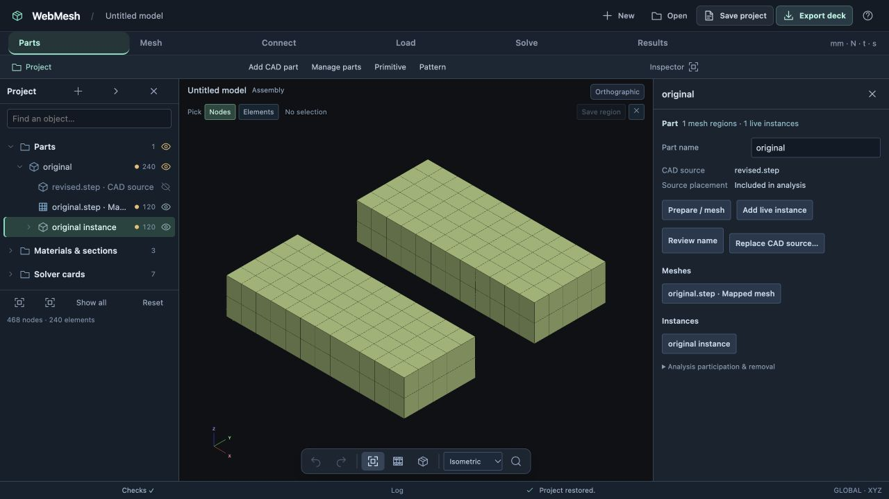
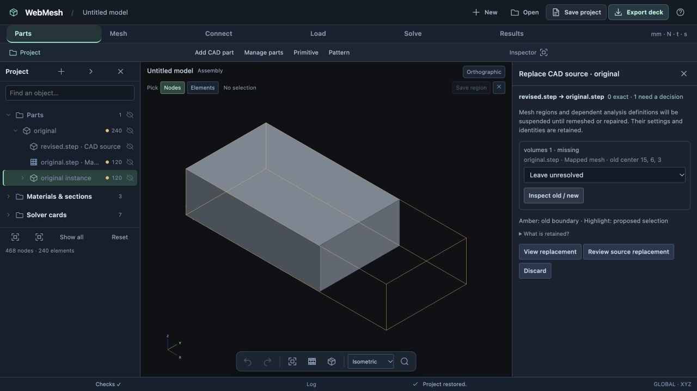

# CAD replacement validation — 24 October 2026

The implementation was exercised manually through the browser at `http://127.0.0.1:8798/WebMeshEditor.html`. The CAD fixtures were generated with OpenCASCADE. Their imports, meshing, live placement, replacement, matching, review/apply, undo/redo, repair and save/reopen used visible application controls.

## Reproduction

1. Add [original.step](original.step), a 20 × 12 × 6 block. Generate its native mapped hex mesh at size 2.5 and apply the review: 162 nodes, 80 HEX8 elements.
2. Add one live instance translated `[0, 22, 0]`: 324 nodes and 160 elements total.
3. From the part inspector, replace the source with [revised.step](revised.step), a 30 × 12 × 6 block. The changed solid has no automatic exact match. Inspect the old boundary and explicitly accept replacement solid 1.
4. Review and apply. The part/source identities persist; source mesh and live instance are suspended and produce no elements. Undo restores 160 elements and the original source; redo restores the suspended revision.
5. Save, reload the browser, and open [suspended.webmesh](suspended.webmesh). The new source, old definitions, retained CAD revision and three invalid checks survive reopening.
6. Choose **Remesh** on the part inspector. The same region owner opens on the revised CAD draft, with solid 1 selected. Review/apply its 234-node, 120-element mesh. The live instance remains suspended.
7. Open the instance and choose **Review repair / reactivation**. Apply its 120-element materialization. There are now 468 nodes, 240 elements and no invalid checks. Both meshes have minimum scaled Jacobian 1.0 in this rectangular fixture.
8. Save/reload/open [rebuilt.webmesh](rebuilt.webmesh). Preview a further source replacement and discard it: the source remains `revised.step`, with 468 nodes and 240 elements.

[browser-evidence.json](browser-evidence.json) records the workflow, counts, test results and fixture hashes. Names intentionally stay unchanged across source replacement; `original.step · Mapped mesh` remains the same authored owner even though its current CAD source is `revised.step`.

## Automated checks

- `npm test`: **532 passed, 0 failed, 0 skipped**.
- `python3 -m unittest discover -s tests -p 'test_*.py'`: **198 passed**.
- `zig build`: passed.
- `zig build test`: passed, including native, Python and WebAssembly bindings.
- Targeted source/draft regressions passed again after the final inspector cleanup.

New coverage includes unique geometry matching despite entity renumbering, ambiguity/movement, explicit choices, suspension and solve blocking, hand-reference protection, mounting-region/RBE2/CBUSH recovery, retained instance identities, owned support/case suspension, mixed shell/solid independent remeshing and RBE3 interface repair, historical CAD drafts, retained plain mesh records, and suspended-object tree counts.

This milestone's browser fixture is not a solved structural case. No new MYSTRAN/Vibestran run is claimed here. Existing solver service and FEM tests remain covered by the suites above; full selective moved-pattern rover acceptance is explicitly deferred in [milestone 16](../../implementation-16-cad-replacement.md).
