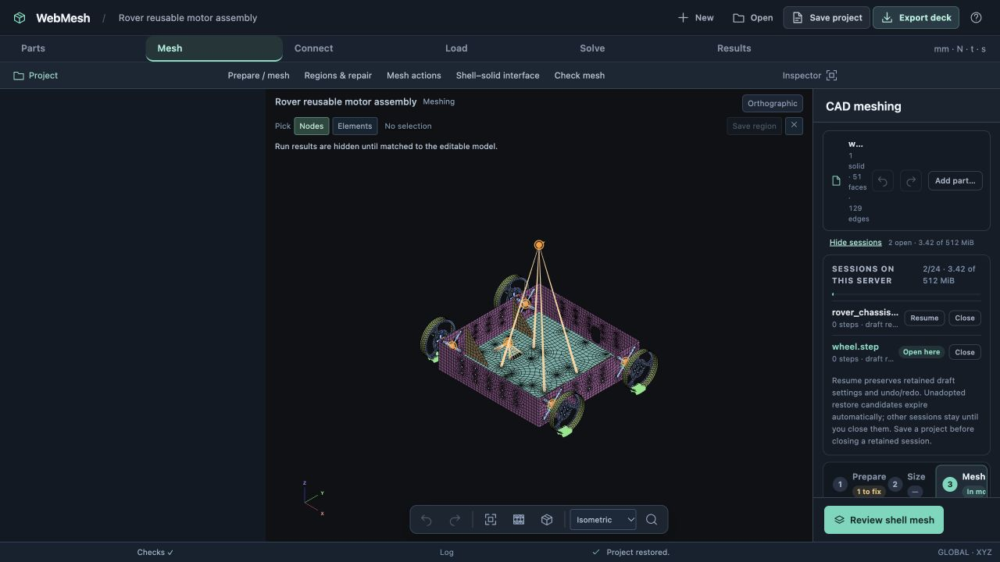
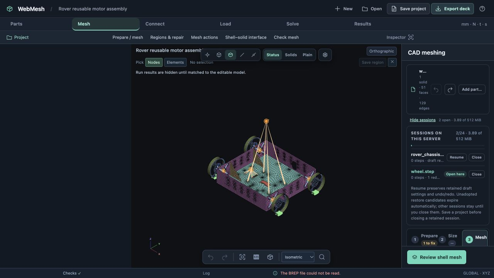
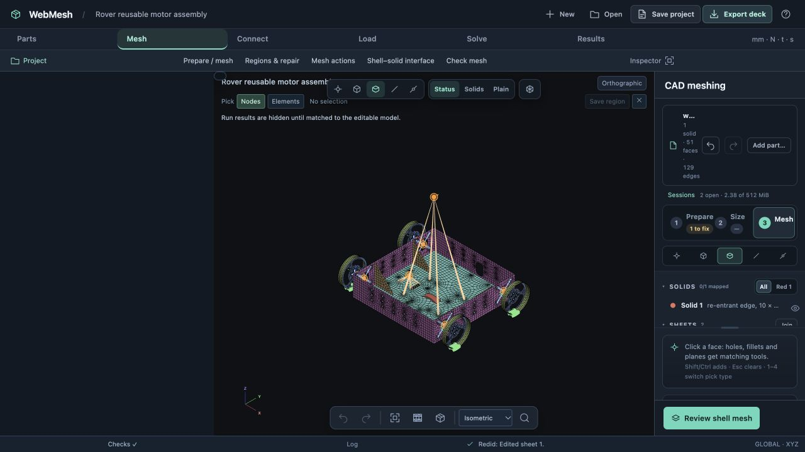
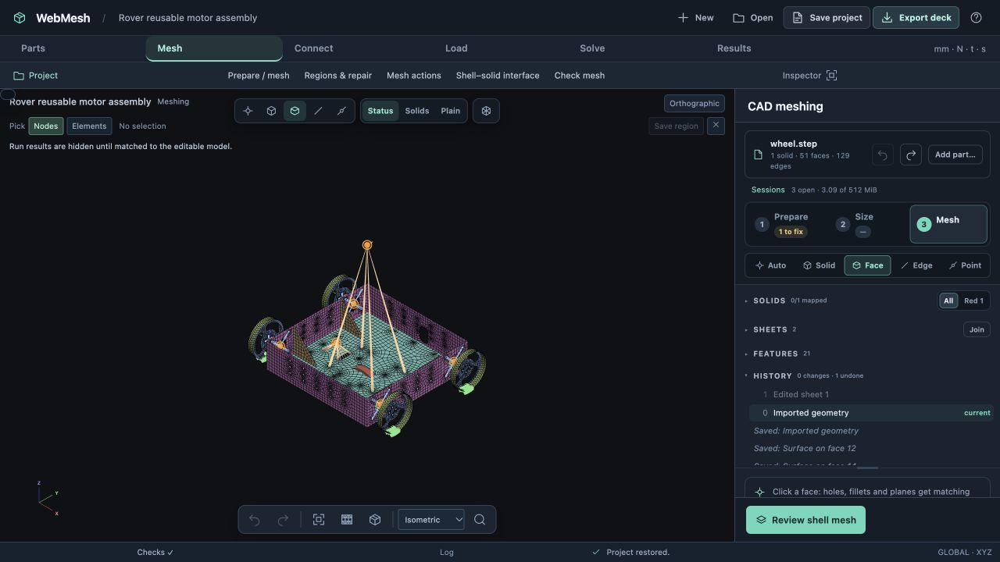

# CAD session restoration acceptance — 24 October 2026

The browser loaded the solved rover chassis/wheel project and exercised reuse, failure cleanup and portable undo/redo. These checks do not change the committed FE model or rerun the solver; the two existing MYSTRAN runs retain their identities.

## Browser checks

1. Opened the same legacy project three times on the updated server (8797). The server retained exactly **two sessions**, one per part, with identical session IDs across opens. Mesh size 3 mm and 12 intervals per circle remained in the wheel draft.
2. Changed the wheel sheet from **T=2, ZOFFS=−1** to **T=2.2, ZOFFS=−1.1**, then undid the change. The CAD history showed one executable redo step.
3. Opened a project with a corrupt second CAD part. The first part needed a new candidate because its older saved history differed from the live draft. The kernel rejected the second part; the candidate disappeared and the original two sessions, settings and redo branch remained.
4. Opened a project with an invalid model digest after CAD staging. The current workspace and CAD history remained usable; only the new candidate was removed.
5. Saved the redo branch and opened it on an empty server (8798). The sheet, topology, settings and redo step returned. **Redo** changed the sheet to 2.2/−1.1, and **Undo** returned it to 2/−1. Executable history survived without access to the original sessions.
6. Refreshed the page and reopened the portable project. Unchanged sessions were reused. Sessions with a newer revision were retained independently. The final CAD dock obeys workspace widths, without the legacy blank sidebar.









The final fresh server has three retained sessions: one chassis, the wheel session advanced by Redo/Undo, and the unchanged saved wheel revision reopened separately. That separation preserves the newer live history; subsequent unchanged reopens reuse the saved revision. `session-evidence.json` records those identities and confirms no provisional candidates remain. The failure-test server still has its original two sessions.

## Reproduce

Run from the repository root:

```sh
node docs/design/validation/cad-sessions/verify.cjs --unpack
```

Open the resulting `rover-cad-redo.webmesh` in WebMesh, select **Mesh → Prepare / mesh**, and use **Redo: Edited sheet 1**. The current sheet is 2/−1; the saved redo state is 2.2/−1.1. Undo restores the initial values. CAD preparation remains a draft; the committed mesh is unchanged.

`redo-cad-parts.json.gz` contains the actual browser-saved CAD drafts, including all retained history states. To avoid duplicating the large solved rover, the verifier combines them with the existing `../project-workspace/rover-remesh.webmesh.gz`. It validates both checkpoint hashes, sheet values, cursor, settings, part identities, both saved run hashes and the unchanged model digest. `verification.json` is its output.

Legacy “Saved:” history entries remain audit text; the separate numbered history entries are executable. Unavailable historical geometry from older project formats cannot be recreated from those labels.

## Regression coverage

Final suites: **517 JavaScript tests** and **198 Python tests** pass.

- Backend: repeated reuse at full capacity, separate parts/clients, exact revision matching, edited-session isolation, malformed archives, compression bounds, cursor/redo preservation, second-part failure, abort during a running kernel import, retry idempotence, expired candidates, explicit adoption, and failed commits that must retain edited drafts.
- Frontend: validate all parts before importing, abort the shared group on the second failure, discard imported previews, restore current drafts, avoid duplicate archive/BREP uploads, preserve run bindings and executable FE undo/redo on failed model replacement, and prevent duplicated browser tabs from sharing a mutable session identity.
- HTTP: restore/abort routing, origin checks and abort while the mesher slot is occupied.
- Real geometry kernel: restore a sliced block's complete history, redo it, then create and undo another slice on the restored BREP.

Sessions are not durable outside their server process. Save a project before stopping the server. Only abandoned, unadopted restore candidates expire automatically; retained drafts require explicit closing.
