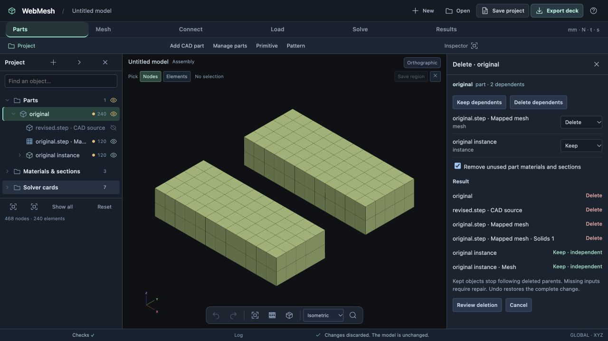
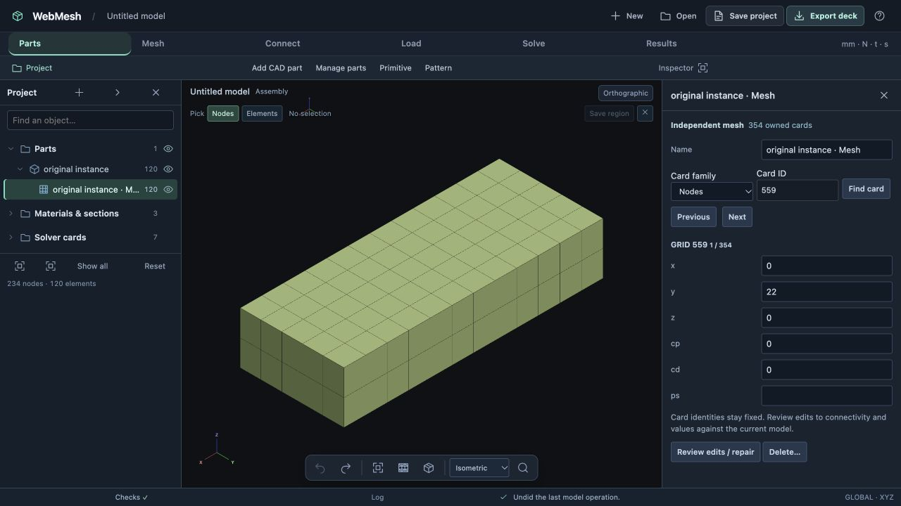

# Deletion and independent dependents — acceptance evidence

Validated 2026-10-24 on `codex/project-core-foundation`, using the local WebMesh server at port 8798.

## Automated checks

`npm test`: **545 passed, 0 failed, 0 skipped**.

The 11 deletion tests cover keep-all, delete-all and mixed dependent decisions; stable card identities; private connection recipes; explicit region retention; suspension and repair after missing geometry; support/case suspension; reference-only source participation; shared materials/sections; hand-card conflicts; independent edits; and deletion after CAD source replacement.

The complete rover regression loads `../project-workspace/rover-remesh.webmesh.gz`, deletes the wheel source and retains its dependents. It verifies four independent wheel parts, unchanged mesh cards, all four motor CBUSH connections, masses, supports, both analysis cases, reference exclusions and the hand-authored LOAD combination. Ownership, references and analysis readiness remain valid. This milestone did not rerun MYSTRAN; it tests deletion against the previously solved rover model.

Part-workspace tests verify that deleting an active CAD part and undoing/redoing retains the exact runtime draft and split/midsurface/extend history without reimporting. Saving omits removed parts and stale CAD mesh-owner records without mutating the retained Undo draft.

## Browser exercise

Starting project: `../cad-replacement/rebuilt.webmesh` — one CAD part, one source mesh and one live placement; **468 nodes / 240 hex elements**.

1. Right-click the part and choose **Delete…**. Verify two dependent choices and the live outcome list.
2. Choose **Delete dependents**, then **Cancel**. The model remains 468 nodes / 240 elements.
3. Focus the part row and press **Delete**. Choose Delete for the source mesh and Keep for the placement.
4. **Review deletion** shows 354 solver cards removed. Apply produces an independent placement with **234 nodes / 120 hex elements** and valid checks.
5. Undo restores the source CAD part, mesh and live placement at 468 / 240. Redo restores the independent result at 234 / 120.
6. Save, reload the browser and open the saved project. The independent part and mesh remain; the removed CAD source does not return.
7. Open the independent mesh inspector. Change a node's Z coordinate by 0.1, review the single changed solver card, apply and undo. The mesh remains editable after reopening.
8. Separately open the original placement's **Make independent…** context action. Its review shows zero solver-card changes, and Discard leaves the source model unchanged.

## Saved project

`independent-placement.webmesh.gz` is the compressed browser-saved project from step 6, before the temporary node edit. Decompress it to a `.webmesh` file and use **Open → Open project**.

- Decompressed size: 677,808 bytes.
- Decompressed SHA-256: `aa24cfc244d4ce14070360ee0803dc74af5e51875fc567e9ad9df6a5734a3d64`.
- No active CAD snapshot and no saved CAD part entries remain.
- Model Undo is retained during the active workspace session. The saved project represents its committed state; it does not introduce a persistent unified CAD/FE Undo timeline.
