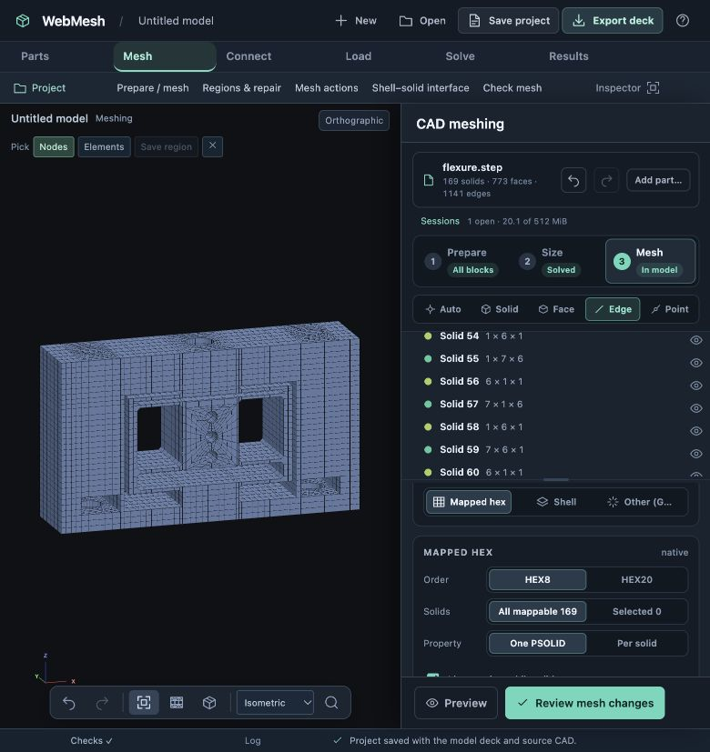

# Flexure: tangent fillets, blind-bore splits and cap projection

25 October 2026 · `codex/project-core-foundation`

The supplied preparation now produces a complete mapped mesh without removing holes or fillets. The browser workflow reaches **169/169 mapped solids**, then creates **14,430 HEX8 elements and 18,452 nodes** at a target size of 1 mm.

## Reproduction and saved result

The original `flexure_hexmesh_defect.webmesh` contains 121 solids and 26 CAD history states. Before these changes, 99 solids were considered mappable, and selecting the lower Ø4.6 bore offered removal but no radial corner split. The original file remains unchanged.

A separate, locally generated result is saved at `test-results/flexure-hex/flexure-complete-hex8.webmesh`. Open it with **Open → Open project**. It includes the complete HEX8 mesh and all **36 CAD history states**, including the original preparation. This generated file is ignored by Git; compact regression fixtures live under `tests/fixtures/flexure-hex/`.

## Corrections

- Four-sided fillet patches may meet tangentially in CAD while their finite HEX8 chords form an open corner. The mapper now admits circular tangencies with usable endpoint chords, provided the solid still passes the six-side/eight-corner checks. Both ends of a tangential solid edge require this evidence. Straight knife edges, collapsed chords and genuinely five-sided patches remain blocked. Readiness warnings explain that refinement towards the exact tangent can reduce quality.
- Selecting a partitioned blind-bore segment now offers **Split around hole** and **Split with O-grid ring**, scoped to that segment's surrounding block. Removing a feature still addresses the whole feature. A blind bore is never silently converted into a through passage.
- **Project face partition through cap** carries the complete coplanar pattern: the circular floor outline and all four surrounding radial sectors. It follows adjacent layers with the same footprint so the incompatibility is not merely moved to the next layer. The preview identifies the affected solids. Cap material is retained, and shared boundaries are imprinted on neighbors.
- The general **Project** tool also accepts explicit target solid IDs or **Use selected solids**. Leaving targets empty retains its existing whole-model scope. This is the same preparation operation used by the suggested cap action, with preview, apply and undo.
- A filled circular cap uses its four actual partition junctions as logical mapping corners. The extra CAD periodic seam is excluded. Smooth circular faces without four suitable junctions are not arbitrarily relabeled as quadrilaterals. These curved corners carry a mesh-quality warning.
- HEX20 quality now samples the quadratic serendipity mapping at 27 corner/edge/face/centre locations and eight Gauss points. Previously, it examined only corner-node chords. A folded midside mapping is now counted as invalid and blocked by the existing quality gate. Sampling is not a proof of positivity everywhere.

## Manual preparation sequence

Every operation below was previewed and applied through the browser, without Auto-fix. IDs refer to the state immediately before that step, because partitioning renumbers the solids.

1. Open the supplied project and choose **Prepare / mesh**. The unchanged geometry is now **111/121 mappable**; twelve tangent fillet blocks no longer require unnecessary cutting.
2. Select solid **4**, then **Split around hole**. Repeat on solid **5**, then **85**, then **85** again after renumbering. These are the four interrupted segments of the two blind bores. Result: **127/133 mappable**.
3. Select cap solid **5**, then **Project face partition through cap**. The preview includes five face regions and target solids **5, 6, 7, 8**. Apply it. Select cap solid **80** and repeat for target solids **77, 78, 79, 80**. Result: **161/165 mappable**.
4. Four narrow fillet patches really have five sides. Use **Slice this solid**, choose **Z**, keep the one-solid scope and enter these offsets: solid **43** at **7.25**, solid **43** at **6.5**, solid **56** at **7.25**, solid **57** at **6.5**. These cuts pass through arc endpoints and keep the fillets. Result: **169/169 mappable**.
5. Set element size **1**, choose **All mappable 169**, and preview both HEX8 and HEX20. Return to HEX8, review the mesh changes, apply them, and save the project.

## Quality and connectivity

| Mesh | Elements | Nodes | Minimum sampled scaled Jacobian | Invalid elements |
|---|---:|---:|---:|---:|
| HEX8 | 14,430 | 18,452 | 0.271838 | 0 |
| HEX20 | 14,430 | 69,561 | 0.001545 | 0 |

The complete HEX20 mesh has very poor quality near the smooth circular-cap corners despite remaining positive at the sampled points. For this preparation, HEX8 is the better validation result. An internal O-grid or further repartitioning should be considered before using those quadratic cap elements for analysis. Both orders also have a maximum aspect ratio of about 126 in thin regions; a green mapping status is not an analysis-quality certification.

Material volume remains **13,637.857453 mm³**, within 1e-6 mm³ of the supplied checkpoint. All 297 shared CAD faces use the same node IDs on both adjacent blocks, including midside nodes for HEX20. Regression checks also compare the actual quadrilateral element-face partitions on both sides. Mesh validation reports no inverted/degenerate elements or non-manifold faces.

## Verification

- **555 JavaScript tests passed**, including real-kernel CAD workflows and the complete flexure sequence.
- **31 Python CAD tests passed**.
- The focused flexure regression previews the bore and cap operations, rejects an invalid projection target, checks retained volume and shared interfaces, and undoes all ten changes back to the original 121-solid state.
- Browser validation exercised all ten preparation operations, both element orders, mesh review/commit, saving and reopening the complete project, and the general Project tool's selected-solid scope.
- A refinement regression confirms that increased curve subdivisions retain positive HEX8 quality at the tangent fillet while reducing the minimum corner Jacobian.
- A quadratic regression moves a midside node in an otherwise perfect corner box and verifies that HEX20 reports the resulting folded mapping.

The suggested midpoint subdivision of a five-sided face is not a good choice for these narrow curved fillet patches. The scoped arc-endpoint slices above provide a workable analyst-controlled route; no automatic preparation step was needed for the saved result.
