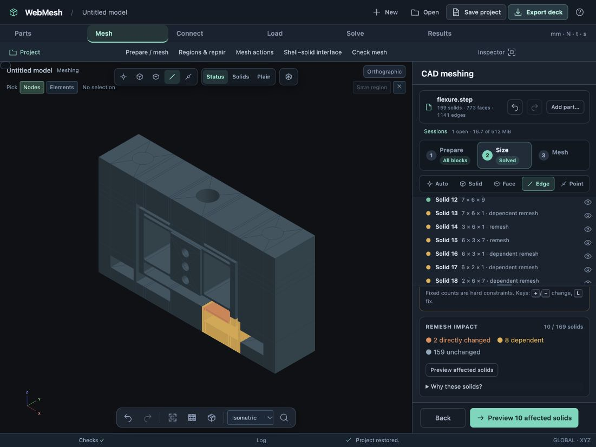

# Flexure local-remeshing case study

Starting point: `test-results/flexure-hex/flexure-complete-hex8.webmesh`, the 169-solid mesh from the [hex preparation case](../flexure-hex/README.md). The original user checkpoint is unchanged.

## Blade refinement

1. Open the completed project and choose **Prepare / mesh → Size**.
2. Pick **Solid 15**. Its directional controls show Y: 12 mm / 6 intervals, Z: 0.5 mm / 1 interval, X: 7 mm / 7 intervals.
3. Pick the 0.5 mm Z control, CAD edge 152, and set its fixed count to **3**.
4. Inspect **Remesh impact**, then **Preview affected solids** and **Review mesh changes**.
5. Apply the patch. Save/reopen and use model undo/redo to verify that the mesh revision remains reviewable and reversible.

The solved closure is solids **13, 14, 15, 16, 17, 18, 19, 23, 24 and 72**. Solids 14 and 15 touch the controlled edge; the other eight follow through compatibility equations. **159 solids stay unchanged.** This also demonstrates why a blade and its neighboring fillets cannot always be remeshed independently of one another.

| Measurement | Result |
| --- | ---: |
| Initial elements | 14,430 HEX8 |
| Retained elements, exact cards/IDs | 14,064 |
| Retained nodes, exact cards/IDs | 17,892 |
| Replacement elements | 432 |
| Final elements | 14,496 HEX8 |
| Minimum replacement scaled Jacobian | 0.269630 |
| Shared CAD faces checked after merging | 297 / 297 |

Every shared face was checked using real element-face connectivity, not just coincident node sets. All checks pass. The patch does not fix the circular-core HEX20 corner-quality issue discussed in the original case; internal O-grid construction remains the next method action.

The numeric run uses the same public `solve`, `impact`, `generateMesh`, `build` and ownership review operations as the UI. Results are retained locally in `test-results/flexure-hex/local-remesh-metrics.json`. Automated regressions use the checked-in prepared flexure and split-block fixtures.

## Browser and regression validation

The browser sequence reached the reviewed **Apply** operation, then showed **14,496 elements / 18,536 nodes** in the mesh inspector. Model Undo restored 14,430 elements; Redo restored 14,496. The saved project reopened with three thickness intervals, no pending count changes, and the complete mesh. The saved result is `test-results/flexure-hex/flexure-local-remesh.webmesh` (an ignored local validation artifact).

A subsequent draft increase from three to four thickness intervals flags only **five** solids (two direct, three dependent). The other blocks changed by the first refinement already have compatible counts. This confirms the highlight compares the actual solved counts against the current committed mesh, rather than retaining a permanent neighborhood list.

A separate cylinder-only remesh of **solid 145** generates **210 HEX8 elements**, retains **14,286 elements and 18,396 nodes**, and again passes all **297** shared-face checks. Browser selection, preview and review use that same scope. Its minimum scaled Jacobian is 0.271838; this is the existing mapped method, not an O-grid.

The full JavaScript suite passes **562 tests**, including the real CAD service workflows. Focused patch/UI/replacement regressions also pass. No solver run is claimed for this sizing/mesh-connectivity milestone.

