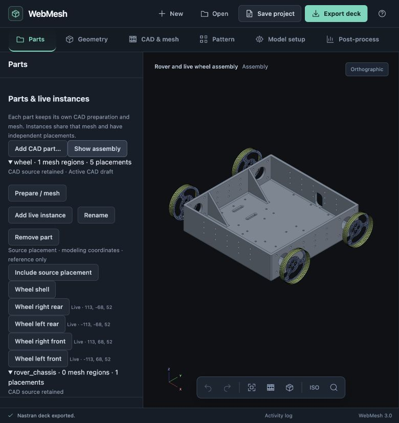

# Independent parts and live instances: browser acceptance

23 October 2026 · `codex/project-core-foundation`

Open [rover-wheel-assembly.webmesh](rover-wheel-assembly.webmesh) through **Open → Open project**. The file embeds the original `rover_chassis.step` and `wheel.step`, separate prepared CAD drafts, wheel mesh/source ownership, four live placements, source analysis participation, shared sections/material and an instance-scoped region. It does not depend on the validation server's session IDs.



## What was exercised

1. Add the chassis and wheel as separate CAD parts. Switching to the chassis and back retained the wheel's preparation and sizing.
2. Manually create a 2 mm web sheet from wheel face 12 and a 2.5 mm rim sheet from face 14, retaining their physical offsets. Join them and use Recombined quad meshing, size 2 mm / 16 intervals per circle. Result: 1,214 quads and 1,348 nodes, minimum scaled Jacobian 0.703.
3. Add four live instances at `(±113, ±68, 52)` mm. Rotate 90° about global Z; the negative-X wheels also reflect across source XZ before rotation. Keep the original wheel placement at modeling coordinates and mark it reference-only.
4. Save/reopen, switch CAD drafts, then remesh the wheel at 2.5 mm. Inspect the proposal for the source and all four copies. Discard once and verify the unchanged 6,070 elements / 6,740 nodes. Apply the next proposal: each wheel becomes 892 quads / 1,008 nodes, minimum scaled Jacobian 0.656. Chassis source data and placement transforms remain unchanged. Expand an owner and a removed GRID to inspect field-level differences.
5. Edit the shared wheel material to provisional PLA: E 3,000 N/mm², ν 0.35, density 1.24e−9 tonne/mm³. Create **Wheel web** from source CAD face 50, then **Right front wheel web** scoped to the corresponding live instance (722 mapped nodes).
6. Save and reopen the repository fixture on a fresh local server. Verify the scoped-region inspector identifies its source, placement and count. Export [wheel-mesh-export.bdf](wheel-mesh-export.bdf): exactly 3,568 CQUAD4 and 4,032 GRID cards, two PSHELL and one shared MAT1. The source mesh's 892 elements and 1,008 unused GRIDs are omitted. The editable project's deck retains 4,460 elements / 5,040 GRIDs.

The project name and JSON whitespace were normalized when retaining the browser download. Solver cards, definitions, original CAD and drafts were not synthesized or changed outside the browser.

## Automated evidence

Run:

```sh
node docs/design/validation/parts-instances/verify.cjs
npm test
```

The verifier checks the saved deck against ownership, both original CAD hashes, unchanged chassis source definition, fixed placement transforms, fresh remesh IDs, every copy's coordinates/connectivity/quality and shell offsets, 722 scoped nodes, compact generation identities, shared PLA, and analysis export participation. [before-remesh.json](before-remesh.json) retains the relevant browser checkpoint data.

The final isolated JavaScript suite passes **479/479**, with no failures or skips. It covers pure part actions, mixed shell/solid copies, quadratic reflections, independent mesh copies, region consumers and frame repair, stale/invalid saved metadata, legacy CAD adoption, atomic history, and all four writer formats. Analysis-export regressions also prove that source GRIDs referenced by an assembly mass remain while unused ones are omitted, and that editable saves retain every GRID. Preexisting unrelated viewport/performance edits were excluded from the isolated checkout.

## Scope and observed limits

The chassis is CAD reference geometry with no committed FE mesh in this fixture. The wheels are placed but have no motor connections, supports or load cases; this is not an analysis-ready rover and no new solve is claimed. The earlier full rover study remains separate. The next milestone should complete reusable assembly connections and the rover solve on the new part architecture.

Repeated validation reloads reached the existing server's 24-session quota. The UI reported the limit. Closing an old session was rejected by automatic approval review because of possible geometry/history loss; none was deleted. Final reopen/export succeeded on a fresh server at `http://127.0.0.1:8794/WebMeshEditor.html`. Session-quota preflight and lifecycle management for repeated project openings remain follow-up work. Saved CAD preparation history reopens as an audit record, not executable server undo history.
