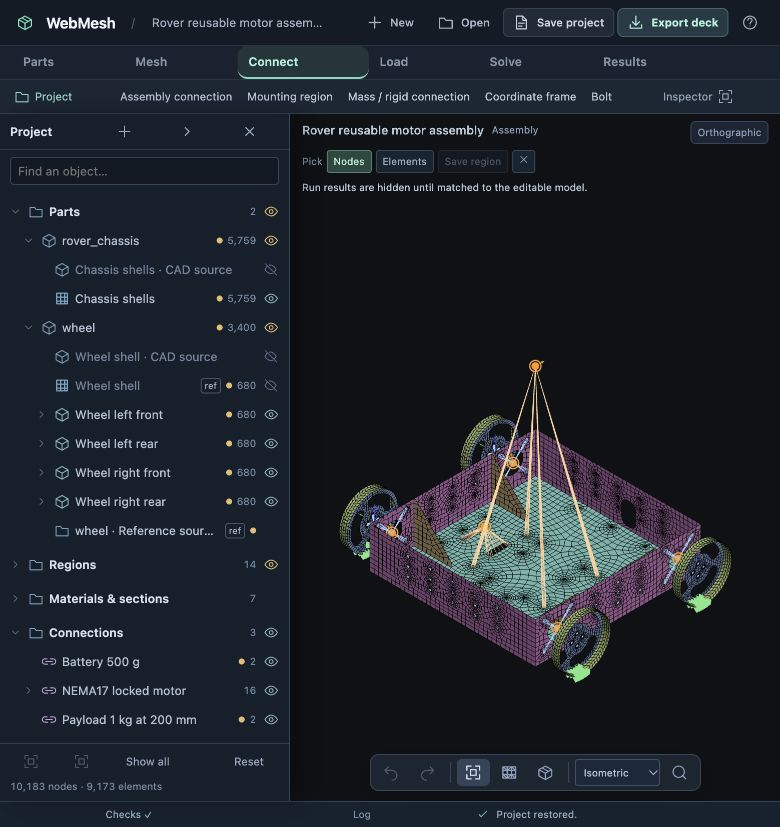
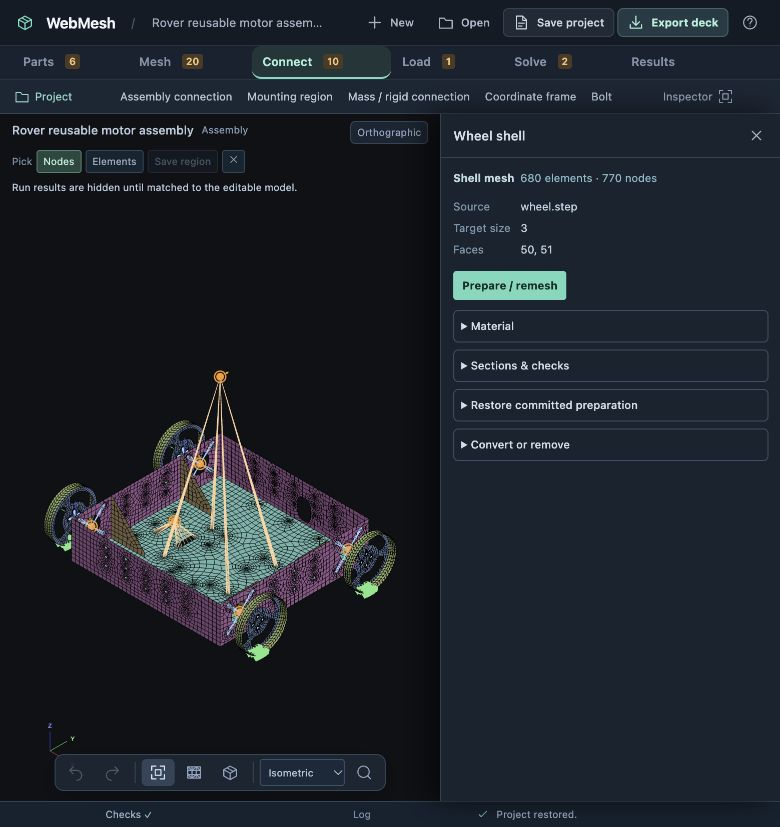
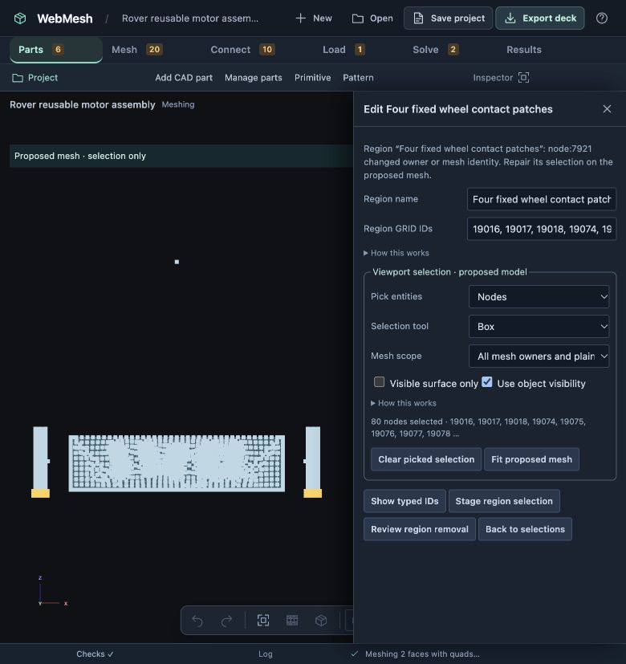
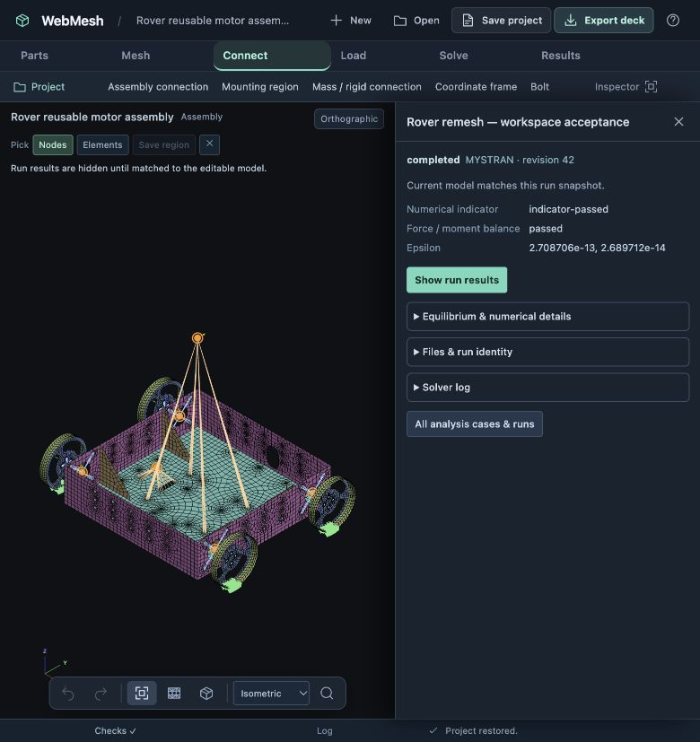
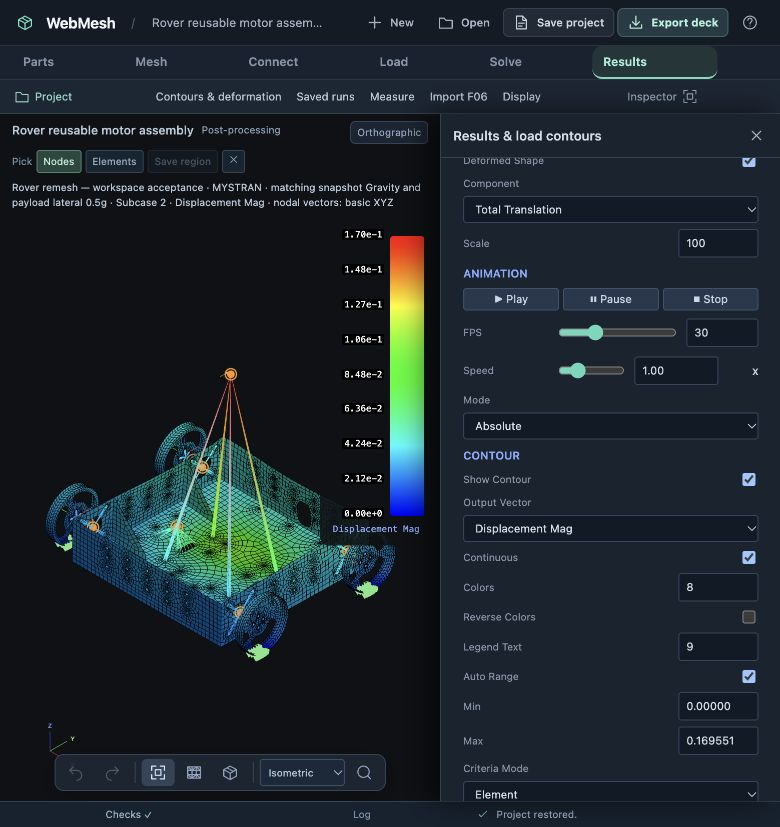
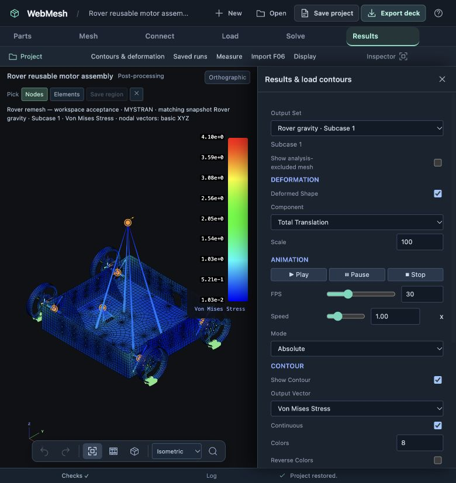

# Project workspace acceptance — 23 October 2026

The full rover was remeshed and solved through the browser. This is workflow acceptance of an estimated PLA model, not physical validation of a rover design.

## UI exercised

- Hierarchical parts, source CAD, source meshes, live instances, named regions, connections, cases and saved runs; search retains ancestor paths. Plain solver cards remain accessible.
- Hide/show the reference wheel and an individual instance; isolate a previously hidden instance, then exit and recover its prior state. Show/hide does not alter participation, model digest or solver deck.
- Source wheel remains hidden after remesh and save/reopen; all four placed wheels remain visible.
- Docked mesh/instance/run editors, compact controls, collapsed secondary information, stage changes preserving uncommitted inputs, graphical proposed-mesh repair with visibility filtering.
- Narrow-window overlays at 780×828: Fit frames the visible model beside the dock; controls and legend remain accessible.
- Completed run reopened from the project tree, with matching model identity; both subcases parsed and displacement, shell von Mises and deformation displayed.













## Remesh and solve

Wheel shell size changed **2.5 → 3 mm**, per circle **16 → 12**. The source changed from 1,008 nodes / 892 quads to **770 nodes / 680 quads**. Four instances regenerated with fresh IDs; each wheel-side RBE2 now uses 48 mounting nodes. The chassis and battery/payload regions retained their definitions.

The reviewed transaction contained **16,755 solver-card changes**. The old explicit contact region blocked Apply until graphically repaired: a through-depth box across the lower wheel rims selected **80 nodes, 20 per wheel**.

The active deck contains **9,413 GRIDs, 8,479 CQUAD4s, 8 RBE2s, 2 RBE3s, 4 CBUSHes and 6 CONM2s**. Independent connectivity finds one component. Integrated shell mass plus added masses is **3.364656 kg**, agreeing with the **32.995794 N** gravity load within 0.1%. No translational AUTOSPC constraints were introduced; reported AUTOSPC forces are zero.

| Case | Peak displacement | Peak shell von Mises |
| --- | ---: | ---: |
| Gravity | 0.076929 mm | 4.09679 MPa |
| Gravity + payload lateral 0.5g | 0.169551 mm | 4.46781 MPa |

MYSTRAN exited successfully for both cases. Epsilon values are 2.708706e−13 and 2.689712e−14. Force/moment checks pass the application’s documented criterion: 1e−5 of the absolute contributing load sum plus F06 rounding bounds. The stricter resultant-relative check does not pass; raw residuals are retained in `verification.json` rather than described as exact equilibrium.

The verifier checks every active GRID for displacement output, every shell for stress, and all four CBUSHes for force output; CBUSHes do not receive invented von Mises stress. It validates both saved-run hashes, confirms that the new run matches and the older run is stale, checks retired wheel IDs, contact coverage and preserved visibility.

Deck SHA-256: `4b66e9137ee01fd7538e071f057928666e12d9c77a6f21a0a91ee48936c4b21d`. Solver executable and SHA-256 are recorded in `verification.json`.

## Reproduce

Run from the repository root:

```sh
node docs/design/validation/project-workspace/verify.cjs --unpack
```

Open the resulting `rover-remesh.webmesh` in WebMesh. The gzip contains the full CAD drafts, editable project, workspace visibility and both complete saved runs. Select **Rover remesh — workspace acceptance** in Runs, then **Show run results**. `rover-remesh.bdf`, `rover-remesh.F06.gz` and `solver.log.gz` are the exact solver artifacts. `before-remesh.webmesh.gz` is the browser checkpoint before the mesh change.

## Remaining usability issue

Repeated project opens accumulated 24 CAD sessions on port 8795 and blocked restoration. The saved project was intact; final reopen checks used a fresh local server on **8796**, preserving the older sessions. The current workflow needs session reuse, atomic cleanup of failed staged restores, and clearer capacity recovery. This was not a solver failure. The [CAD session milestone](../../implementation-15-cad-sessions.md) now addresses reuse, atomic failure cleanup and portable history; its [acceptance evidence](../cad-sessions/README.md) records the follow-up checks.

Regression: `npm test` passes **506 tests** in the working tree; no unrelated baseline changes are included in this milestone’s commit.
