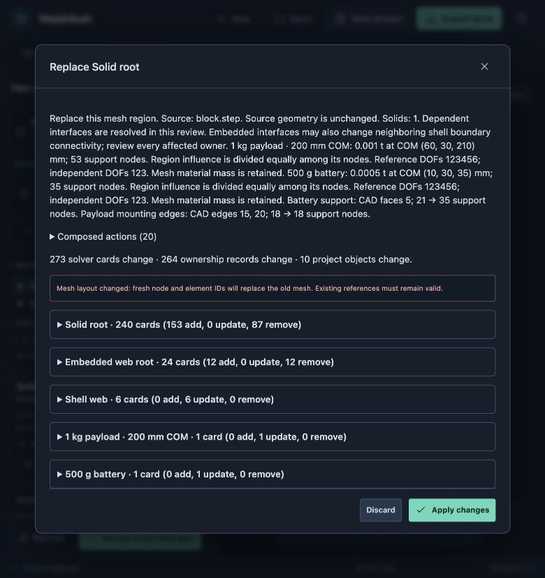
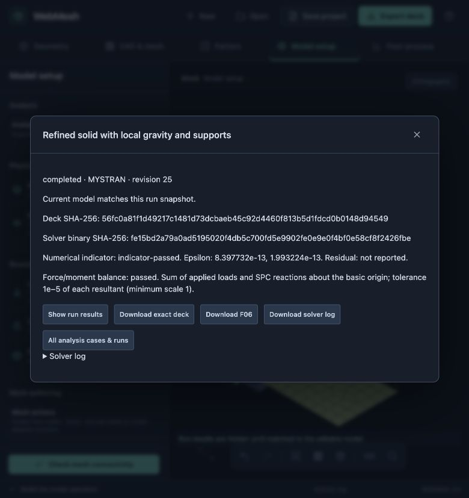
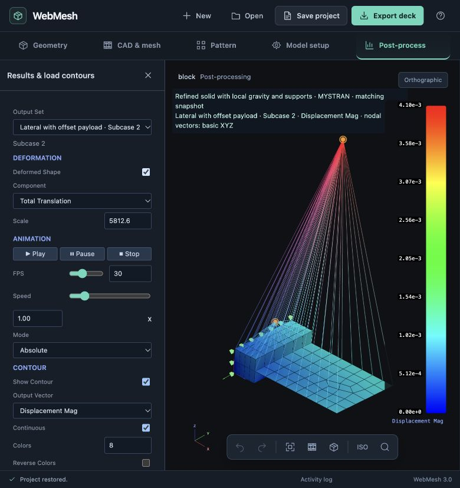

# Selection repair and frame validation

23 October 2026. These are small workflow/solver fixtures, not a qualified rover analysis.

## Browser exercise

`repaired.webmesh` contains the saved battery/payload project and both its baseline and refined runs. In the local browser, the analyst:

1. Created CORD2R “Local Z is global X”: local X = basic Z, local Y = −basic Y, local Z = basic X.
2. Changed gravity to local (−9806.65, 0, 0) mm/s² and assigned the root support's 21 GRIDs to that displacement frame. Reviewed every changed GRID CD.
3. Refined the solid along its length from 24 to 48 HEX8 elements, keeping shell edge spacing conforming. The explicit support selection was invalidated; named battery/payload regions resolved automatically after the embedded interface rebuilt.
4. Tried GRID 999999 and received a missing-node error. Used the proposed GRID/XYZ inventory to replace the support with the 21 new nodes at X=0. Reviewed 273 card changes, including the remesh, embedded shells, canonical neighboring connectivity, RBE3 support updates and SPC1. Applied one transaction, then exercised undo/redo.
5. Ran both static cases in MYSTRAN, displayed displacement/deformation and stress controls, changed the visible subcase, saved and reopened. The old run remains stale; the new run matches its saved model.

The retained `browser.bdf`, `browser.F06` and `browser.log` exactly match the second run. Epsilon estimates: 8.397732e−13 and 1.993224e−13. The product's six-component force/moment checks pass, including local-coordinate SPC reactions. The viewport caption identifies the active subcase, field and basic vector basis above the model, clear of the legend.







## Combined assembly regression

`before` and `after` retain decks, semantic/ownership snapshots, F06 and logs for one RBE2/CBUSH motor attachment with a 280 g motor mass, a 500 g battery and a 1 kg payload with 200 mm COM offset. The shell and solid share an embedded strip. The support, CBUSH and loads reference coordinate 1234. Both models have gravity and a 10 N local chassis-force case.

The automated integration fixture refines the solid, explicitly repairs the nodal force to a replacement GRID at the same specified location and preserves mount/shaft, PBUSH, CONM2, RBE3, support SID and load SID identities. All generated material mass is retained. The two-row embedded strip becomes shorter under refinement, so its declared overlap mass changes; these models are not a mesh-convergence study.

Run independent integration/reaction checks with:

```sh
python3 docs/design/validation/selection-frames/verify.py
```

This integrates element and lumped mass, rotates the printed local reactions independently and compares all six resultants to gravity or the applied nodal force. Maximum allowed difference: 0.0001 N or N mm. `equilibrium.json` records the successful result. MYSTRAN epsilon magnitudes for the four cases are below 1e−11.

To regenerate the assembly inputs using production authoring actions:

```sh
WEBMESH_WRITE_FRAME_EVIDENCE=1 node --test --test-name-pattern='combined motor battery' tests/engine-ownership.test.cjs
```

Solve each free-field BDF in its own temporary directory with MYSTRAN. The decks already include the reviewed MYSTRAN compatibility projection. Copy the resulting F06/log only after checking completion and numerical diagnostics. External solver investigations belong in ignored `solver-bug-reports/`.
