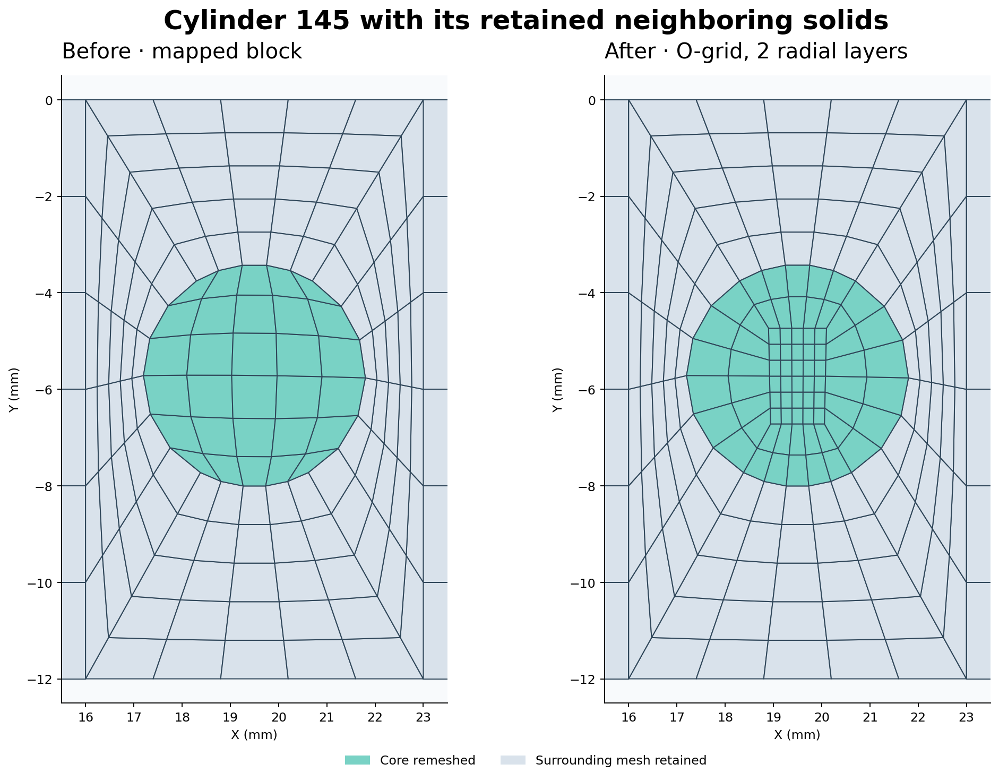
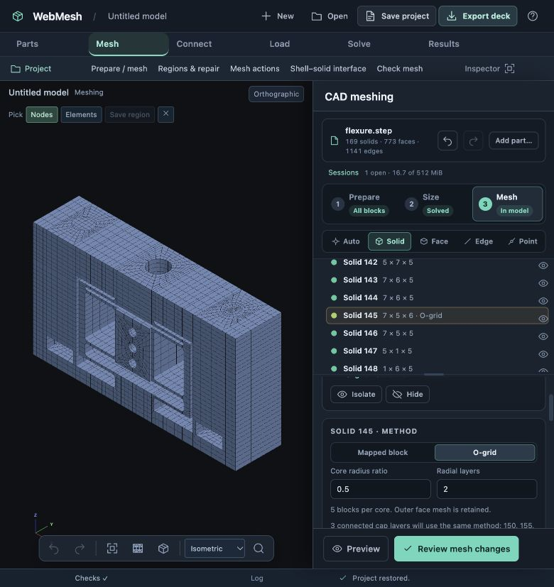

# O-grid method-switch validation — 25 October 2026

The starting project is the locally refined 169-solid flexure from milestone 19: 14,496 HEX8 elements, with the blade already refined through its thickness. The browser selects solid 145 and changes its method to O-grid, with a core radius ratio of 0.5 and two radial layers. Shared circular caps include solids 150, 155 and 161.

| Measurement | Result |
| --- | --- |
| Direct / dependent solids | 1 / 3 |
| Unchanged solids | 165 |
| Retained element cards, exactly unchanged | 13,806 |
| Retained node cards, exactly unchanged | 18,056 |
| New core-stack elements | 1,702, replacing 690 |
| Complete applied model | 15,508 elements / 19,592 nodes |
| Shared CAD faces checked | 297 / 297 conforming |
| HEX8 minimum scaled Jacobian in the four cores | 0.271838 → 0.504500 |
| HEX20 minimum scaled Jacobian in the four cores | 0.001545 → 0.504500 |
| Inverted elements in the O-grid stack | 0, for both orders |

Quality improvements apply to these four cores. The remaining model retains its previous quality and resolution. O-grid adds elements in this example; global mesh optimization or analysis convergence is not claimed. The HEX20 comparison samples the curved element mapping, including midsides.

Browser checks: method switching in both directions, dependent highlights, local preview and Apply, model undo (14,496 elements) and redo (15,508), Save project, and reopening after a server restart. The reopened inspector retains the O-grid settings. A typed core-ratio change identifies the same four affected solids; restoring the committed value removes the pending change.

The saved browser project is `test-results/flexure-hex/flexure-ogrid.webmesh` (local ignored output). The original user checkpoint remains untouched. [verification.json](verification.json) records measurements from the saved project. The portable prepared geometry is `tests/fixtures/flexure-hex/complete.json.gz`.

Run `node docs/design/validation/solid-methods/verify.cjs` to recheck those two saved projects, or pass their before/after paths as the two arguments. The verifier compares retained cards and shared face connectivity and regenerates both element orders for the quality comparison.

`tests/cad-ogrid.test.cjs` covers complete HEX8 and HEX20 interfaces, local card retention, parameter changes, switching back, serialized ownership, unsupported geometry and incomplete cap-stack rejection. The full JavaScript suite passed **565 tests**; **40 focused tests** passed after the final mesher refactor and inspector adjustments. The temporary validation server was stopped. The updated user server runs on 8765 with MYSTRAN and Vibestran available. No solver run is needed or claimed for this mesh-method validation.
