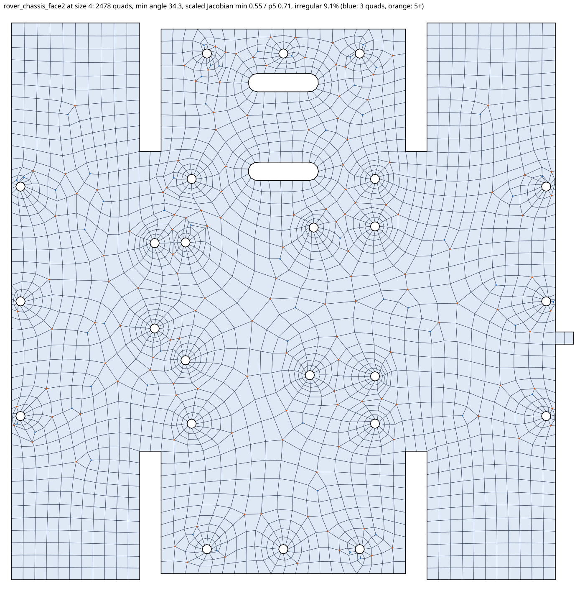

# Paved quad mesher (Q-Morph) for WebMesh faces

An all-quad 2D face mesher with the paving look: rows of quads that follow every
boundary and hole, mostly four quads per interior node, and size changes spread over
a few rows. It is the alternative to the quadtree mesher in `../quadmesh` for WebMesh's
swept hex meshing, and it implements the same C ABI (`quadmesh.h`, ABI 0.3 with open control
curves), so WebMesh
can load either library. Zig 0.17.0, standard library only.

The design follows `../quadmesh/webmesh_faces/PAVED_MESHER_SKETCH.md`; the interface follows
`../quadmesh/webmesh_faces/REQUIREMENTS.md`.



## Results on the seven test faces (size 4)

Measured with `tests/compare_faces.py` (same metric code for both meshers, best of three
runs through the Python binding, Apple M2, ReleaseFast). Irregular share is
the share of interior nodes not shared by exactly four quads. The quadtree columns were
measured on 2026-10-20 with the quadtree mesher's 09:00 Meson build of `../quadmesh`; its
default mode reproduces the numbers in `../quadmesh/webmesh_faces/README.md` exactly.

### Paved mesher

| Face | Quads | Min angle | Min SJ | p5 SJ | Irregular | Valid | Time |
|---|---|---|---|---|---|---|---|
| wheel_top | 189 | 39.0° | 0.560 | 0.754 | 12.8% (16/125) | yes | 7 ms |
| rover_chassis_face1 | 2,644 | 34.4° | 0.560 | 0.733 | 8.3% (195/2358) | yes | 105 ms |
| rover_chassis_face2 | 2,478 | 34.3° | 0.555 | 0.709 | 9.1% (195/2145) | yes | 128 ms |
| rover_chassis_face61 | 993 | 35.0° | 0.570 | 0.764 | 9.9% (82/831) | yes | 39 ms |
| balancer_chassis_face17 | 144 | 51.4° | 0.725 | 0.836 | 9.1% (10/110) | yes | 3 ms |
| balancer_chassis_face19 | 383 | 33.9° | 0.555 | 0.721 | 8.3% (23/278) | yes | 12 ms |
| balancer_chassis_face21 | 353 | 33.8° | 0.556 | 0.694 | 11.2% (28/250) | yes | 15 ms |

### Quadtree mesher, default mode (the numbers in its README)

| Face | Quads | Min angle | Min SJ | p5 SJ | Irregular | Valid | Time |
|---|---|---|---|---|---|---|---|
| wheel_top | 6,016 | 26.5° | 0.446 | 0.629 | 27.0% | no: 2 element edges cross the boundary | 157 ms |
| rover_chassis_face1 | 23,441 | 20.9° | 0.356 | 0.707 | 32.5% | yes | 890 ms |
| rover_chassis_face2 | 47,692 | 19.2° | 0.329 | 0.707 | 30.5% | yes | 1,844 ms |
| rover_chassis_face61 | 12,357 | 14.5° | 0.250 | 0.678 | 31.6% | yes | 468 ms |
| balancer_chassis_face17 | 1,431 | 35.1° | 0.524 | 0.707 | 26.0% | yes | 23 ms |
| balancer_chassis_face19 | 5,798 | 26.2° | 0.357 | 0.707 | 26.9% | yes | 182 ms |
| balancer_chassis_face21 | 5,492 | 18.9° | 0.222 | 0.707 | 27.1% | yes | 187 ms |

### Quadtree mesher, finite-element sizing (12 elements per circle; work in progress there)

| Face | Quads | Min angle | Min SJ | p5 SJ | Irregular | Valid | Time |
|---|---|---|---|---|---|---|---|
| wheel_top | 495 | 18.2° | 0.313 | 0.583 | 18.6% | yes | 15 ms |
| rover_chassis_face1 | 3,248 | 9.5° | 0.166 | 0.469 | 23.6% | yes | 180 ms |
| rover_chassis_face2 | 3,204 | 9.5° | 0.166 | 0.469 | 25.4% | yes | 216 ms |
| rover_chassis_face61 | 1,294 | 10.2° | 0.177 | 0.292 | 35.4% | yes | 44 ms |
| balancer_chassis_face17 | 166 | 29.3° | 0.490 | 0.610 | 19.7% | yes | 3 ms |
| balancer_chassis_face19 | 535 | 12.7° | 0.220 | 0.469 | 22.9% | yes | 16 ms |
| balancer_chassis_face21 | 537 | 13.7° | 0.237 | 0.469 | 23.2% | yes | 16 ms |

SVGs of the seven paved meshes are in [`docs/svg/`](docs/svg) (blue dots: interior nodes
with three quads; orange: five or more):
[wheel_top](docs/svg/wheel_top.svg),
[rover_chassis_face1](docs/svg/rover_chassis_face1.svg),
[rover_chassis_face2](docs/svg/rover_chassis_face2.svg),
[rover_chassis_face61](docs/svg/rover_chassis_face61.svg),
[balancer_chassis_face17](docs/svg/balancer_chassis_face17.svg),
[balancer_chassis_face19](docs/svg/balancer_chassis_face19.svg),
[balancer_chassis_face21](docs/svg/balancer_chassis_face21.svg).

### Targets from the sketch

| Target | Result |
|---|---|
| All quads, validates | Met on all seven faces, and at every size from 2 to 8 (`zig build test`; size sweep). |
| Fixed boundary nodes kept exactly | Met: the 76-node plate test; and every face re-meshed with all loops as closed fixed runs keeps them bit for bit (`tests/fixed_faces.py`). |
| Element count within 1.5 × area / h² plus the boundary rows | Met on all faces, e.g. rover_chassis_face1 2,644 ≤ 3,203 + 522 = 3,725 (the requirements' 2 × area / h² cap is 4,271); face21 353 ≤ 434 + 194. |
| Min angle ≥ 30° (half the corner angle at corners under 60°) | Met: 33.8° to 51.4°. None of the faces has an input corner under 60°. |
| Scaled Jacobian ≥ 0.5 for 95% of quads, ≥ 0.3 for all | Met: every quad is ≥ 0.555. |
| Fewer than 10% of interior nodes irregular | Met on five faces (8.3–9.9%); **missed on balancer_chassis_face21 (11.2%) and wheel_top (12.8%)**, see below. |
| About 5,000 quads in under 1 s | Met: rover_chassis_face1 at size 2.2 gives 5,050 quads in 0.28 s (6,200 quads in 0.40 s). |
| Same input, same mesh | Met: tested, and the wasm module produces a bit-identical mesh to the native build (`zig build test-bindings` compares hashes). |

**Why the irregular-share target misses on two faces.** For a quad mesh, Σ(4 − v) over
interior nodes plus Σ(2 − v) over boundary nodes equals 4χ, so holes force irregular
nodes. wheel_top (three slots, χ = −2) needs at least 8 five-valent interior nodes when its
smooth boundary nodes carry two quads each, a floor of 6.4% of its 125 interior nodes;
face21 (seven holes, 16 convex hole corners) needs at least about 14, a floor of 5.6%.
Both faces are small, so one node is 0.4–0.8 percentage points, and both have strips only
one or two elements wide (between the wheel's slots and rim, and the 5 mm gap between
face21's outer edge and its slot) where fronts collide and leave extra 3–5 pairs that local
cleanup cannot pair off. They sit at about twice the topological floor. The share depends on
size: at size 2.5 face21 drops to 4.2%, while wheel_top rises to 16.6% because its strips are
then two to three rows wide with mismatched rows from both sides.

## Open control curves (ABI 0.3)

A curve (`MQ_LOOP_CURVE = 3`, contract in `../quadmesh/webmesh_faces/OPEN_CURVES.md`) is an open
polyline inside the face whose segments must be mesh edges with a quad on each side: a brace
or wall standing on the face. Results for the curve test faces (`faces/curves/*.json`, every
loop and curve fixed, size 4), checked by `tests/test_curves.py` and the milestone 6 tests:

| Face | Quads | Min angle | Min SJ | p5 SJ | Irregular | Time | Each curve segment in two quads |
|---|---|---|---|---|---|---|---|
| tee | 373 | 60.8° | 0.786 | 0.996 | 1.2% | 7 ms | yes |
| floating | 398 | 60.2° | 0.768 | 0.986 | 1.2% | 8 ms | yes |
| hole_and_boundary | 358 | 54.7° | 0.758 | 0.870 | 4.7% | 8 ms | yes |
| plus | 400 | 44.0° | 0.650 | 0.845 | 6.0% | 15 ms | yes |
| invalid_crossing | refused: `MQ_STATUS_UNSUPPORTED_INPUT`, "curve 1 crosses curve 2 between their nodes (segment 8 and segment 2)" | | | | | | |

The real rover floor with its brace junctions is not exported yet; as a stand-in,
`tests/stress_curves.py` adds four brace-like curves (three from the plate's edge, one free)
to rover_chassis_face1: at size 5 it gives 2,238 quads, min angle 36.1°, min SJ 0.553 in
0.09 s; at size 2.5, 4,709 quads in 0.26 s; the same mesh with free or fully fixed loops, and
twice the same. SVGs: [tee](docs/svg/curves/tee.svg), [floating](docs/svg/curves/floating.svg),
[hole_and_boundary](docs/svg/curves/hole_and_boundary.svg), [plus](docs/svg/curves/plus.svg).

How it works:

- **Input.** A curve has n ≥ 2 points and must carry one open fixed run over all of them
  (start (0, 0), end (n − 2, 1)); a curve without one is refused (free curves are not supported).
  A curve node that coincides, within the absolute tolerance, with a node of another loop or
  curve becomes the same mesh node (the earlier loop's coordinates are kept). On a free loop
  run, a curve end becomes a node at the curve end's exact coordinates.
- **Rules**, checked before meshing (`MQ_STATUS_UNSUPPORTED_INPUT`, the message names the
  curve and what it meets): no crossing of loops, other curves or itself except at shared
  nodes; an end may lie on another loop or curve only at one of its nodes ("its first end …
  touches outer loop 0 between its nodes"); interior curve nodes stay off outer and hole loops;
  every free node lies inside the meshed region; no zero-length segment.
- **Meshing.** Curve segments are constrained edges of the triangulation and are cut before
  Q-Morph, so each side is a front: the curve is a slit. At a free end the front turns around
  the tip (a 360° front angle, filled with row corners); a node shared with a loop splits that
  loop's front. Curves add their segment count to the front on both sides, so parity is
  unchanged (curves are left out of the outer and hole edge total). Repair, cleanup and patch
  remeshing never cross or swap a curve edge; curve nodes never move.
- **Output.** Curve nodes are reported in the boundary-node provenance with `loop` = the
  curve's index and their fixed run position, once per loop or curve a shared node belongs to;
  each curve segment is reported once in the boundary edges. Validation requires every curve
  segment to be an edge of exactly two quads (and every fixed curve node kept).

## Method

The eight-step pipeline of the sketch, as implemented (`src/`):

1. **Input** (`boundary.zig`). Loops (outer, holes, control) with fixed runs (exact node
   lists) and free runs (polylines). Free runs are discretized here: sharp corners (turn above
   the feature angle, default 30°, or vertex kind *corner*) become nodes, corners closer than
   0.3 of the local size are merged (defeaturing remnants), and nodes are spaced by integrating
   1 / size along the curve. The total edge count on outer and hole loops is made even by the
   free piece that changes least; with no free run an odd fixed count is rejected
   (`MQ_STATUS_UNSUPPORTED_INPUT`, "odd number of fixed boundary edges … an all-quad mesh is
   impossible").
2. **Size field** (`sizefield.zig`). h(x) = min(H, minᵢ hᵢ + kᵢ |x − pᵢ|) over boundary
   sources, evaluated exactly with a bucketed ring search. Near the boundary the size is the
   node spacing; kᵢ = g − 1 (default growth 1.2) except around holes, where kᵢ is the natural
   row growth 2π/N (N elements per circle, default 12), so a Ø3 hole with 12 elements returns to
   the target size within about four rows.
3. **Triangulation** (`cdt.zig`, `trimesh.zig`, `predicates.zig`). Bowyer–Watson Delaunay of
   the boundary nodes, boundary edges recovered by flips (never split), exterior removed by
   parity of crossed loop edges; then Rebay frontal insertion. Orientation and in-circle tests
   are exact (adaptive orient2d; filtered incircle with an exact expansion fallback).
4. **Q-Morph** (`qmorph.zig`). The front is the set of triangle edges facing a quad or the
   boundary; loops are implicit (next/previous front edges are found by rotating through the
   triangles, which handles pinch nodes). Edges are processed lowest row first, then by
   state. A side edge reuses the adjacent front edge below 145°; otherwise its tip is placed at
   the ideal point along the bisector at the local size (an existing node there is reused, else
   one is inserted), side and top edges are recovered by flips, and the triangles inside become
   the quad. Paving's row corners (two side edges at angles above 210° with long edges, or above
   240°) let expanding rows add elements; seams merge front edges meeting below 30°; a
   look-ahead along each side edge closes the gap to an opposite front evenly instead of leaving a
   thin row (rectangles and L-shapes come out as the exact structured grid). A quad that would
   split a front region is formed only if every resulting region keeps an even front edge count
   (checked by alternating breadth-first searches that stop at the smaller side). Loops of 4 or 6
   edges are closed with templates; interior triangle nodes left close to a new front are removed.
5. **Fallback** (`fallback.zig`, `polymesh.zig`). Where the front stalls, the remaining
   triangles are paired greedily by quad quality and completed with Edmonds' blossom
   matching; without a perfect matching, edges near unmatched triangles are flipped and the
   region is matched again; any triangle still left is carried across quads (re-splitting the
   triangle + quad pentagon) until it meets another and the two merge. The result is all quads.
6. **Cleanup** (`cleanup.zig`). Doublet removal, diamond collapse and quad edge swaps that
   lower Σ(v − ideal)², with ideal = 4 inside and angle / 90° (not rounded) on the boundary,
   plus shape-driven swaps. Each change is smoothed locally and undone unless every quad stays
   valid. Boundary nodes are never moved or removed.
7. **Smoothing** (`smooth.zig`, `mesher.zig`). Angle-based smoothing (Zhou and Shimada)
   blended with length-weighted Laplacian, then a pattern search that maximizes the worst
   corner of the poorest quads (it also untangles). Patches around quads still below scaled
   Jacobian 0.5 are remeshed with the same pipeline (patch boundary as a closed fixed run) and
   kept only if better.
8. **Output** (`mesher.zig`, `quality.zig`). Nodes (boundary nodes first, in loop order),
   quads (counterclockwise), per-quad quality, boundary node and edge provenance, and the
   report: all quads, conformity (edges used once are exactly the boundary edges, control
   edges are interior), no inverted or non-convex quad, quads cover the domain area, fixed nodes
   kept bit for bit, angles, scaled Jacobian minimum and 5th percentile, irregular share.

Deviations from the sketch: it is a separate Zig project rather than a second pipeline inside
`../quadmesh` (the user chose Zig), so it has its own validator and IO; the Blossom step is a
maximum-cardinality matching with quality-greedy initialization rather than a minimum-cost
perfect matching; the side-edge threshold is 145° instead of Owen's 135° (tuned on these
faces together with the seam and row-corner angles).

## Interface

### C ABI

`include/quadmesh_paved.h`, libraries `zig-out/lib/libquadmesh_paved.{a,dylib}` and
`zig-out/bin/quadmesh_paved.wasm`. Functions, enums and struct layouts are those of
`../quadmesh/include/quadmesh_c/quadmesh.h` (ABI 0.3; `mq_abi_version()` returns `3 << 12`): `mq_context_*`, `mq_options_*`,
`mq_domain_*` (loops, per-loop sizing with arc-fraction samples, vertex kinds, fixed runs),
`mq_mesh_generate[_with_options]`, node, quad, quality and provenance copies, and the
validation report. The quadtree mesher's own Python and JavaScript bindings run unchanged
against this library (`zig build test-bindings` checks both).

- Options: target size (0 = largest extent / 24), feature angle (default 30°), elements per
  circle (default 12, at least 8), chord tolerance (fraction of the local size, default off),
  smoothing on/off and iterations, tolerances. The quadtree-only options (max refinement level,
  local sizing promotion, finite-element sizing) are accepted and ignored.
- Additions: `MQ_OPTION_GROWTH_RATE` (64, default 1.2), `MQ_OPTION_ENABLE_CLEANUP` (65),
  `mq_implementation()` (returns "paved"), and `mq_validation_report_paved_quality()` with the
  5th-percentile scaled Jacobian, irregular share and the individual validity checks.
- Loop roles: outer, hole, control loop, and curve (`MQ_LOOP_CURVE = 3`, see above).
- Fixed runs: nodes follow the loop direction; an open run includes both ends and spans
  (start segment, parameter) to (end segment, parameter) on the input polyline; a closed run
  is the whole loop. Back-to-back runs share their junction node.
- Provenance: one record per boundary node (two where one fixed run ends and the next begins):
  loop, input segment and parameter, fixed run and index (−1 on free runs). One record per input
  segment piece covered by each boundary edge, with the fixed run and edge index.
- Errors: invalid arguments, crossing loops ("boundary edges … cross: loops intersect"),
  nodes on other loops' edges, odd fixed parity and curve rule violations return a status and a message in
  `mq_context_last_error`. A mesh that does not validate is still returned, with its issues in
  the report.

### Python and JavaScript

```python
from quadmesh_paved import Mesher          # bindings/python
m = Mesher("zig-out/lib/libquadmesh_paved.dylib")
out = m.mesh([{"points": [(0, 0), (40, 0), (40, 20), (0, 20)]},
              {"points": hole, "role": "hole", "fixed_runs": [{"nodes": hole_nodes, "closed": True}]}],
             target_size=2)
out["valid"], out["report"]["irregular_share"], out["boundary_nodes"][0]
```

```js
import { loadModule, createMesher } from "./bindings/javascript/quadmesh_paved.mjs";
const module = await loadModule(await fetch("quadmesh_paved.wasm"));   // no Emscripten
const out = createMesher(module)({ loops, options: { targetSize: 4, growthRate: 1.2 } });
```

`loadModule` gives the module the Emscripten-style surface (`_malloc`, `HEAP*`,
`UTF8ToString`, `_mq_*`), so the quadtree mesher's `createMesher` also works with it.

### Input sampling for WebMesh

- Sample arcs finely enough that each vertex turns less than the feature angle (30°; 10° or
  less is a good default) and give true CAD corners a turn above it, or set vertex kinds
  (`MQ_VERTEX_CORNER`, `MQ_VERTEX_SMOOTH`) to say so explicitly. Tangent arcs and straight
  stretches need no special treatment; curvature is estimated from the sampling.
- Defeaturing remnants (corner pairs closer than 0.3 of the local size) are merged on free runs.
  Duplicate consecutive points are tolerated. On fixed runs every given node is kept as is.
- With the edge-first workflow, pass every loop as fixed runs (one closed run, or open runs
  per CAD edge) and make the total edge count of outer and hole loops even. A face made of
  several disconnected regions needs an even count per region (only the total is checked).

## Building and testing

```bash
zig build -Doptimize=ReleaseFast
```

```bash
zig build test
```

```bash
zig build test-bindings -Doptimize=ReleaseFast
```

```bash
./zig-out/bin/paved faces/rover_chassis_face1.txt 4 out.svg --marks -v
```

```bash
./zig-out/bin/paved faces/curves/tee.json 0 tee.svg
```

(A JSON face with size 0 uses its own target size; all its loops and curves are fixed.)

`zig build test` runs 38 tests: predicates, size field, discretization, triangulation, and the
milestone tests (rectangles and an L-shape give the exact grid; the 40 × 20 plate with a Ø10
hole and 76 fixed nodes keeps exactly those nodes; a Ø3 hole gets 12 elements; an odd fixed
edge count is rejected with a clear error; holes, mixed runs and control loops; cleanup improves
raw Q-Morph; the seven faces meet the validity and quality floor; the same input gives the same
mesh; the C ABI end to end; open curves: the four curve faces, the crossing face refused by
name, odd segment counts, a curve ending on another curve's interior node, a one-segment curve,
a curve end placed on a free loop, and refusals for an end between loop nodes, a curve inside a
hole and a self-crossing curve). `zig build test-bindings` runs `tests/test_ctypes.py`,
`tests/test_curves.py` (both Python bindings) and `tests/test_wasm.mjs`.
`tests/stress_curves.py LIB [size]` runs the rover stand-in with brace curves. `tests/compare_faces.py LIB [size] [option=value …]` prints the results
table for any library with this ABI; `tests/fixed_faces.py LIB [size …]` re-meshes the faces
with all boundary nodes fixed.

The CLI also takes `--growth`, `--per-circle`, `--no-smooth`, `--no-cleanup`, `--view x0 y0 x1 y1`,
`--hash`, `--repeat N` and `--qm-<name> value` for the Q-Morph thresholds (angles in degrees).

## Notes and limitations

- Cleanup cost grows faster than linearly (0.10 s at 2,600 quads, 0.40 s at 6,200).
- Free-run nodes on the two sides of a narrow gap are spaced independently; with fixed runs
  WebMesh decides the alignment.
- Smoothing never moves boundary nodes, fixed or free.
- Q-Morph thresholds were tuned on these seven faces; other parts may favor other values
  (`--qm-*` flags for experiments).
